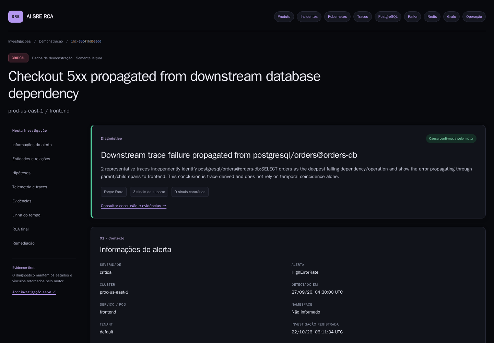
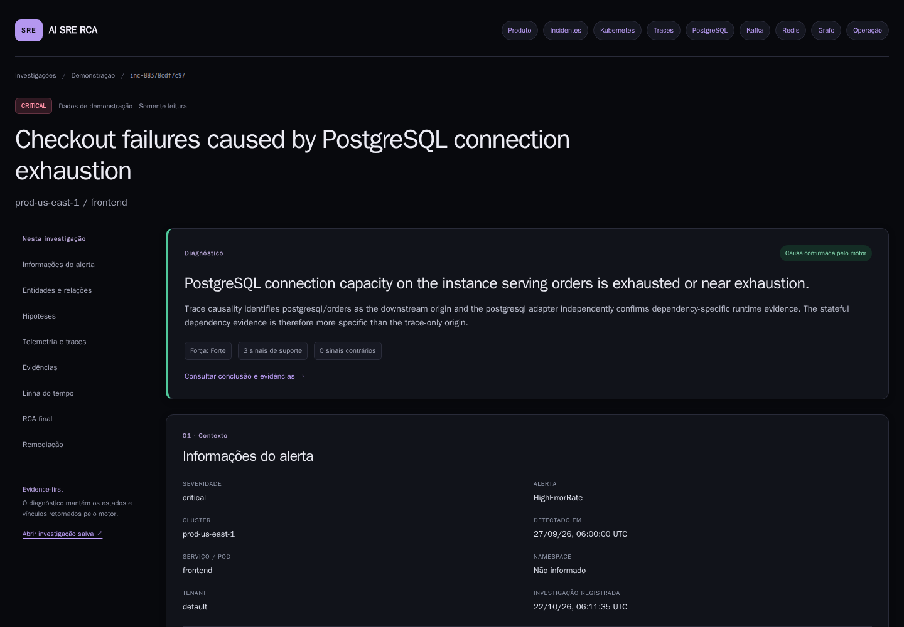
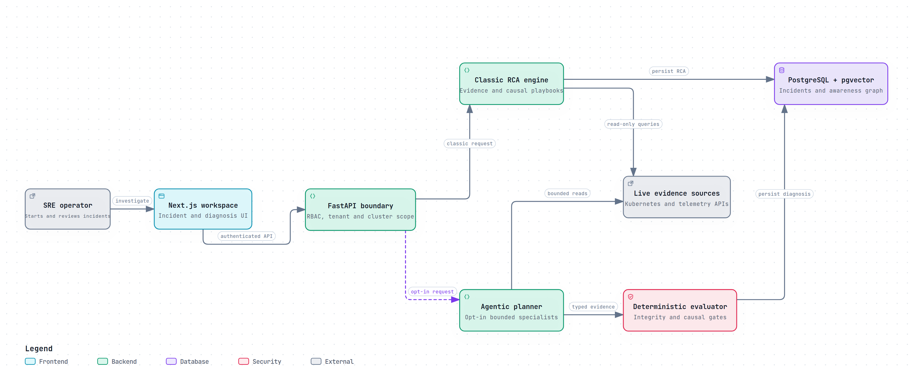

# Tracecroft AI

**Evidence-first investigation for Kubernetes and distributed services.** Tracecroft AI (the evolution of the AI SRE RCA project) combines scoped telemetry collection, persistent investigations and conversational assistance with deterministic root-cause evaluation.

**Version: `0.8.0-rc.3`** ([VERSION](VERSION)); development release candidate. [Português do Brasil](README_PT-BR.md).


[**Tracecroft AI website (hosting pending)**](https://tracecroft-ai.marcocristofolini.dev) · [Website source and deployment guide](website/README.md) · [Interactive Archify architecture](docs/archify/ai-sre-rca.html)

> **Brand and repository:** Tracecroft AI is the product name. The repository remains `ai-sre-rca` to preserve existing clone URLs, history, code references and integrations. Existing benchmark evidence, UX captures and historical project identifiers remain credited to the original engineering work.

## What it solves

Incident response spans Kubernetes state, metrics, logs, traces, recent changes and past incidents. AI SRE RCA brings these into one investigation workspace, records where evidence came from and distinguishes observed failure mechanisms from correlations. Missing evidence produces an inconclusive result.

## Current capabilities

| Area | Implemented behavior |
| --- | --- |
| Investigation scope | Pod, Service, Deployment and StatefulSet selection from authorized inventory, with bounded time windows. Deployment → ReplicaSet → Pod and StatefulSet → Pod ownership uses Kubernetes UIDs and controller ownerReferences. |
| Persistent Orchestrator | Bounded read-only specialist execution, persisted jobs, idempotent submission, leases, concurrency limits and recovery. SSE progress supports replay; polling is available. Synchronous APIs remain supported. |
| Copilot | Questions about verified independent causes, evidence, rejected hypotheses, timeline and next steps. Deterministic answers cite authorized evidence IDs and preserve uncertainty without requiring a model. |
| Interactive investigation | Natural-language request plus an explicit inventory/time selection compiles into a typed proposal. Scope and budgets are reviewed before explicit confirmation creates a job. Free text never grants scope or selects tools. |
| Deterministic RCA | Integrity and reference checks, playbook scoring, Kubernetes/source precedence and independently verified multiple-root verdicts (`root_causes`) grounded in distinct live Node or repeated trace evidence. Models cannot change verdicts or execute remediation. |
| Persistent context | Awareness Graph with authoritative inventory, history, tombstones, changes and bounded topology; incident memory in PostgreSQL/pgvector. Historical similarity is context, not causal evidence. |
| Workspace | Live specialist progress, evidence, hypotheses, timeline, primary and secondary verified causes with evidence links, plus follow-up questions about completed investigations. |

Persistent worker modes are currently reported as experimental (PostgreSQL leased workers or volatile in-process memory). Agentic execution is implemented but opt-in (`AGENTIC_EXECUTION_ENABLED=true`). Optional model-assisted planning is experimental and separately gated; the server recompiles allow-listed tasks.

## Tracecroft AI visual identity

[Brand guide, palette and usage](docs/tracecroft-brand.md) · [Current website source](website/) · [Verified screenshots](#application-screenshots--running-local-demo)

The circuit-inspired **T** mark represents branching service traces converging on verified evidence. The new near-black, cyan and violet identity applies to the application shell and the standalone bilingual website; it does not alter investigation permissions, evaluation or remediation. The [website](website/) features all five original verified browser captures, the interactive self-contained Archify diagram, feature breakdowns, integrations and validation methodology.


## Independent multiple-root diagnosis

The original `root_cause` is still the primary, backward-compatible verdict. The optional, ordered `root_causes` collection reports additional **independently verified causes**, each linked to its own confirmed playbook hypothesis and integrity-checked evidence. Classic, opt-in Agentic and Copilot preserve deterministic Kubernetes precedence; neither an LLM nor a specialist's advisory output may promote a cause into the persisted verdict.

| Controlled incident | Verified causes | Outcome |
| --- | --- | --- |
| Synthetic benchmark `b002` | `container-oom` + `node-not-ready` (verified Pod and Node conditions) | Complete in Classic, Agentic and Copilot |
| Disposable Kind benchmark `l002` | `container-oom` + `trace-causal-propagation` (independent recurring trace ancestry) | Complete in all three paths; evidence integrity passed |

Unknown, stale, missing or conflicting evidence still fails closed. Unsupported extra causes count as **false confirmations**, not successful diagnoses. `resolved` means the investigation produced a diagnosis—not that the service recovered. See [the multi-causal report](docs/rca-benchmark-v23-multicausal-results.md) and [benchmark methodology](docs/rca-benchmark.md).

## Application screenshots — running local demo

Five screenshots were captured in Chromium on **22 October 2026** using the production-built Next.js frontend. Four routes ran with a **FastAPI demo backend and synthetic adapters**, each returning HTTP 200 without browser page errors. The fifth shows a **frozen, integrity-verified result from a disposable Kind telemetry investigation**, displayed read-only in the same frontend. None shows a production incident. Click to enlarge.

**Multiple independent causes from a controlled Kind incident:** the recorded `l002` diagnosis is displayed in the running Next.js interface, with a verified OOM failure and a separate trace-derived root. The cluster was disposable; this is a read-only replay for UI verification.

[](docs/images/app-multicausal-kind-running.png)

| Kubernetes RCA investigation | Distributed trace investigation |
| --- | --- |
| [](docs/images/app-investigation-running.png) | [](docs/images/app-trace-running.png) |
| **Stateful dependency investigation** | **Awareness and topology** |
| [](docs/images/app-dependencies-running.png) | [](docs/images/app-awareness-running.png) |

The demo routes illustrate one primary cause; the additional Kind screenshot shows two causes recovered from a controlled live-telemetry run. See [multi-causal benchmark and local validation](docs/rca-benchmark-v23-multicausal-results.md). None of the screenshots is a production incident.

## Architecture and safety



[**Explore the interactive Archify architecture**](docs/archify/ai-sre-rca.html) (download the self-contained HTML and open it locally) · [Expanded system architecture](docs/images/ai-sre-rca-architecture.svg)

*The Archify view covers the investigation flow only. Remediation execution and release validation are separate concerns and are intentionally not depicted.*

Next.js forwards authentication to FastAPI. Backend role checks and tenant/cluster scope apply to incidents, evidence, jobs and progress. PostgreSQL stores investigations, graph observations, audit and job state; pgvector supports deterministic hash-embedding similarity.

Investigation adapters are read-only. Retrieved text, logs and model responses are untrusted. Copilot bounds context and model output, verifies citations against the authorized investigation and falls back deterministically on unavailable or rejected responses. These controls do not establish that all model prose is factually correct.

Remediation is a separate service/credential boundary, disabled by default: typed proposals, policy, dry-run, human approval, drift checks and audited allow-listed execution. The current action is `scale_deployment`; the Copilot does not invoke it. See [architecture](docs/architecture.md) and [remediation](docs/remediation.md).

## Integrations and telemetry prerequisites

- **Kubernetes:** live state, events, UID ownership, inventory, HPA/KEDA/Karpenter signals.
- **Prometheus:** service, Kubernetes and dependency metrics; **Loki:** scoped structured logs; **Tempo/OpenTelemetry:** traces and causal propagation.
- **Argo CD / GitHub:** collected deployment/revision context; proximity alone does not prove causality.
- **PostgreSQL, Redis and Kafka dependency analyzers:** require matching current telemetry and trace-derived dependency identity. Kafka live failure/recovery validation remains pending.
- **Alertmanager:** ingestion; **Slack/PagerDuty:** optional notifications after persistence.

Dynamic workload scope requires fresh, complete authoritative inventory and verified controller/Pod UID relationships. Workload and Service scopes require explicit telemetry identity mappings (`ai-sre.io/telemetry-service`); resource names and selectors alone are not ownership proof. Controller log queries require trustworthy Loki `pod_uid` labels matching the selected Pods. Do not derive these labels from untrusted log bodies.

Prometheus/Loki readiness and Kubernetes readiness where applicable are checked before dynamic job creation. Traces require instrumented services and correctly propagated context. Ambiguous identities, stale/incomplete inventory, unavailable required telemetry and changed membership are rejected rather than guessed. Rolling updates include all verified ReplicaSets; zero replicas provide context without inventing Pod telemetry.

## Local quick start

Prerequisites: Git, Docker Engine/Desktop and Docker Compose. Run from the repository root:

```bash
cp .env.example .env
docker compose up --build
```

Open [the console](http://localhost:3000), `/incidents` for saved investigations and `/incidents/new` to start one. Backend API documentation is at [localhost:8080/docs](http://localhost:8080/docs).

Compose uses demo adapters, PostgreSQL/pgvector and local development credentials; authentication and LLM calls are disabled by default. **It is not a secured production deployment.** Compose declares backend environment values directly: editing `.env` alone does not override them.

For live operation, configure backend environment/Helm values using [.env.example](.env.example) and the [operations guide](docs/operations.md):

| Setting | Purpose |
| --- | --- |
| `DEMO_MODE=false`, `DATABASE_URL` | Production adapters and persistent PostgreSQL/pgvector; without a database, the repository is in memory. |
| `AUTH_ENABLED=true`, `OIDC_ISSUER`, `OIDC_AUDIENCE`, `OIDC_JWKS_URL` | Verify tokens; map role, tenant and cluster claims using the corresponding `OIDC_*_CLAIM` settings. |
| `CLUSTER_CONFIG_JSON` | Trusted per-cluster endpoints/credentials for Kubernetes, Prometheus, Loki and Tempo. |
| `AWARENESS_INVENTORY_CLUSTERS`, `AWARENESS_INVENTORY_TENANT_ID` | Explicit authoritative collector scope; see the [graph guide](docs/persistent-awareness-graph.md). |
| `AGENTIC_EXECUTION_ENABLED=true` | Enable read-only orchestrated investigations and Copilot proposals. |
| `QUERY_BUDGET_*` | Global call, per-source and elapsed-time limits; dynamic scope requires positive enabled budgets. |
| `LLM_ENABLED`, `LLM_BASE_URL`, `LLM_MODEL`, `LLM_API_KEY` | Optional compatible chat provider; default is deterministic fallback. |

Keep credentials out of Git. Scope remote read credentials to the intended cluster; configure remediation credentials separately.

### Usage

With Compose's local demo configuration:

```bash
curl -fsS http://localhost:8080/api/v1/incidents/demo
curl -fsS http://localhost:8080/api/v1/incidents
```

Open a saved incident, ask “What evidence supports the root cause?”, then review its citations. With agentic execution and valid inventory enabled, choose the target/time window, propose an investigation, review the compiled scope and explicitly confirm. Watch SSE progress and ask follow-up questions after completion. Kubernetes state is live; historical windows apply to telemetry. Time selection is whole-minute, ends in the past and is limited to 60 minutes; the default effective minimum is 15 minutes.

Authenticated deployments require a valid bearer token; API scope remains authoritative. See [API contracts and failure behavior](docs/architecture.md#api-contracts).

## Local validation: recorded results

The [Real-World RCA Validation v1 report](docs/real-world-rca-validation-v1.md), recorded in base `3bec577`, reports:

| Check | Local result |
| --- | --- |
| Controlled live RCA | **6/6 scoped cases matched expected outcomes**, including recovery and zero-replica negative cases |
| Docker/PostgreSQL backend and harness | **325 passed**, zero skipped; five additional subtests, one existing deprecation warning |
| Workload telemetry tests | **8 passed**; local HTTP with mocked OTLP export |
| Browser checks | **50 passed**: 44 independent regressions + 6 live production-adapter checks |
| Next.js production build | **Passed**, including TypeScript and standalone assets |

Real cases used disposable Kind workloads and live Kubernetes, Prometheus, Loki and Tempo: downstream timeout from Deployment and StatefulSet scopes, process exit after rollout, OOMKilled, recovery and zero replicas. The rollout result proves the process-exit mechanism, not Git revision causality. These are controlled local results, **not production reliability, general RCA accuracy or release certification**. Raw reports/logs remain local and excluded from Git; the committed summary is linked above. The documentation update does not rerun these application suites.

### October 22, 2026: multi-causal local validation

The [multi-causal RCA report](docs/rca-benchmark-v23-multicausal-results.md) records these **newly executed** local checks, separate from the older baseline above:

| Check | Observed local result |
| --- | --- |
| Full backend/PostgreSQL regression | **306/306 tests passed**; one pre-existing Starlette deprecation warning |
| Benchmark and harness unit tests | **51 passed** |
| Blind synthetic benchmark: 8 cases × 3 paths | **PASS**: 2 complete, 5 correct abstentions and 1 correct rejection *per path*; no incorrect diagnoses, errors or false confirmations |
| Controlled Kind benchmark: 3 cases × 3 paths | **PASS**: 1 complete and 2 correct abstentions *per path*; **9/9** evidence-integrity checks passed and no source errors |
| Controlled live Copilot regression | **6 scenarios passed** within the Kind benchmark stage |
| Next.js production Docker build | **Passed** |
| Chromium screenshots | **4 demo routes + 1 Kind `l002` result**, all HTTP 200 without page errors; the latter displayed two causes and a linked evidence record |

The new Kind run executed the **benchmark-v2 full stage** and its Copilot regression, **not every independent older full-stack, PostgreSQL/Redis, awareness-graph or Playwright harness**. Unexecuted sections of that report are not passes. LLM/model planning was disabled, and these controlled cases are not production accuracy or release certification. The disposable cluster and containers were removed.

### Reproduce validation with Docker

```bash
make test-docker
# Requires Kind and kubectl; creates only a disposable validation environment:
sh validation/run-docker.sh --copilot --cluster-name ai-sre-real-validation-local
```

Reuse cached images. See [validation prerequisites and reports](validation/README.md) for the complete harness, PostgreSQL configuration and independent browser entry points. Feature suites stay separate: `validate-diagnosis-ui.py`, `validate-copilot-ui.py`, `validate-copilot-v2-ui.py`, `validate-copilot-scope-ui.py` and the live `validate-real-copilot-ui.py`, under `scripts/`. Browser runners require their documented API fixtures and a built standalone frontend with `.next/static` and `public` assets. Do not run host Python or create a venv.

## Limits and next work

- Development release candidate; local validation does not replace preserved release/security gates. No production deployment is implied.
- Inventory completeness, freshness, bounded membership and explicit telemetry identities are required; unsupported or oversized scopes fail closed.
- Replay is bounded by retained events and job retention; clients must handle replay gaps. `resolved` means diagnosis finished, not recovery confirmed.
- Model-assisted planning is experimental; deterministic fallback currently returns Portuguese text even in an English UI. No arbitrary tools, shell or autonomous remediation.
- Broader fault coverage, Kafka live validation, telemetry onboarding and larger-scale/concurrency evaluation remain work ahead. See [roadmap](docs/roadmap.md).

## Documentation

- [Architecture and API contracts](docs/architecture.md) · [investigation lifecycle](docs/images/investigation-pipeline.svg) · [security boundaries](docs/images/security-boundaries.svg)
- [Agentic investigation](docs/agentic-investigation.md) · [Awareness Graph](docs/persistent-awareness-graph.md)
- [Trace causality](docs/trace-causality.md) · [stateful dependencies](docs/stateful-dependencies.md)
- [Operations](docs/operations.md) · [controlled live results](docs/real-world-rca-validation-v1.md) · [historical workload validation](docs/copilot-workload-validation.md)
- [Release process](docs/github-first.md) · [test environment](docs/test-environment.md) · [MIT license](LICENSE)

Historical demo screenshots (`v0.8.0-rc.1`, not live validation): [Kubernetes](docs/images/investigator-k8s.png), [traces](docs/images/trace-aware-rca.png), [PostgreSQL](docs/images/stateful-postgresql.png), [graph](docs/images/awareness-explorer.png), [integration health](docs/images/operations.png).
