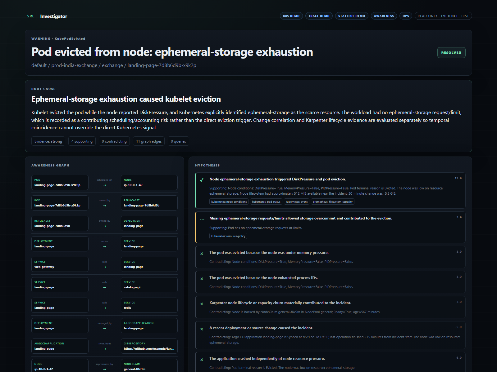
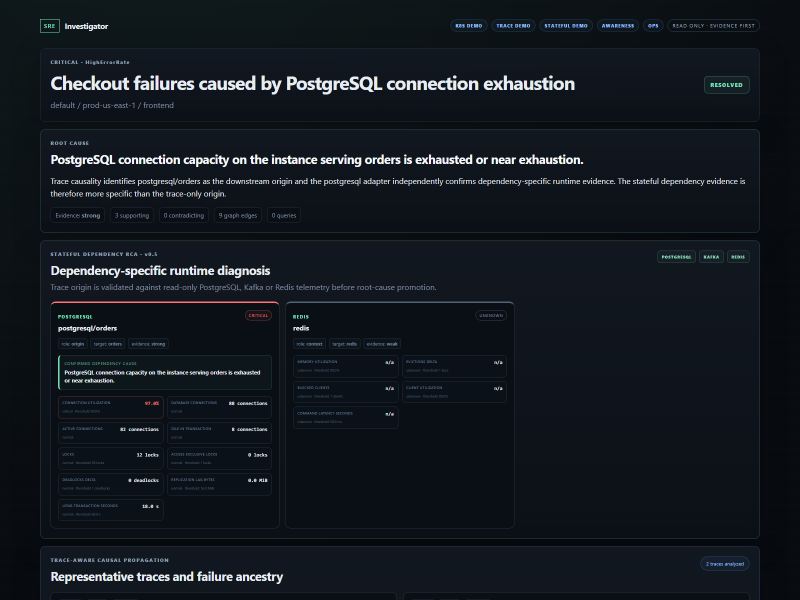
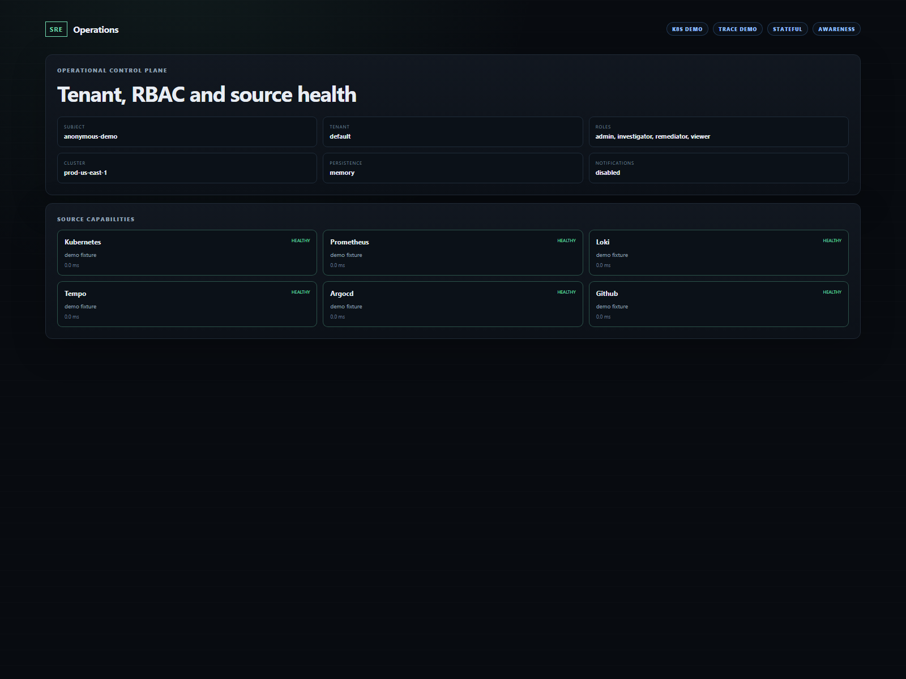

# AI SRE RCA

[Português do Brasil](README_PT-BR.md) · **English**

**AI SRE RCA** is an SRE incident-investigation platform for Kubernetes, distributed observability and stateful dependencies. It collects live evidence, reconstructs causal relationships, keeps persistent operational context and produces a structured RCA without allowing an LLM to invent the root cause.

> **Agentic for deciding where to investigate. Evidence-first for collecting facts. Deterministic for deciding what can be asserted.**

Current status: **v0.8.0-rc.3 in development**.

---

## The problem it solves

During an incident, an engineer usually needs to jump between Kubernetes, metrics, logs, traces, recent changes, stateful dependencies and historical incidents. The hard part is not only finding data. It is separating correlation from causality and refusing conclusions based only on temporal coincidence.

AI SRE RCA automates that investigation while keeping an explicit boundary between **context** and **causal evidence**.

It can answer questions such as:

- did the Pod fail because of OOM, CrashLoop, eviction or a Node issue?
- did the failure originate inside the service or in a downstream dependency?
- do PostgreSQL, Kafka or Redis have current telemetry that confirms the cause?
- is a recent deployment causal or merely close in time?
- what is the likely blast radius in the known topology?
- has a similar incident happened before?
- is the previous cause still valid after the system recovers?
- is there a safe and explicitly allowed remediation action?

---

## What the application does

| Capability | What it delivers |
| --- | --- |
| **Kubernetes RCA** | Investigates OOMKilled, CrashLoopBackOff, eviction, FailedScheduling, NodeNotReady, HPA, KEDA, Karpenter and capacity signals. |
| **Trace-aware RCA** | Reconstructs span trees and finds a downstream origin repeated across independent traces. |
| **Stateful dependencies** | Promotes PostgreSQL, Kafka and Redis into deterministic investigators when causal identity and current telemetry agree. |
| **Metrics and logs** | Queries Prometheus and Loki through narrow read-only adapters and server-owned scopes. |
| **Changes** | Correlates Argo CD and GitHub without treating temporal proximity as automatic proof. |
| **Persistent Awareness Graph** | Keeps entities, relationships, history, tombstones, authoritative inventory, changes and operational context across incidents. |
| **Blast radius** | Traverses only allowed, current causal relationships. |
| **Agentic investigation** | Plans Kubernetes, metrics, logs, traces, database and changes specialists with typed budgets and dependencies. |
| **Incident memory** | Retrieves similar incidents from PostgreSQL/pgvector as context, never as a substitute for current evidence. |
| **Audit and integrity** | Provides SHA-256 evidence hashes, tenant/cluster isolation, structured export and audit trail. |
| **Guarded remediation** | Keeps mutation separate from the investigator with allow-lists, dry-run, human approval, drift protection and rollback. |
| **Real validation** | Runs Kind, PostgreSQL/pgvector, Prometheus, Loki, Tempo/OpenTelemetry and controlled scenarios in GitHub Actions. |

---

## How an investigation works

~~~mermaid
flowchart TD
    I[Incident / Alertmanager] --> N[Normalize identity and scope]
    N --> C[Freeze operational context]
    C --> P[Plan read-only specialists]

    P --> K[Kubernetes]
    P --> M[Metrics]
    P --> L[Logs]
    P --> T[Traces]
    T --> D[Database / Stateful]
    P --> CH[Changes]

    K --> E[Shared Evidence Envelope]
    M --> E
    L --> E
    T --> E
    D --> E
    CH --> E

    E --> H{Evidence integrity OK?}
    H -->|No| INC[Inconclusive]
    H -->|Yes| S[Re-score deterministic hypotheses]

    S --> G1[Trace causality gate]
    G1 --> G2[Stateful gate]
    G2 --> G3[Source precedence gate]
    G3 --> RCA[Structured RCA]

    RCA --> MEM[(PostgreSQL / pgvector)]
    RCA --> PAG[(Persistent Awareness Graph)]
    RCA --> UI[API + UI]
~~~

The optional LLM may help **prioritize investigation branches**, but it cannot create evidence, choose arbitrary tools, change budgets, write graph facts or confirm a root cause.

---

## Architecture

The platform is divided into four planes so investigation, persistent context, mutation and release validation remain separate.

~~~mermaid
flowchart LR
    IN[Alertmanager / REST API] --> ENG[Investigation Engine]

    subgraph READ["1. Read-only investigation"]
      ENG --> PLAN[Bounded Investigation Planner]
      PLAN --> SPEC[Allow-listed Specialists]
      SPEC --> ENV[Shared Evidence Envelope]
      ENV --> DET[Deterministic Evaluator]
    end

    subgraph SOURCES["Evidence sources"]
      K8S[Kubernetes]
      PROM[Prometheus]
      LOKI[Loki]
      TEMPO[Tempo / OpenTelemetry]
      ARGO[Argo CD]
      GIT[GitHub]
      KARP[Karpenter]
    end

    K8S --> SPEC
    PROM --> SPEC
    LOKI --> SPEC
    TEMPO --> SPEC
    ARGO --> SPEC
    GIT --> SPEC
    KARP --> SPEC

    DET --> RCA[Evidence-backed RCA]
    RCA --> API[FastAPI]
    API --> WEB[Next.js]

    subgraph AWARE["2. Persistent awareness"]
      INV[Authoritative Kubernetes inventory] --> PAG[(Persistent Awareness Graph)]
      RCA --> PAG
      PAG --> CTX[Operational Context Snapshot]
      CTX --> PLAN
      PAG --> BR[Blast Radius / Change Timeline]
      PAG --> DB[(PostgreSQL + pgvector)]
    end

    subgraph REM["3. Guarded remediation"]
      RCA --> RP[Remediation Proposal]
      RP --> POLICY[Policy + dry-run + approval]
      POLICY --> RID[Separate identity]
      RID --> ACT[Allow-listed mutation]
    end

    subgraph VAL["4. Release validation"]
      GH[GitHub Actions] --> KIND[Disposable Kind]
      KIND --> STACK[Prometheus + Loki + Tempo + workloads]
      STACK --> ENG
      KIND --> PAG
      ENG --> REP[JSON / Markdown evidence]
    end
~~~

Detailed architecture: [docs/architecture.md](docs/architecture.md).

---

## Application running

The screenshots below are **real rendered application screens**, not design mockups.

### Kubernetes investigation

### Distributed trace causality

### Stateful PostgreSQL dependency

### Persistent Awareness Graph

### Integration health

---

## Main components

### Investigation Engine

The deterministic core normalizes the incident, collects typed evidence, applies playbooks and computes support/contradiction. A hypothesis can become root cause only when its evidence references are valid and the required causal gates pass.

### Investigation Planner

Compiles a bounded plan with these allowed specialists:

- Kubernetes
- metrics
- logs
- traces
- database
- changes

The server recompiles the plan before execution. Clients never execute an arbitrary task graph.

### Trace-aware RCA

Searches representative traces in Tempo, rebuilds parent/child span relationships and identifies the deepest failing span. One trace is not enough to confirm causality. Promotion requires repeated origin across independent traces.

### Stateful Dependency RCA

Dependencies inferred from traces can be investigated with current telemetry:

- **PostgreSQL:** connection utilization, locks, deadlocks, replication lag and long transactions;
- **Kafka:** consumer lag, under-replicated partitions, offline partitions and consumer-group members;
- **Redis:** memory pressure, evictions, blocked clients, client saturation and command latency.

A stateful cause is promoted only when the dependency is causally relevant **and** current telemetry independently confirms the anomaly.

### Persistent Awareness Graph

Keeps operational topology across incidents with stable tenant/cluster identity, append-only history and authoritative reconciliation.

It includes:

- current, stale, historical and tombstoned state;
- Kubernetes entities and relationships;
- ChangeEvents;
- inventory reconciliation;
- graph health;
- retention;
- blast radius;
- change timeline;
- Awareness Explorer;
- Operational Context Snapshot used by the planner.

More detail: [docs/persistent-awareness-graph.md](docs/persistent-awareness-graph.md).

### Guarded remediation

The investigator remains read-only. Mutation lives in a separate service and identity.

The flow is:

~~~text
confirmed RCA
→ typed proposal
→ policy gates
→ Kubernetes dry-run
→ human approval
→ drift check
→ allow-listed mutation
→ audit
→ explicit rollback
~~~

The first supported action is <code>scale_deployment</code>. There is no shell, <code>kubectl exec</code>, generic patch or arbitrary mutation primitive.

More detail: [docs/remediation.md](docs/remediation.md).

---

## Integrations

| System | Purpose |
| --- | --- |
| Kubernetes | runtime state, ownership, events, scheduling, inventory |
| Prometheus | service, Kubernetes and dependency metrics |
| Loki | logs bounded by namespace, Pod or service |
| Tempo / OpenTelemetry | traces, causal paths and service graph |
| Argo CD | deployment state and applied revision |
| GitHub | commit/revision metadata |
| Karpenter | NodeClaim, NodePool and capacity |
| PostgreSQL + pgvector | incidents, awareness graph, audit and vector memory |
| Alertmanager | automatic incident ingestion |
| Slack / PagerDuty | optional notification after persistence |

---

## Safety model

The platform is designed to **fail closed**.

- the investigator uses only GET/LIST/WATCH in Kubernetes;
- there is no <code>pods/exec</code>;
- there is no investigator shell;
- evidence receives SHA-256 integrity hashes;
- integrity failure blocks root-cause selection;
- historical context cannot count as causal proof;
- a recent change is not automatically blamed;
- similar incidents are hints only;
- incomplete branches, exhausted budgets or unavailable sources do not fabricate healthy state;
- the LLM does not confirm RCA;
- remediation uses separate credentials and explicit approval;
- tenant and cluster are part of identity and access boundaries.

---

## Runtime modes

| Mode | Purpose |
| --- | --- |
| <code>DEMO_MODE=true</code> | Explore the UI and investigation flows without external systems. |
| Docker Compose | Run frontend, backend and PostgreSQL/pgvector locally. |
| Test environment | Deploy GitHub-validated images into a Kubernetes test cluster. |
| Helm / production | Connect real sources, OIDC, RBAC, Secrets, NetworkPolicy and multi-cluster routing. |

---

## Quick start

~~~bash
cp .env.example .env
docker compose up --build
~~~

Open:

~~~text
UI:       http://localhost:3000
Swagger:  http://localhost:8080/docs
Health:   http://localhost:8080/healthz
~~~

Demo surfaces:

~~~text
/                         Kubernetes RCA
/trace                    trace-aware RCA
/stateful/postgresql      PostgreSQL
/stateful/kafka           Kafka
/stateful/redis           Redis
/awareness                Persistent Awareness Graph
/ops                      source health
~~~

Backend only:

~~~bash
cd backend
python -m venv .venv
source .venv/bin/activate
pip install -e '.[dev]'
DEMO_MODE=true uvicorn app.main:app --reload --port 8080
~~~

Tests:

~~~bash
pytest -q
~~~

---

## Test environment

The repository has a GitHub-first chain that builds and deploys validated images without depending on a developer workstation.

~~~mermaid
flowchart LR
    PR[Pull Request] --> G[GitHub-first gate]
    G -->|validated main| P[Publish test images]
    P --> GHCR[GHCR]
    GHCR --> D[Deploy test environment]
    D --> K[Test Kubernetes cluster]
    K --> SMOKE[Backend + frontend smoke]
~~~

Published images:

~~~text
ghcr.io/marcocristofolini/ai-sre-rca-backend:edge
ghcr.io/marcocristofolini/ai-sre-rca-backend:sha-<sha>
ghcr.io/marcocristofolini/ai-sre-rca-frontend:edge
ghcr.io/marcocristofolini/ai-sre-rca-frontend:sha-<sha>
~~~

Runbook: [docs/test-environment.md](docs/test-environment.md).

---

## Main APIs

### Incidents

~~~text
GET  /healthz
GET  /api/v1/incidents/{id}
POST /api/v1/incidents/investigate
POST /api/v1/webhooks/alertmanager
~~~

### Persistent Awareness Graph

~~~text
GET  /api/v1/awareness/graph
GET  /api/v1/awareness/health
GET  /api/v1/awareness/history/{target_id}
GET  /api/v1/awareness/topology
GET  /api/v1/awareness/services/{service_name}
GET  /api/v1/awareness/blast-radius/{target_id}
GET  /api/v1/awareness/changes
POST /api/v1/awareness/inventory/reconcile
POST /api/v1/awareness/retention/purge
~~~

### Agentic investigation

~~~text
POST /api/v1/planner/plan
POST /api/v1/planner/execute
POST /api/v1/planner/investigate
~~~

The full OpenAPI interface is available at <code>/docs</code>.

---

## Real-environment validation

The release gate uses a disposable Kind cluster and executes real or controlled scenarios.

It currently validates:

- OOMKilled;
- restart-backoff / CrashLoop safety;
- FailedScheduling;
- authoritative Kubernetes inventory;
- tombstones;
- Persistent Awareness Graph;
- Prometheus;
- Loki;
- Tempo/OpenTelemetry;
- service graph;
- trace causality;
- stateful PostgreSQL;
- classic/agentic parity;
- SHA-256 evidence integrity.

Reports are emitted as JSON and Markdown and tied to the validated Git SHA.

Full contract: [validation/README.md](validation/README.md).

---

## GitHub-first delivery

GitHub is the merge and release authority.

~~~text
branch
→ Pull Request
→ GitHub-first gate
   → CI
   → CodeQL
   → Real Environment Validation
→ gate
→ merge to main
→ Publish test images
→ Deploy test environment
~~~

Release promotion validates the SHA, <code>VERSION</code> and real-environment evidence before creating the tag.

Details: [docs/github-first.md](docs/github-first.md).

---

## Current status

**v0.8.0-rc.3** focuses on real stateful telemetry and recovery validation.

Current work includes:

- PostgreSQL 17 + postgres_exporter in the disposable environment;
- controlled connection pressure;
- deterministic PostgreSQL root-cause promotion;
- dependency recovery;
- fresh post-recovery traces;
- proof that stale causes stop being promoted.

Next rc.3 targets:

- Redis + redis_exporter;
- Kafka + kafka_exporter;
- recovery semantics for all three stateful dependencies;
- release-candidate closure.

Full roadmap: [docs/roadmap.md](docs/roadmap.md).

---

## Repository layout

~~~text
backend/
  app/core/             engine, causality, playbooks and scoring
  app/agentic/          planner, specialists and evaluator
  app/integrations/     read-only adapters
  app/remediation/      separate remediation service
  app/db/               PostgreSQL/pgvector
  tests/                regressions and safety invariants

frontend/               Next.js UI
helm/ai-sre-rca/        chart, RBAC and deployment
validation/             real-environment release gate
docs/                   architecture, operations and runbooks
~~~

---

## Documentation

- [Architecture](docs/architecture.md)
- [Agentic investigation](docs/agentic-investigation.md)
- [Persistent Awareness Graph](docs/persistent-awareness-graph.md)
- [Guarded remediation](docs/remediation.md)
- [Operations and security](docs/operations.md)
- [Test environment](docs/test-environment.md)
- [GitHub-first delivery](docs/github-first.md)
- [Roadmap](docs/roadmap.md)
- [Validation harness](validation/README.md)
- [Changelog](CHANGELOG.md)

---

## Core principle

**Context guides. Evidence proves. The deterministic evaluator decides.**

That principle applies to Kubernetes, traces, stateful dependencies, changes, incident memory and agentic investigation.
