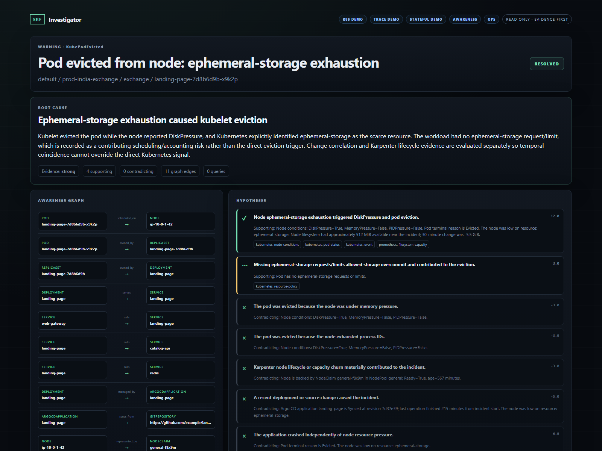

# AI SRE RCA

**Português do Brasil** · [English](README.md)

**AI SRE RCA** é uma plataforma de investigação de incidentes SRE para Kubernetes, observabilidade distribuída e dependências stateful. Ela coleta evidências reais, reconstrói relações causais, mantém contexto operacional persistente e produz um RCA estruturado sem permitir que um LLM invente a causa raiz.

> **Agentic para decidir onde investigar. Evidence-first para coletar fatos. Determinístico para decidir o que pode ser afirmado.**

Status atual: **v0.8.0-rc.3 em desenvolvimento**.

---

## O problema que a aplicação resolve

Durante um incidente, um engenheiro normalmente precisa consultar Kubernetes, métricas, logs, traces, mudanças recentes, dependências e incidentes anteriores em ferramentas diferentes. O problema não é apenas encontrar dados. É separar correlação de causalidade e evitar conclusões baseadas em coincidência temporal.

O AI SRE RCA automatiza esse trabalho mantendo uma fronteira explícita entre **contexto** e **evidência causal**.

Ele pode responder perguntas como:

- o Pod caiu por OOM, CrashLoop, eviction ou problema no Node?
- a falha começou dentro do serviço ou em uma dependência downstream?
- PostgreSQL, Kafka ou Redis apresentam telemetria atual que confirma a causa?
- um deployment recente está apenas próximo no tempo ou há evidência real de regressão?
- qual o blast radius provável dentro da topologia conhecida?
- o problema já ocorreu antes?
- a causa continua válida depois que o sistema se recupera?
- existe uma ação de remediação segura e explicitamente permitida?

---

## O que a aplicação faz

| Capacidade | O que entrega |
| --- | --- |
| **RCA Kubernetes** | Investiga OOMKilled, CrashLoopBackOff, eviction, FailedScheduling, NodeNotReady, HPA, KEDA, Karpenter e sinais de capacidade. |
| **RCA por traces** | Reconstrói árvores de spans e encontra a origem downstream repetida em traces independentes. |
| **Dependências stateful** | Promove PostgreSQL, Kafka e Redis para investigadores determinísticos quando identidade causal e telemetria atual concordam. |
| **Métricas e logs** | Consulta Prometheus e Loki por adapters read-only e scopes controlados pelo servidor. |
| **Mudanças** | Correlaciona Argo CD e GitHub sem transformar proximidade temporal em prova automática. |
| **Persistent Awareness Graph** | Mantém entidades, relações, histórico, tombstones, inventário autoritativo, mudanças e contexto operacional entre incidentes. |
| **Blast radius** | Percorre somente relações causais permitidas e atuais. |
| **Investigação agentic** | Planeja especialistas Kubernetes, metrics, logs, traces, database e changes com budgets e dependências tipadas. |
| **Memória de incidentes** | Recupera incidentes semelhantes em PostgreSQL/pgvector como contexto, nunca como substituto de evidência atual. |
| **Auditoria e integridade** | Usa hashes SHA-256, tenant/cluster isolation, export estruturado e audit trail. |
| **Remediação guardada** | Mantém mutação separada do investigador, com allow-list, dry-run, aprovação humana, drift protection e rollback. |
| **Validação real** | Executa Kind, PostgreSQL/pgvector, Prometheus, Loki, Tempo/OpenTelemetry e cenários controlados no GitHub Actions. |

---

## Como uma investigação funciona

~~~mermaid
flowchart TD
    I[Incidente / Alertmanager] --> N[Normalizar identidade e escopo]
    N --> C[Congelar contexto operacional]
    C --> P[Planejar especialistas read-only]

    P --> K[Kubernetes]
    P --> M[Metrics]
    P --> L[Logs]
    P --> T[Traces]
    T --> D[Database / Stateful]
    P --> CH[Changes]

    K --> E[Shared Evidence Envelope]
    M --> E
    L --> E
    T --> E
    D --> E
    CH --> E

    E --> H{Integridade das evidências OK?}
    H -->|Não| INC[Inconclusivo]
    H -->|Sim| S[Recalcular hipóteses determinísticas]

    S --> G1[Gate de causalidade por traces]
    G1 --> G2[Gate stateful]
    G2 --> G3[Precedência de fontes]
    G3 --> RCA[RCA estruturado]

    RCA --> MEM[(PostgreSQL / pgvector)]
    RCA --> PAG[(Persistent Awareness Graph)]
    RCA --> UI[API + UI]
~~~

O LLM opcional pode ajudar a **priorizar ramos de investigação**, mas não pode criar evidência, escolher ferramentas arbitrárias, alterar budgets, escrever no grafo ou confirmar uma causa raiz.

---

## Arquitetura

A plataforma é dividida em quatro planos para manter investigação, contexto, mutação e validação separados.

~~~mermaid
flowchart LR
    IN[Alertmanager / REST API] --> ENG[Investigation Engine]

    subgraph READ["1. Investigação read-only"]
      ENG --> PLAN[Bounded Investigation Planner]
      PLAN --> SPEC[Especialistas allow-listed]
      SPEC --> ENV[Shared Evidence Envelope]
      ENV --> DET[Avaliador determinístico]
    end

    subgraph SOURCES["Fontes de evidência"]
      K8S[Kubernetes]
      PROM[Prometheus]
      LOKI[Loki]
      TEMPO[Tempo / OpenTelemetry]
      ARGO[Argo CD]
      GIT[GitHub]
      KARP[Karpenter]
    end

    K8S --> SPEC
    PROM --> SPEC
    LOKI --> SPEC
    TEMPO --> SPEC
    ARGO --> SPEC
    GIT --> SPEC
    KARP --> SPEC

    DET --> RCA[RCA baseado em evidências]
    RCA --> API[FastAPI]
    API --> WEB[Next.js]

    subgraph AWARE["2. Awareness persistente"]
      INV[Inventário autoritativo Kubernetes] --> PAG[(Persistent Awareness Graph)]
      RCA --> PAG
      PAG --> CTX[Operational Context Snapshot]
      CTX --> PLAN
      PAG --> BR[Blast Radius / Change Timeline]
      PAG --> DB[(PostgreSQL + pgvector)]
    end

    subgraph REM["3. Remediação guardada"]
      RCA --> RP[Remediation Proposal]
      RP --> POLICY[Policy + dry-run + aprovação]
      POLICY --> RID[Identidade separada]
      RID --> ACT[Mutação allow-listed]
    end

    subgraph VAL["4. Validação da release"]
      GH[GitHub Actions] --> KIND[Kind descartável]
      KIND --> STACK[Prometheus + Loki + Tempo + workloads]
      STACK --> ENG
      KIND --> PAG
      ENG --> REP[JSON / Markdown evidence]
    end
~~~

Arquitetura detalhada: [docs/architecture.pt-BR.md](docs/architecture.pt-BR.md).

---

## Aplicação em execução

As imagens abaixo são **screenshots reais da aplicação renderizada**, não mockups.

### Investigação Kubernetes

### Causalidade distribuída por traces

### Dependência stateful PostgreSQL

### Persistent Awareness Graph

### Saúde das integrações

---

## Principais componentes

### Investigation Engine

O core determinístico normaliza o incidente, coleta evidências tipadas, aplica playbooks e calcula suporte/contradição. Uma hipótese só pode se tornar causa raiz quando suas referências de evidência são válidas e os gates causais necessários passam.

### Investigation Planner

Compila um plano bounded com especialistas permitidos:

- Kubernetes
- metrics
- logs
- traces
- database
- changes

O plano é recompilado no servidor antes da execução. O cliente nunca executa um task graph arbitrário.

### Trace-aware RCA

Busca traces representativos no Tempo, reconstrói relações parent/child e identifica a span de falha mais profunda. Um único trace não é suficiente para confirmar causalidade. A promoção exige repetição da mesma origem em traces independentes.

### Stateful Dependency RCA

Dependências inferidas pelos traces podem ser investigadas com telemetria atual:

- **PostgreSQL:** utilização de conexões, locks, deadlocks, replication lag e long transactions;
- **Kafka:** consumer lag, under-replicated partitions, offline partitions e members;
- **Redis:** memory pressure, evictions, blocked clients, clients saturation e command latency.

Uma causa stateful só é promovida quando a dependência é causalmente relevante **e** a telemetria atual confirma a anomalia.

### Persistent Awareness Graph

Mantém topologia entre incidentes com identidade estável por tenant/cluster, histórico append-only e reconciliação autoritativa.

Inclui:

- current, stale, historical e tombstoned state;
- entidades e relações Kubernetes;
- ChangeEvents;
- inventory reconciliation;
- graph health;
- retention;
- blast radius;
- change timeline;
- Awareness Explorer;
- Operational Context Snapshot usado pelo planner.

Mais detalhes: [docs/persistent-awareness-graph.pt-BR.md](docs/persistent-awareness-graph.pt-BR.md).

### Remediação guardada

O investigador permanece read-only. A mutação existe em um serviço e identidade separados.

O fluxo exige:

~~~text
RCA confirmado
→ proposta tipada
→ policy gates
→ Kubernetes dry-run
→ aprovação humana
→ drift check
→ mutação allow-listed
→ audit
→ rollback explícito
~~~

A primeira ação suportada é <code>scale_deployment</code>. Não existe shell, <code>kubectl exec</code>, patch genérico ou mutação arbitrária.

Mais detalhes: [docs/remediation.pt-BR.md](docs/remediation.pt-BR.md).

---

## Integrações

| Sistema | Uso |
| --- | --- |
| Kubernetes | runtime state, ownership, events, scheduling, inventory |
| Prometheus | métricas de serviço, Kubernetes e dependências |
| Loki | logs bounded por namespace, Pod ou service |
| Tempo / OpenTelemetry | traces, causal path e service graph |
| Argo CD | estado de deployment e revisão aplicada |
| GitHub | metadados de commit/revisão |
| Karpenter | NodeClaim, NodePool e capacidade |
| PostgreSQL + pgvector | incidentes, awareness graph, audit e memória vetorial |
| Alertmanager | entrada automática de incidentes |
| Slack / PagerDuty | notificação opcional após persistência |

---

## Modelo de segurança

A plataforma foi desenhada para **falhar fechado**.

- o investigador usa somente GET/LIST/WATCH no Kubernetes;
- não existe <code>pods/exec</code>;
- não existe shell no investigator;
- evidências recebem hash SHA-256;
- falha de integridade bloqueia seleção de causa raiz;
- contexto histórico não conta como prova causal;
- mudança recente não é automaticamente culpada;
- incidentes similares são apenas pistas;
- branch incompleta, budget esgotado ou source indisponível não produz “healthy” artificial;
- LLM não confirma RCA;
- remediação usa credenciais separadas e aprovação explícita;
- tenant e cluster fazem parte das fronteiras de identidade e acesso.

---

## Modos de execução

| Modo | Objetivo |
| --- | --- |
| <code>DEMO_MODE=true</code> | Explorar UI e fluxos sem dependências externas. |
| Docker Compose | Executar frontend, backend e PostgreSQL/pgvector localmente. |
| Test environment | Implantar imagens validadas pelo GitHub em um cluster Kubernetes de testes. |
| Helm / produção | Integrar fontes reais, OIDC, RBAC, Secrets, NetworkPolicy e multi-cluster. |

---

## Início rápido

~~~bash
cp .env.example .env
docker compose up --build
~~~

Abra:

~~~text
UI:       http://localhost:3000
Swagger:  http://localhost:8080/docs
Health:   http://localhost:8080/healthz
~~~

Telas de demonstração:

~~~text
/                         RCA Kubernetes
/trace                    RCA baseado em traces
/stateful/postgresql      PostgreSQL
/stateful/kafka           Kafka
/stateful/redis           Redis
/awareness                Persistent Awareness Graph
/ops                      Saúde das integrações
~~~

Backend isolado:

~~~bash
cd backend
python -m venv .venv
source .venv/bin/activate
pip install -e '.[dev]'
DEMO_MODE=true uvicorn app.main:app --reload --port 8080
~~~

Testes:

~~~bash
pytest -q
~~~

---

## Ambiente de testes

O repositório possui uma cadeia GitHub-first para gerar e implantar imagens sem depender de uma workstation.

~~~mermaid
flowchart LR
    PR[Pull Request] --> G[GitHub-first gate]
    G -->|main validado| P[Publish test images]
    P --> GHCR[GHCR]
    GHCR --> D[Deploy test environment]
    D --> K[Test Kubernetes cluster]
    K --> SMOKE[Backend + frontend smoke]
~~~

Imagens publicadas:

~~~text
ghcr.io/marcocristofolini/ai-sre-rca-backend:edge
ghcr.io/marcocristofolini/ai-sre-rca-backend:sha-<sha>
ghcr.io/marcocristofolini/ai-sre-rca-frontend:edge
ghcr.io/marcocristofolini/ai-sre-rca-frontend:sha-<sha>
~~~

Runbook: [docs/test-environment.md](docs/test-environment.md).

---

## APIs principais

### Incidentes

~~~text
GET  /healthz
GET  /api/v1/incidents/{id}
POST /api/v1/incidents/investigate
POST /api/v1/webhooks/alertmanager
~~~

### Persistent Awareness Graph

~~~text
GET  /api/v1/awareness/graph
GET  /api/v1/awareness/health
GET  /api/v1/awareness/history/{target_id}
GET  /api/v1/awareness/topology
GET  /api/v1/awareness/services/{service_name}
GET  /api/v1/awareness/blast-radius/{target_id}
GET  /api/v1/awareness/changes
POST /api/v1/awareness/inventory/reconcile
POST /api/v1/awareness/retention/purge
~~~

### Agentic investigation

~~~text
POST /api/v1/planner/plan
POST /api/v1/planner/execute
POST /api/v1/planner/investigate
~~~

O Swagger completo fica em <code>/docs</code>.

---

## Validação de ambiente real

A release gate usa um cluster Kind descartável e executa cenários reais/controlados.

Atualmente valida:

- OOMKilled;
- restart backoff / CrashLoop safety;
- FailedScheduling;
- inventário Kubernetes autoritativo;
- tombstones;
- Persistent Awareness Graph;
- Prometheus;
- Loki;
- Tempo/OpenTelemetry;
- service graph;
- causalidade por traces;
- PostgreSQL stateful;
- paridade classic/agentic;
- integridade SHA-256.

Os relatórios são emitidos em JSON e Markdown e associados ao SHA validado.

Contrato completo: [validation/README_PT-BR.md](validation/README_PT-BR.md).

---

## GitHub-first delivery

O GitHub é a autoridade de merge e release.

~~~text
branch
→ Pull Request
→ GitHub-first gate
   → CI
   → CodeQL
   → Real Environment Validation
→ gate
→ merge em main
→ Publish test images
→ Deploy test environment
~~~

A promoção de release valida o SHA, o <code>VERSION</code> e o relatório de ambiente real antes de criar a tag.

Detalhes: [docs/github-first.pt-BR.md](docs/github-first.pt-BR.md).

---

## Estado atual

**v0.8.0-rc.3** está focada em telemetria stateful real e recovery validation.

O trabalho atual inclui:

- PostgreSQL 17 + postgres_exporter no ambiente descartável;
- pressão controlada de conexões;
- promoção determinística de causa PostgreSQL;
- recuperação da dependência;
- novas traces pós-recuperação;
- comprovação de que uma causa antiga deixa de ser promovida.

Próximos alvos da rc.3:

- Redis + redis_exporter;
- Kafka + kafka_exporter;
- recovery semantics para as três dependências;
- fechamento da release candidate.

Roadmap completo: [docs/roadmap.md](docs/roadmap.md).

---

## Estrutura do repositório

~~~text
backend/
  app/core/             engine, causalidade, playbooks e scoring
  app/agentic/          planner, specialists e evaluator
  app/integrations/     adapters read-only
  app/remediation/      plano de remediação separado
  app/db/               PostgreSQL/pgvector
  tests/                regressões e safety invariants

frontend/               Next.js UI
helm/ai-sre-rca/        chart, RBAC e deployment
validation/             release gate em ambiente real
docs/                   arquitetura, operação e runbooks
~~~

---

## Documentação

- [Arquitetura](docs/architecture.pt-BR.md)
- [Investigação agentic](docs/agentic-investigation.pt-BR.md)
- [Persistent Awareness Graph](docs/persistent-awareness-graph.pt-BR.md)
- [Remediação guardada](docs/remediation.pt-BR.md)
- [Operação e segurança](docs/operations.pt-BR.md)
- [Ambiente de testes](docs/test-environment.md)
- [GitHub-first delivery](docs/github-first.pt-BR.md)
- [Roadmap](docs/roadmap.md)
- [Validation harness](validation/README_PT-BR.md)
- [Changelog](CHANGELOG.md)

---

## Princípio central

**Contexto orienta. Evidência prova. O evaluator determinístico decide.**

Esse princípio vale para Kubernetes, traces, dependências stateful, mudanças, memória de incidentes e investigação agentic.
