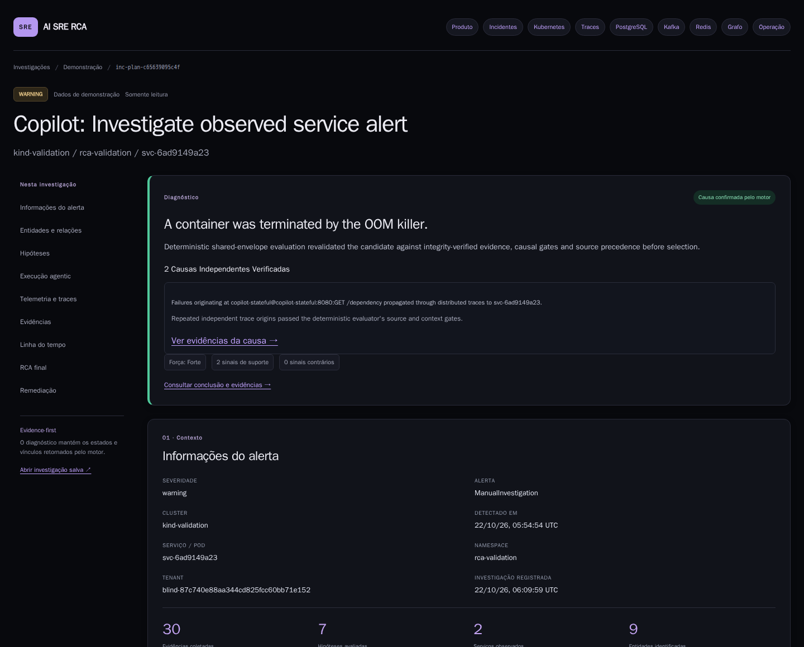
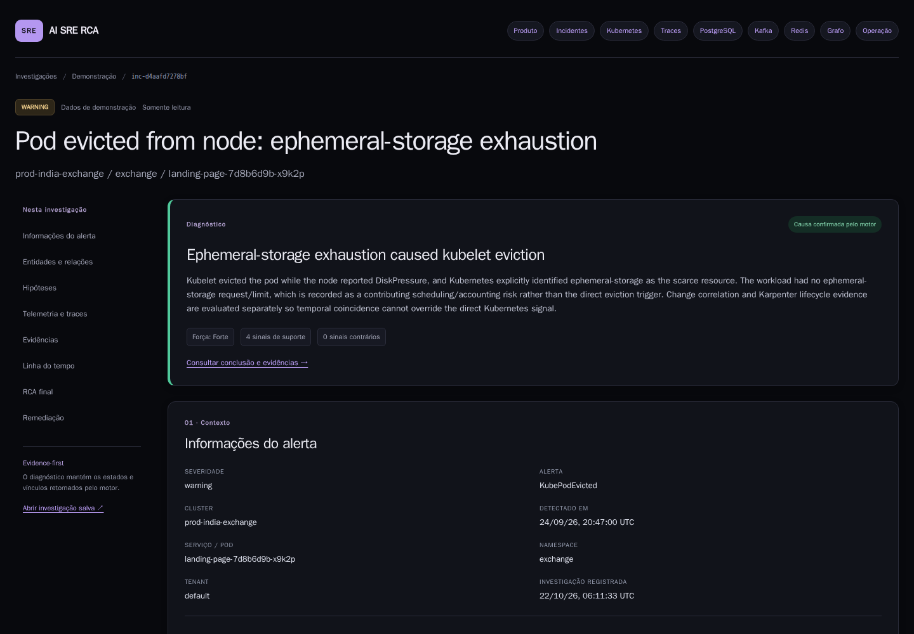
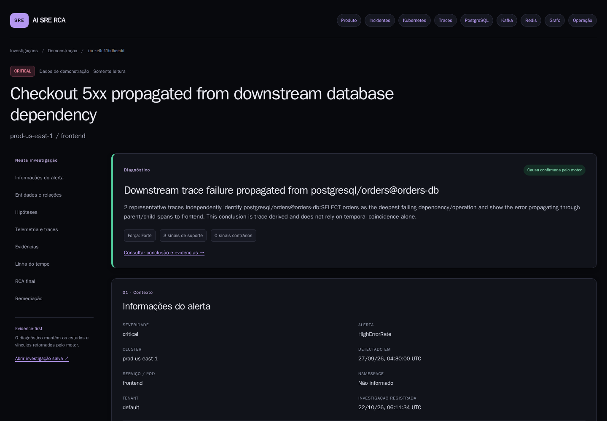
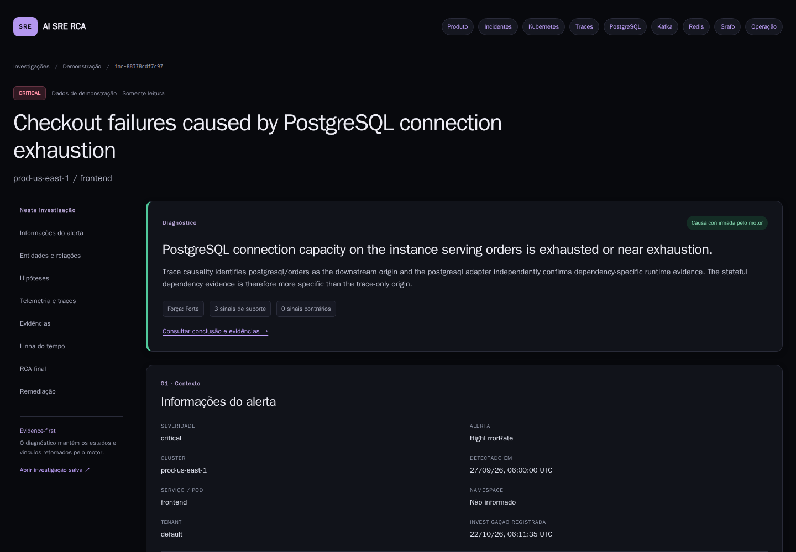
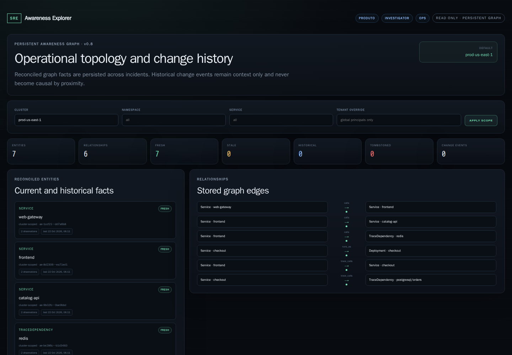
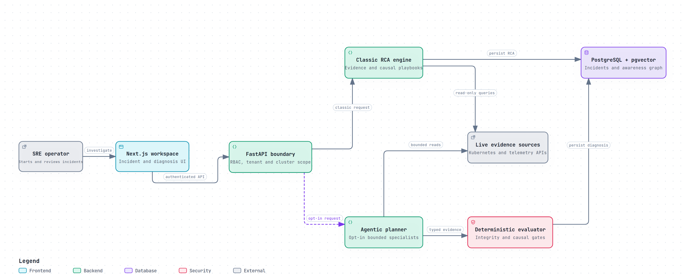

# Tracecroft AI

**Investigação de Kubernetes e serviços distribuídos baseada em evidências.** O Tracecroft AI (evolução do projeto AI SRE RCA) reúne coleta delimitada de telemetria, investigações persistentes e assistência conversacional com avaliação determinística de causa raiz.

**Versão: `0.8.0-rc.3`** ([VERSION](VERSION)); candidata a lançamento em desenvolvimento. [English](README.md).


[**Conheça o website do Tracecroft AI**](https://tracecroft-ai.marcocristofolini.dev) · [Código do website](website/) · [Arquitetura Archify interativa](docs/archify/ai-sre-rca.html)

> **Marca e repositório:** Tracecroft AI é o nome do produto. O repositório continua `ai-sre-rca` para preservar URLs, histórico, referências técnicas e integrações. Benchmarks e capturas anteriores mantêm sua proveniência original.

## Problemas que resolve

Responder a um incidente exige cruzar estado do Kubernetes, métricas, logs, traces, mudanças recentes e incidentes anteriores. O AI SRE RCA reúne essas informações em um workspace, registra a origem das evidências e diferencia mecanismos de falha observados de correlações. A falta de evidência resulta em diagnóstico inconclusivo.

## Capacidades atuais

| Área | Comportamento implementado |
| --- | --- |
| Escopo de investigação | Seleção de Pod, Service, Deployment e StatefulSet a partir de inventário autorizado, com janela temporal limitada. Deployment → ReplicaSet → Pod e StatefulSet → Pod são resolvidos por UIDs e ownerReferences de controladores. |
| Orquestrador persistente | Execução limitada de especialistas somente leitura, jobs persistidos, submissão idempotente, leases, limites de concorrência e recuperação. Progresso SSE com replay e alternativa por polling. APIs síncronas continuam disponíveis. |
| Copilot | Perguntas sobre causas independentes verificadas, evidências, hipóteses descartadas, cronologia e próximos passos. Respostas determinísticas citam evidências autorizadas e preservam a incerteza sem depender de modelo. |
| Investigação interativa | Solicitação em linguagem natural com seleção explícita de inventário e período gera proposta tipada. O usuário revisa escopo e orçamento antes de confirmar a criação do job. Texto livre nunca concede escopo nem escolhe ferramentas. |
| RCA determinístico | Verificação de integridade e referências, pontuação por playbooks, precedência Kubernetes/telemetria e múltiplas causas verificadas de forma independente (`root_causes`), sustentadas por condições atuais de Node ou traces causais recorrentes. Modelos não alteram vereditos nem executam remediação. |
| Contexto persistente | Awareness Graph com inventário autoritativo, histórico, tombstones, mudanças e topologia limitada; memória de incidentes em PostgreSQL/pgvector. Similaridade histórica é contexto, não prova causal. |
| Workspace | Progresso dos especialistas, evidências, hipóteses, cronologia, causas primária e secundárias verificadas com links para evidências e perguntas sobre as investigações concluídas. |

Os modos de worker ainda são identificados como experimentais (leases em PostgreSQL ou memória volátil no processo). A execução agentic está implementada, mas exige ativação (`AGENTIC_EXECUTION_ENABLED=true`). O planejamento opcional assistido por modelo é experimental e possui controle separado; o servidor recompila apenas tarefas permitidas.

## Nova identidade visual Tracecroft AI

O símbolo **T** inspirado em circuitos representa traces de serviços convergindo para evidências verificadas. A identidade grafite, ciano e violeta integra a interface e o website bilíngue independente, sem alterar permissões de investigação, vereditos determinísticos ou remediação. O [website](website/) reúne as cinco capturas reais verificadas, o desenho Archify autossuficiente, funcionalidades, integrações e metodologia de validação.


## Diagnóstico de múltiplas causas independentes

O campo original `root_cause` permanece como causa primária, preservando a compatibilidade. A coleção opcional e ordenada `root_causes` apresenta outras **causas verificadas de forma independente**, cada uma vinculada a uma hipótese de playbook confirmada e evidências com integridade validada. Classic, Agentic opcional e Copilot preservam a precedência determinística do Kubernetes; modelos e pareceres isolados dos especialistas não podem promover causas à conclusão persistida.

| Incidente controlado | Causas verificadas | Resultado |
| --- | --- | --- |
| Benchmark sintético `b002` | `container-oom` + `node-not-ready` (condições verificadas de Pod e Node) | Completo em Classic, Agentic e Copilot |
| Benchmark Kind descartável `l002` | `container-oom` + `trace-causal-propagation` (ancestralidade independente e recorrente de traces) | Completo nos três caminhos; integridade aprovada |

Evidência desconhecida, desatualizada, ausente ou conflitante impede afirmações injustificadas. Causas extras sem suporte contam como **confirmações falsas**, nunca como diagnósticos corretos. `resolved` significa que o diagnóstico foi concluído, **não** que o serviço se recuperou. Veja o [relatório multicausal](docs/rca-benchmark-v23-multicausal-results.md) e a [metodologia do benchmark](docs/rca-benchmark.md).

## Imagens da aplicação em funcionamento — demonstração local

Cinco imagens foram capturadas no Chromium em **22 de outubro de 2026** com o frontend Next.js compilado para produção. Quatro rotas utilizaram um **backend FastAPI demonstrativo com adaptadores sintéticos**, todas com HTTP 200 e sem erros de página. A quinta exibe um **resultado congelado e com integridade validada de uma investigação controlada no Kind descartável**, reproduzido em modo somente leitura. Nenhuma representa incidente em produção. Clique para ampliar.

**Duas causas independentes em incidente controlado no Kind:** o diagnóstico `l002` registrado é exibido na interface Next.js em execução, com um encerramento por OOM e outra causa comprovada por traces. O cluster era descartável; a tela foi verificada reproduzindo o resultado em modo somente leitura.

[](docs/images/app-multicausal-kind-running.png)

| Investigação RCA de Kubernetes | Investigação de traces distribuídos |
| --- | --- |
| [](docs/images/app-investigation-running.png) | [](docs/images/app-trace-running.png) |
| **Investigação de dependências stateful** | **Awareness Graph e topologia** |
| [](docs/images/app-dependencies-running.png) | [](docs/images/app-awareness-running.png) |

As rotas demonstrativas mostram uma causa principal; a captura adicional do Kind mostra duas causas identificadas durante uma execução controlada com telemetria real. Consulte o [relatório de benchmark multicausal e validação local](docs/rca-benchmark-v23-multicausal-results.md). As imagens não representam incidentes de produção.

## Arquitetura e segurança



[**Explore a arquitetura interativa do Archify**](docs/archify/ai-sre-rca.html) (baixe o HTML autossuficiente e abra-o localmente) · [Arquitetura completa do sistema](docs/images/ai-sre-rca-architecture.svg)

*O desenho do Archify representa apenas o fluxo de investigação. A execução de remediações e a validação de releases são separadas e não fazem parte desta visualização.*

O Next.js encaminha autenticação ao FastAPI. Verificações de papel e escopo de tenant/cluster no backend protegem incidentes, evidências, jobs e progresso. O PostgreSQL armazena investigações, observações do grafo, auditoria e jobs; o pgvector oferece similaridade com embeddings determinísticos por hash.

Os adaptadores de investigação são somente leitura. Textos recuperados, logs e respostas de modelos são dados não confiáveis. O Copilot limita contexto e saída do modelo, verifica citações na investigação autorizada e usa resposta determinística quando o modelo está indisponível ou sua saída é rejeitada. Esses controles não garantem a correção factual de toda frase gerada.

A remediação tem serviço e credenciais separados e fica desativada por padrão: propostas tipadas, políticas, dry-run, aprovação humana, verificação de divergência e execução auditada de ações permitidas. A ação atual é `scale_deployment`; o Copilot não a invoca. Consulte [arquitetura](docs/architecture.pt-BR.md) e [remediação](docs/remediation.pt-BR.md).

## Integrações e pré-requisitos de telemetria

- **Kubernetes:** estado atual, eventos, propriedade por UID, inventário e sinais de HPA/KEDA/Karpenter.
- **Prometheus:** métricas de serviços, Kubernetes e dependências; **Loki:** logs estruturados com escopo; **Tempo/OpenTelemetry:** traces e propagação causal.
- **Argo CD / GitHub:** contexto coletado de implantação e revisão; proximidade temporal não comprova causalidade.
- **Analisadores de PostgreSQL, Redis e Kafka:** exigem telemetria atual correspondente à identidade da dependência obtida dos traces. A validação real de falha e recuperação do Kafka está pendente.
- **Alertmanager:** ingestão; **Slack/PagerDuty:** notificações opcionais após persistência.

O escopo dinâmico exige inventário autoritativo recente e completo, com relações verificadas entre UIDs de controladores e Pods. Escopos de workload e Service exigem mapeamento explícito de identidade de telemetria (`ai-sre.io/telemetry-service`); nomes e seletores isolados não provam propriedade. Consultas de logs de controladores exigem rótulos Loki `pod_uid` confiáveis e correspondentes aos Pods selecionados. Esses rótulos não devem ser derivados de conteúdo não confiável dos logs.

A disponibilidade de Prometheus/Loki e, quando aplicável, Kubernetes é verificada antes da criação do job dinâmico. Traces exigem instrumentação e propagação correta de contexto. Identidades ambíguas, inventário desatualizado/incompleto, telemetria obrigatória indisponível e mudanças de membros são rejeitados. Rolling updates incluem todos os ReplicaSets verificados; zero réplicas fornece contexto sem inventar telemetria de Pods.

## Início rápido local

Pré-requisitos: Git, Docker Engine/Desktop e Docker Compose. Na raiz do repositório:

```bash
cp .env.example .env
docker compose up --build
```

Abra [o console](http://localhost:3000), `/incidents` para consultar investigações salvas e `/incidents/new` para iniciar uma. A documentação da API fica em [localhost:8080/docs](http://localhost:8080/docs).

O Compose utiliza adaptadores de demonstração, PostgreSQL/pgvector e credenciais locais de desenvolvimento; autenticação e chamadas a LLM ficam desativadas por padrão. **Não é uma implantação segura para produção.** O ambiente do backend está declarado diretamente no Compose: editar apenas `.env` não substitui esses valores.

Para fontes reais, configure o ambiente do backend/valores Helm conforme [.env.example](.env.example) e o [guia operacional](docs/operations.pt-BR.md):

| Configuração | Finalidade |
| --- | --- |
| `DEMO_MODE=false`, `DATABASE_URL` | Adaptadores reais e PostgreSQL/pgvector persistente; sem banco, o repositório funciona em memória. |
| `AUTH_ENABLED=true`, `OIDC_ISSUER`, `OIDC_AUDIENCE`, `OIDC_JWKS_URL` | Validação de tokens; mapeie claims de papel, tenant e clusters nas configurações `OIDC_*_CLAIM`. |
| `CLUSTER_CONFIG_JSON` | Endpoints/credenciais confiáveis por cluster para Kubernetes, Prometheus, Loki e Tempo. |
| `AWARENESS_INVENTORY_CLUSTERS`, `AWARENESS_INVENTORY_TENANT_ID` | Escopo explícito do coletor autoritativo; consulte o [guia do grafo](docs/persistent-awareness-graph.pt-BR.md). |
| `AGENTIC_EXECUTION_ENABLED=true` | Ativa investigações orquestradas somente leitura e propostas do Copilot. |
| `QUERY_BUDGET_*` | Limites globais de chamadas, chamadas por fonte e tempo; escopo dinâmico exige orçamentos positivos e ativos. |
| `LLM_ENABLED`, `LLM_BASE_URL`, `LLM_MODEL`, `LLM_API_KEY` | Provedor opcional de chat compatível; o padrão é resposta determinística. |

Não versione credenciais. Restrinja credenciais de leitura ao cluster pretendido e configure as de remediação separadamente.

### Uso

Com a configuração local de demonstração do Compose:

```bash
curl -fsS http://localhost:8080/api/v1/incidents/demo
curl -fsS http://localhost:8080/api/v1/incidents
```

Abra um incidente salvo e pergunte “Quais evidências sustentam a causa raiz?”. Confira as citações. Com execução agentic e inventário válido, selecione alvo/período, solicite uma proposta, revise o escopo compilado e confirme explicitamente. Acompanhe o SSE e faça perguntas após a conclusão. O estado Kubernetes é atual; o período histórico se aplica à telemetria. A janela usa minutos inteiros, termina no passado e tem máximo de 60 minutos; o mínimo efetivo padrão é 15 minutos.

Ambientes autenticados exigem bearer token válido; a API continua sendo a autoridade sobre escopo. Consulte [contratos e falhas](docs/architecture.pt-BR.md#contratos-de-api).

## Validação local: resultados registrados

O [relatório Real-World RCA Validation v1](docs/real-world-rca-validation-v1.md), registrado na base `3bec577`, informa:

| Verificação | Resultado local |
| --- | --- |
| RCA real controlado | **6/6 casos com escopo corresponderam ao esperado**, incluindo os casos negativos de recuperação e zero réplicas |
| Backend e harness com Docker/PostgreSQL | **325 passaram**, nenhum ignorado; cinco subtestes adicionais e um aviso de descontinuação existente |
| Telemetria dos workloads | **8 passaram**; HTTP local e exportação OTLP simulada |
| Verificações de navegador | **50 passaram**: 44 regressões independentes + 6 verificações reais com adaptadores de produção |
| Build de produção Next.js | **Passou**, incluindo TypeScript e assets standalone |

Os casos usaram workloads descartáveis no Kind e Kubernetes, Prometheus, Loki e Tempo reais: timeout downstream investigado por Deployment e StatefulSet, saída de processo após rollout, OOMKilled, recuperação e zero réplicas. O resultado do rollout comprova o mecanismo de saída do processo, não causalidade da revisão Git. São resultados locais controlados, **não confiabilidade de produção, acurácia geral de RCA ou certificação de release**. Relatórios e logs brutos permanecem locais, fora do Git; o resumo versionado está no link acima. Esta atualização documental não reexecuta essas suítes da aplicação.

### 22 de outubro de 2026: validação local multicausal

O [relatório de RCA multicausal](docs/rca-benchmark-v23-multicausal-results.md) registra estas **novas verificações executadas localmente**, separadas da validação histórica acima:

| Verificação | Resultado local observado |
| --- | --- |
| Regressão completa de backend/PostgreSQL | **306/306 testes aprovados**; um aviso Starlette preexistente |
| Testes unitários de benchmark e harness | **51 aprovados** |
| Benchmark sintético cego: 8 casos × 3 caminhos | **PASS**: 2 completos, 5 abstenções corretas e 1 rejeição correta *por caminho*; sem diagnósticos incorretos, erros ou confirmações falsas |
| Benchmark controlado no Kind: 3 casos × 3 caminhos | **PASS**: 1 completo e 2 abstenções corretas *por caminho*; **9/9** verificações de integridade aprovadas e nenhum erro de fonte |
| Regressões controladas do Copilot | **6 cenários aprovados** durante o estágio Kind do benchmark |
| Build Docker de produção do Next.js | **Aprovado** |
| Capturas Chromium | **4 rotas de demonstração + 1 resultado Kind `l002`**, todas com HTTP 200 e sem erros de página; a última exibiu duas causas e link para evidência |

A nova execução Kind cobriu o **estágio completo do benchmark-v2** e suas regressões do Copilot, **não todas as suítes históricas independentes de full-stack, PostgreSQL/Redis, Awareness Graph ou Playwright**. Seções não executadas não representam testes aprovados. O uso de LLM/planejamento por modelo estava desativado; os casos controlados não certificam acurácia em produção nem release. O cluster e os containers descartáveis foram removidos.

### Reproduzir a validação com Docker

```bash
make test-docker
# Exige Kind e kubectl; cria somente ambiente descartável de validação:
sh validation/run-docker.sh --copilot --cluster-name ai-sre-real-validation-local
```

Reutilize imagens em cache. Consulte [pré-requisitos e relatórios](validation/README.md) para o harness completo, configuração PostgreSQL e pontos de entrada independentes de navegador. As suítes permanecem separadas: `validate-diagnosis-ui.py`, `validate-copilot-ui.py`, `validate-copilot-v2-ui.py`, `validate-copilot-scope-ui.py` e a real `validate-real-copilot-ui.py`, em `scripts/`. Os runners exigem as fixtures de API documentadas e frontend standalone compilado com `.next/static` e `public`. Não use Python no host nem crie venv.

## Limitações e próximos trabalhos

- Release candidate em desenvolvimento; validação local não substitui os controles preservados de release/segurança. Não implica implantação em produção.
- Completude, atualidade, quantidade limitada de membros e identidades explícitas de telemetria são obrigatórias; escopos não suportados ou grandes demais são rejeitados.
- Replay depende da retenção de eventos e jobs; clientes precisam tratar lacunas. `resolved` significa diagnóstico concluído, não recuperação confirmada.
- Planejamento assistido por modelo é experimental; a resposta determinística atual usa português mesmo na UI em inglês. Não há ferramentas arbitrárias, shell ou remediação autônoma.
- Cobertura maior de falhas, validação real do Kafka, configuração de telemetria e avaliação de escala/concorrência seguem pendentes. Consulte o [roadmap](docs/roadmap.md).

## Documentação

- [Arquitetura e contratos](docs/architecture.pt-BR.md) · [ciclo da investigação](docs/images/investigation-pipeline.svg) · [limites de segurança](docs/images/security-boundaries.svg)
- [Investigação agentic](docs/agentic-investigation.pt-BR.md) · [Awareness Graph](docs/persistent-awareness-graph.pt-BR.md)
- [Causalidade por traces](docs/trace-causality.pt-BR.md) · [dependências stateful](docs/stateful-dependencies.pt-BR.md)
- [Operação](docs/operations.pt-BR.md) · [resultados reais controlados](docs/real-world-rca-validation-v1.md) · [validação histórica de workloads](docs/copilot-workload-validation.md)
- [Processo de release](docs/github-first.pt-BR.md) · [ambiente de testes](docs/test-environment.pt-BR.md) · [licença MIT](LICENSE)

Capturas históricas de demonstração (`v0.8.0-rc.1`, não são validação real): [Kubernetes](docs/images/investigator-k8s.png), [traces](docs/images/trace-aware-rca.png), [PostgreSQL](docs/images/stateful-postgresql.png), [grafo](docs/images/awareness-explorer.png), [saúde das integrações](docs/images/operations.png).
