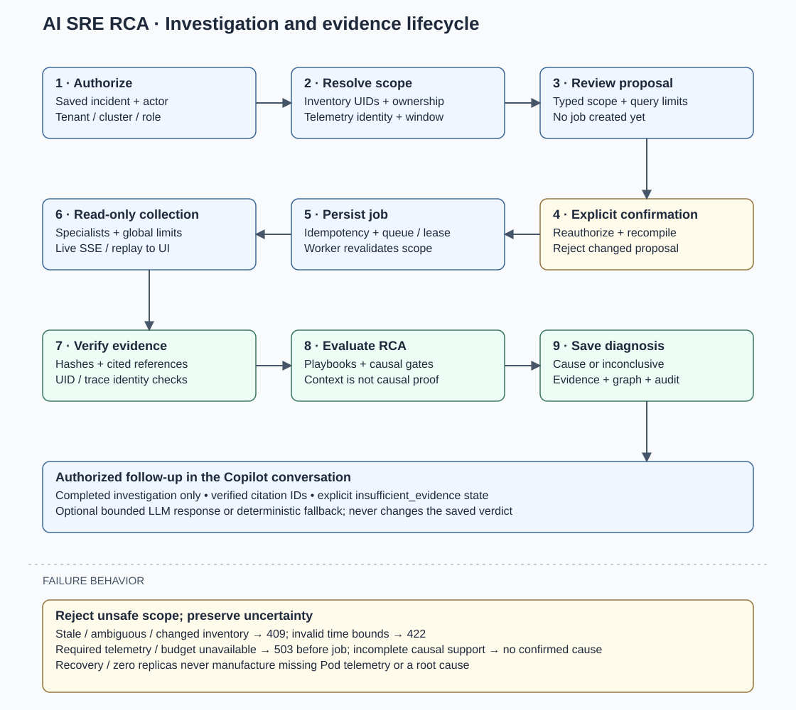
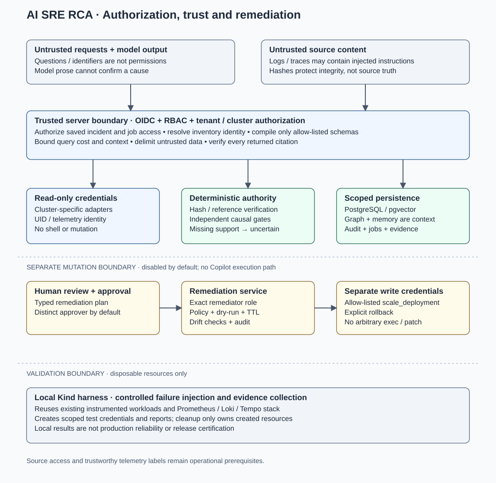

# Architecture — validated platform

[Português do Brasil](architecture.pt-BR.md) · [Project overview](../README.md)

Scope: implementation at `3bec577`; version `0.8.0-rc.3` from [VERSION](../VERSION). This is a development release candidate. Historical design detail is retained in [the previous architecture snapshot](architecture-history.md); this document takes precedence for current runtime behavior.

## Components and runtime

| Component | Responsibility / source |
| --- | --- |
| Next.js console | Incident history/form/workspace, Copilot, scope selector, specialist progress, evidence and follow-up. Server routes forward authentication. [Frontend](../frontend/app), [Copilot](../frontend/components/IncidentCopilot.tsx). |
| FastAPI | Typed APIs; verified identity, roles, tenant and cluster checks. [Application](../backend/app/main.py), [authorization](../backend/app/auth.py). |
| Proposal compiler | Converts a natural-language display label and trusted incident/inventory selection into `IncidentInput`; never executes text as queries or tools. [Compiler](../backend/app/api/copilot_investigations.py), [scope resolver](../backend/app/core/copilot_scope.py). |
| Persistent Orchestrator | Submission, idempotency, bounded queue, worker leases/heartbeats, execution and persisted progress. The worker runs in the API application's lifespan, not a separate message-broker service. [Job APIs/worker](../backend/app/api/planner.py). |
| Planner and specialists | Server-owned, allow-listed Kubernetes, metrics, logs, traces, database and changes tasks. Bounded dependencies/parallelism and shared evidence envelope. [Implementation](../backend/app/agentic). |
| Deterministic evaluator | Recalculates causal eligibility from verified evidence, precedence and completeness; produces selected, rejected or inconclusive decisions. [Evaluator](../backend/app/agentic/evaluator.py). |
| Persistence | SQL repository stores diagnoses, graph state/history, changes, audit, jobs and progress. PostgreSQL/pgvector memory uses deterministic 128-dimensional hash embeddings, not a remote embedding model. [Repository](../backend/app/db/repository.py). |
| Remediation service | Separately scoped credential/permission boundary, disabled by default; allow-listed deployment scaling after policy and approval. [Service](../backend/app/remediation). |

The classic deterministic engine and synchronous planner APIs remain available. Persistent orchestration reuses the planner/evaluator rather than replacing them. Runtime health identifies worker modes as `experimental-postgres-leased-workers` or `experimental-in-process-memory`; production-scale worker behavior is not certified. Production uses configured source adapters; `DEMO_MODE=true` uses explicit demo adapters, not evidence from a live cluster.

## Investigation and evidence lifecycle

1. Authorize access to the saved source investigation. A viewer may ask questions; proposing/starting jobs requires investigator permission and enabled execution.
2. Resolve an optional selected Service, Pod, Deployment or StatefulSet from authorized server-side inventory. Tenant comes from authorized context; cluster selection must also be permitted.
3. Validate identity, window, inventory completeness/freshness, source readiness and positive query budgets. Compile a typed proposal without creating a job.
4. Show the resolved scope and limits. Confirmation must contain the actual boolean `true` and reviewed proposal digest. The server recompiles and reauthorizes; a changed identity/scope invalidates confirmation.
5. Submit through the existing persistent queue with `copilot:{proposal_digest}` idempotency. Leases, heartbeats, queue/concurrency bounds and recovery protect execution; this is not a claim of exactly-once external collection.
6. Revalidate queued workload scope before read-only specialist execution. Database tasks depend on trace-derived dependency identity. Apply both global and specialist budgets.
7. Verify evidence hashes/references, evaluate deterministically and persist the diagnosis and audit. Progress streams specialist status and verified evidence; the UI loads the authorized completed diagnosis for follow-up.

The proposal digest binds source incident, actor, question, compiled incident and selected identity/budgets. It checks what was reviewed; it is not a permission token. Free text, model output and evidence content cannot introduce tenant IDs, permissions, tool names or arbitrary execution graphs.

### Scope and telemetry identity

- `ScopeSelection`: cluster, kind (`Service|Pod|Deployment|StatefulSet`), name, optional namespace, `starts_at`, `ends_at`. Time bounds must be timezone-aware, whole-minute and positive; maximum 60 minutes, effective minimum `max(5, service_graph_window_minutes, dependency_window_minutes)` (15 by default), within incident retention and ending in the past.
- Kubernetes state is live, not a historical reconstruction; selected windows bound telemetry.
- Controllers compile to typed `WorkloadScope`/`WorkloadMember` contracts. Authoritative root/member identity and ownership proofs must be fresh, complete, untombstoned and from the same source/snapshot. Membership is bounded (up to 32 members, including ReplicaSets).
- Deployment → ReplicaSet → Pod and StatefulSet → Pod use matching UIDs and controller ownerReferences. Names, selectors, merged metadata and model output are insufficient. All verified ReplicaSets in a rolling update are included; terminating Pods remain explicit members.
- Zero-replica scope requires verified desired replicas of zero and no Pods. It produces context without querying nonexistent Pod logs or manufacturing causal evidence.
- Service/controller telemetry identity is explicit (`ai-sre.io/telemetry-service`); conflicting controller mappings are rejected. Selector-derived graph `serves` relationships are context, not ownership proof.
- Loki controller collection uses exact namespace/Pod/`pod_uid` identities and validates returned tuples against membership. Missing or mismatched UID labels fail closed. Metrics and traces use the verified telemetry service, not guessed workload names.
- Live controller/ReplicaSet/Pod reads recheck UID ownership; node identity and UID-scoped events support the existing Kubernetes engine. Inventory membership alone is marked context-only.
- Trace IDs are canonicalized and aliases deduplicated; fetched span trace IDs must match the requested canonical ID. Collection is bounded and selects error/recency representatives; independent traces remain distinct causal observations.

See [scope implementation](../backend/app/core/copilot_scope.py), [live workload collection](../backend/app/agentic/workload_kubernetes.py) and [inventory collector](../backend/app/awareness/kubernetes_inventory.py).

## API contracts

Paths below are backend routes, not Next.js proxy paths. See generated `/docs` for complete schemas.

| Method / path | Contract |
| --- | --- |
| `POST /api/v1/incidents/investigate` | Classic synchronous `IncidentInput` → persisted `InvestigationResult`. |
| `GET /api/v1/incidents`, `GET /api/v1/incidents/{incident_id}` | Authorized summaries/pagination and persisted diagnosis. |
| `POST /api/v1/incidents/{incident_id}/copilot` | `{"question":"..."}` → `CopilotAnswer`: `answer`, `insufficient_evidence`, `evidence_ids`, `mode` (`model` or `deterministic`). |
| `GET /api/v1/incidents/{incident_id}/copilot/scope-options?cluster=...` | Authorized inventory choices and window bounds. |
| `POST /api/v1/incidents/{incident_id}/copilot/proposals` | `InvestigationRequest`: question (3–500 characters), optional scope → proposal digest, compiled incident and optional resolved identity/query limits. No job creation. |
| `POST /api/v1/incidents/{incident_id}/copilot/confirm` | Same request plus `proposal_id` (64 hex characters), `confirmed: true` → `OrchestrationJob`, HTTP 202. |
| `POST /api/v1/planner/jobs` | `IncidentInput`, optional `Idempotency-Key` header → persistent job, HTTP 202. |
| `GET /api/v1/planner/jobs/{job_id}` | Authorized job status/result links. |
| `GET /api/v1/planner/jobs/{job_id}/progress?after=0` | Job and retained progress events; polling fallback. |
| `GET /api/v1/planner/jobs/{job_id}/events?after=0` | SSE, sequence IDs, `Last-Event-ID` replay and heartbeat; emits `replay_gap` when retained history cannot cover the cursor. |
| `POST /api/v1/planner/plan`, `/execute`, `/investigate` | Plan only, execution envelope, or synchronous evaluated/persisted diagnosis respectively; caller-authored task graphs are not executed. |
| `GET /api/v1/incidents/{incident_id}/audit`, `/export` | Authorized audit and structured export. |

[Incident APIs](../backend/app/api/incidents.py), [Copilot APIs](../backend/app/api/copilot_investigations.py), [planner APIs](../backend/app/api/planner.py).

### Failures and replay

Missing/inaccessible tenant records are not exposed through fallback demo data; cluster authorization also applies. Depending on the gate, unauthorized access returns 401/403/404. Disabled agentic execution returns 404; scope conflicts/stale membership return 409; invalid temporal/typed input returns 422. Dynamic required telemetry or budget unavailability returns 503 **before job creation**. Optional-source failures during execution remain explicit specialist failures/skips and can block causal selection.

The SSE endpoint authenticates/authorizes the job before streaming. Invalid `Last-Event-ID` returns 400. Events are persisted with monotonic per-job sequences; replay/retention is bounded, not an unlimited event archive. Terminal jobs drain retained events and close the stream. Failed jobs are visible; no result is fabricated to turn failure into completion.

## Causal authority and Copilot trust

The evaluator checks integrity, supporting/contradicting references, current evidence, source precedence and required specialist completion. Context-only inventory, historical memory and deployment proximity cannot establish cause. Direct Kubernetes failures take precedence; trace propagation requires a repeated origin in independent representative traces. PostgreSQL/Redis/Kafka promotion additionally requires matching current dependency telemetry. Insufficient or contradictory support yields uncertainty.

Copilot Q&A reads only the authorized saved investigation. Hash-valid evidence is bounded to 30 items; text and context are sanitized/bounded before an optional chat call (five-second timeout, 350 output-token limit). Incident JSON is delimited as untrusted data; returned citations are intersected with the authorized evidence set. Root-cause and recorded-next-step answers use deterministic paths. Empty/invalid responses, disallowed verdict/action language, provider failures and disabled LLM use deterministic fallback. These are layered controls, not a proof of factual correctness for arbitrary model prose. No Copilot route writes verdicts or invokes the remediation executor.

[Q&A implementation](../backend/app/llm/copilot.py). Evidence hashes detect modification; they do not prove an upstream source is truthful. Source credentials, inventory authority, label provenance and instrumentation remain trust prerequisites.

## Authorization, persistence and remediation boundaries

OIDC validates token issuer/audience/signature via configured JWKS. Role, tenant and cluster claims feed server checks, scoped repository lookups and source selection. Authorization is enforced at APIs rather than delegated to an LLM. `AUTH_ENABLED=false` intentionally provides local/demo identity and must not be mistaken for isolation in an unsecured deployment.

`DATABASE_URL` selects SQL persistence; absent configuration uses volatile memory. SQL startup creates the vector extension/tables and performs additive compatibility updates, including orchestration progress sequence and investigation vector fields; this is not a full migration framework. Existing JSON diagnoses remain readable when optional workload/agentic fields are absent. Database extension/DDL privileges and backups need operational planning.

Graph persistence retains current entities/relationships, append-only observations, authoritative inventory receipts, tombstones and immutable change events. Complete allow-listed authoritative snapshots may tombstone covered absent resources; partial incident observations cannot delete graph state. Frozen bounded graph context informs plans. Incident memory similarity never replaces fresh evidence.

Remediation has its own application, role checks and `REMEDIATION_CLUSTER_CONFIG_JSON`, distinct from investigation credentials. Its `/api/v1/remediation/plans` API supports proposal, approve/reject, execute and explicit rollback paths. Execution requires the exact configured remediator role, approved policy-valid plan, Kubernetes dry-run and drift/TTL checks; a distinct approver is required by default. Only `scale_deployment` is currently allowed. Investigation recommendations do not grant execution permission. See [policy and execution](remediation.md).

## Configuration, status and validation

Defaults in [Settings](../backend/app/config.py): `AGENTIC_PLANNER_ENABLED=true`, `AGENTIC_EXECUTION_ENABLED=false`, `AGENTIC_MODEL_PLANNER_ENABLED=false`, `LLM_ENABLED=false`, `REMEDIATION_ENABLED=false`; `DEMO_MODE=true`, `AUTH_ENABLED=false` are local/demo defaults. Budgets default to 80 calls globally, 30 per source and 45 seconds; specialist and orchestration limits apply additionally. Configure authoritative inventory tenant/clusters and per-cluster adapters explicitly. [Operations](operations.md), [graph guide](persistent-awareness-graph.md), [.env.example](../.env.example).

Implemented: persistent jobs/SSE, dynamic scopes, UID-based workload collection, verified citations and deterministic fallback. Experimental: model-assisted task prioritization behind its separate flag. Planned/unverified at broad scale: additional real failure coverage, Kafka failure/recovery and larger multi-cluster/concurrency evaluations; see [roadmap](roadmap.md). No production availability or generalized accuracy claim is made.

The disposable validation harness reuses the existing Kind, instrumented workload, Prometheus, Loki, Tempo and PostgreSQL resources. Controlled fault injection belongs only to that environment, not runtime investigation. [Recorded local results](real-world-rca-validation-v1.md): 6/6 scoped cases, 325 backend/harness tests, 8 telemetry tests, 50 browser checks and a successful Next.js production build. Recovery and zero replicas are negative cases; rollout diagnosis establishes process exit rather than Git revision causality. Raw reports are local artifacts. These results do not satisfy release promotion gates; this documentation change does not rerun application suites.

## Diagrams and detailed references

SVGs have explicit accessible titles/descriptions and opaque high-contrast backgrounds. Editable layout source: [generate-diagrams.mjs](images/generate-diagrams.mjs); matching Mermaid graphs: [system](images/ai-sre-rca-architecture.mmd), [lifecycle](images/investigation-pipeline.mmd), [security](images/security-boundaries.mmd). Regenerate with `node docs/images/generate-diagrams.mjs` from the repository root. The repository has no Mermaid CLI dependency, so SVGs use the small local generator rather than a network renderer or embedded fonts.

[Agentic investigation](agentic-investigation.md) · [Awareness Graph](persistent-awareness-graph.md) · [trace causality](trace-causality.md) · [stateful analyzers](stateful-dependencies.md) · [local validation harness](../validation/README.md) · [release gates](github-first.md).
