# Architecture — v0.5

[Português do Brasil](architecture.pt-BR.md) · **English**

## System overview

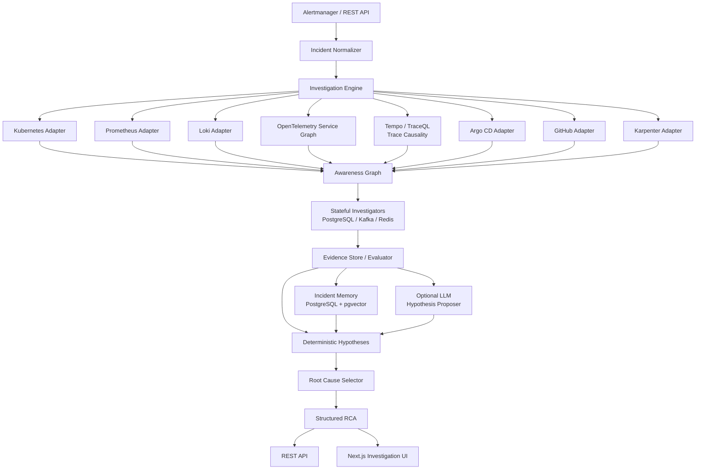

## Investigation lifecycle

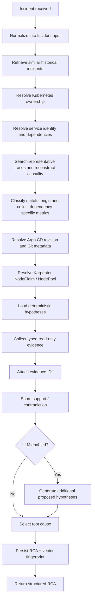

The lifecycle is intentionally evidence-first. Historical incidents and model output can expand context, but neither is allowed to override stronger current telemetry.

## Investigation sequence

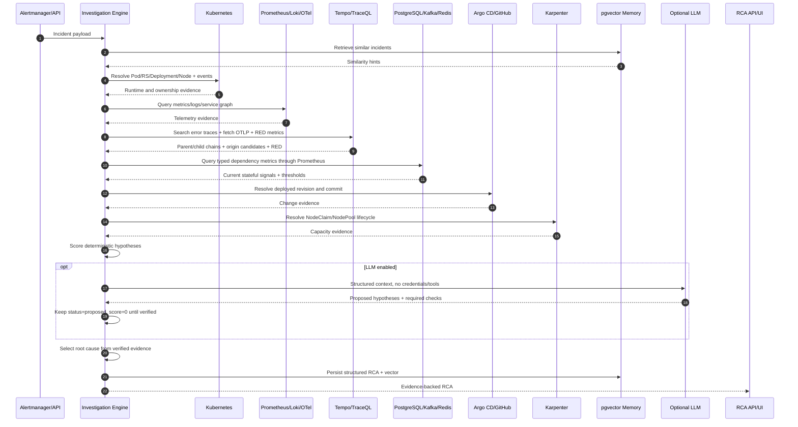

## Causal safety hierarchy

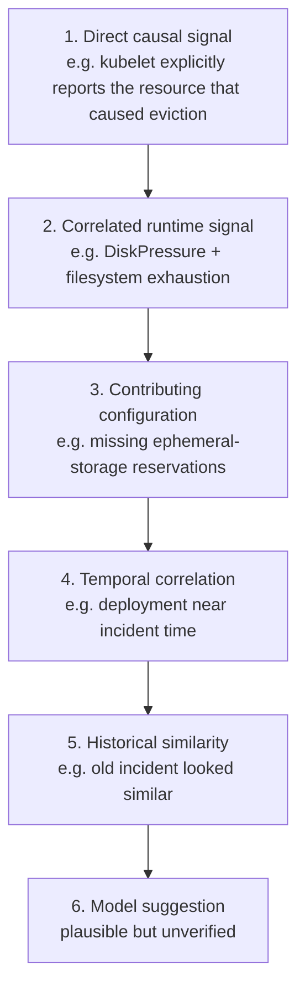

A lower layer cannot override a higher layer unless new typed evidence promotes it.

## Awareness Graph

The API returns explicit `graph_edges`; the frontend does not need to infer relationships from a flat entity list.

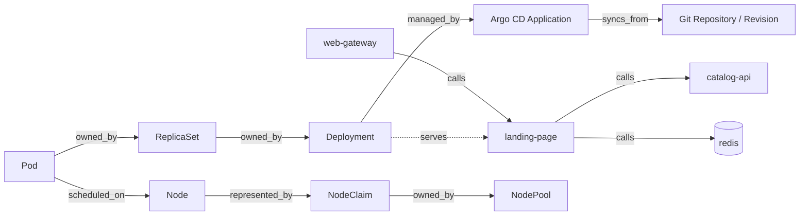

## Change correlation

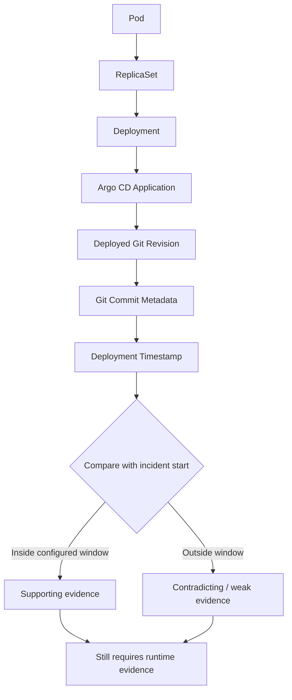

Temporal proximity is intentionally weaker than explicit runtime evidence.

## Service graph source

Tempo metrics-generator, Grafana Alloy or an OTel servicegraph processor can emit Prometheus metrics with `client` and `server` labels. The investigator consumes those metrics from the configured Prometheus-compatible backend.

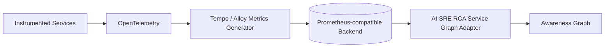

This keeps aggregate topology on typed PromQL queries. Starting in v0.4, the investigator also has **bounded, read-only** Tempo access for per-trace causality.

## Trace-aware causal propagation — v0.4

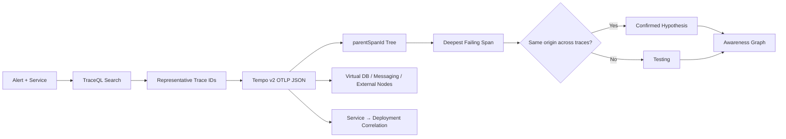

A trace-only root cause requires the same downstream origin to repeat across independent representative traces. One trace cannot confirm root cause. A previously confirmed Kubernetes RCA also keeps precedence over trace evidence.

Details: [docs/trace-causality.md](trace-causality.md).

## Stateful dependency RCA — v0.5

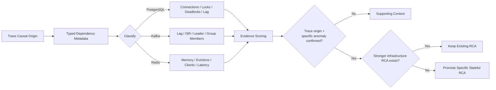

v0.5 does not connect directly to PostgreSQL, Kafka or Redis with administrative credentials. Stateful investigators use allow-listed Prometheus queries and preserve the engine's read-only boundary.

Details: [docs/stateful-dependencies.md](stateful-dependencies.md).

## Incident memory

`SQLRepository` stores the full structured RCA payload, a normalized textual fingerprint and a 128-dimensional vector.

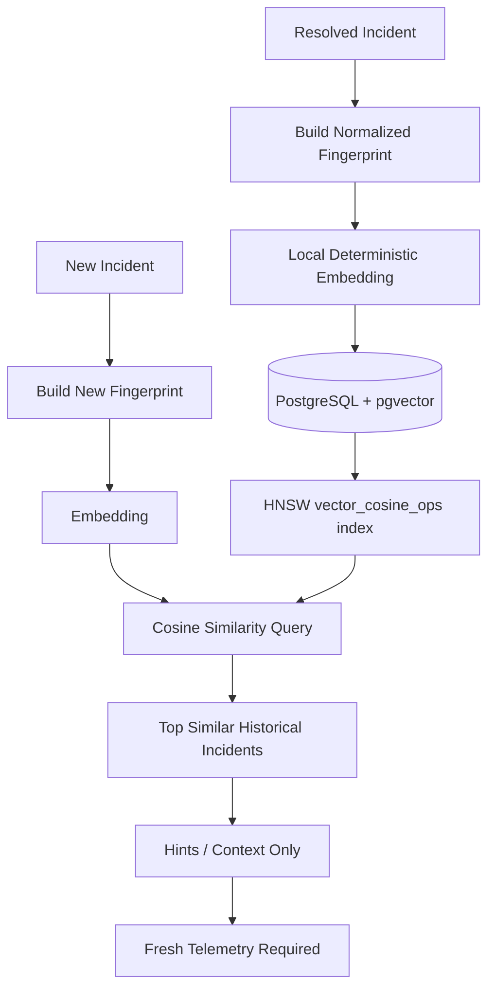

The embedding provider is isolated so a production embedding service can replace the default local implementation later.

## LLM boundary

The optional model is a **hypothesis proposer**, not an infrastructure agent.

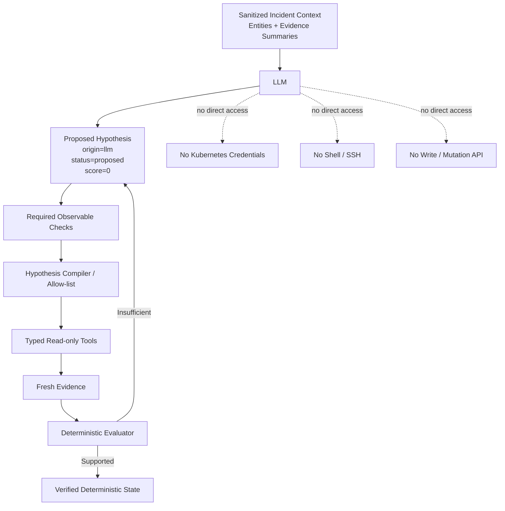

The LLM cannot query Kubernetes directly, execute PromQL/LogQL itself, run shell commands, attach evidence IDs, modify scores, set `confirmed`, or participate directly in primary root-cause selection.

## Security and remediation boundary

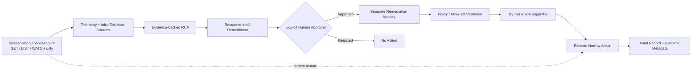

## Production hardening

- NetworkPolicy allowlists for Kubernetes API, telemetry, Argo and Git provider.
- Workload identity or short-lived credentials where supported.
- Secret redaction before any model call.
- Evidence payload hashing and immutable audit sink.
- Per-source query timeouts, range limits and cardinality budgets.
- Tenant and cluster isolation.
- Admission policy that rejects write verbs for the investigator ServiceAccount.
- Separate identity and explicit human approval for any future remediation executor.

## Operational plane — v0.6

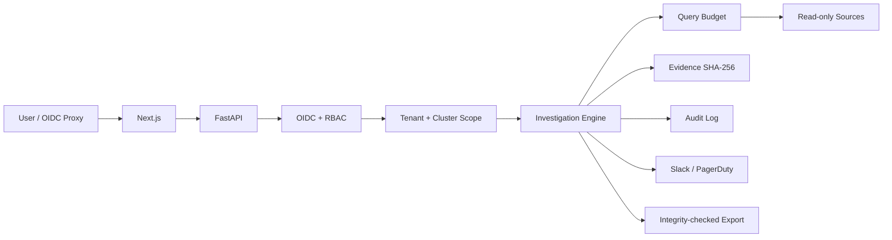

v0.6 adds authentication, tenant/cluster isolation, budgets, retention, audit and operational delivery without changing the investigator's read-only boundary. Full details: [operations.md](operations.md).
