# Architecture — v0.8.0-rc.1

[Português do Brasil](architecture.pt-BR.md) · **English**

## System overview

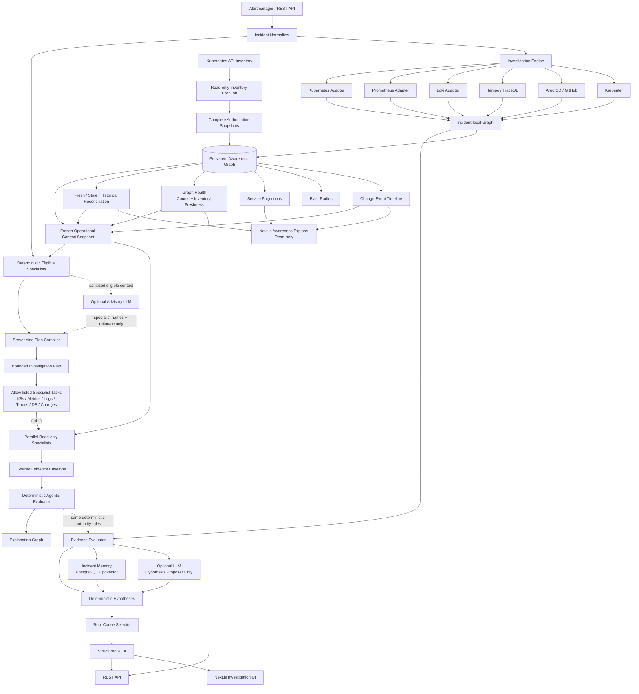


## Automatic Kubernetes inventory reconciliation — v0.8

The automatic inventory path is a separate Kubernetes CronJob rather than a loop inside the API Deployment. It uses the investigator ServiceAccount, which has GET/LIST/WATCH only, and writes only through the existing authoritative graph repository contract.

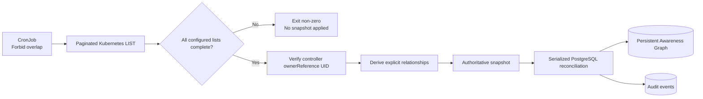

The collector never infers ownership from naming conventions. An `owned_by` edge is emitted only when a single controller `ownerReference` exists and its UID matches the currently observed owner object. Scheduling uses `Pod.spec.nodeName`. Service routing uses exact Service selectors against workload Pod-template labels, so the topology remains stable even when a workload is scaled to zero. Namespace-scoped runs split Node inventory from namespaced resources so a partial namespace scope cannot claim authoritative Pod-to-Node deletion semantics.

## Awareness Graph health — v0.8

Graph health is a read-only factual projection over persisted state. It does not assign a synthetic reliability score and does not use an LLM to infer whether the graph is healthy.

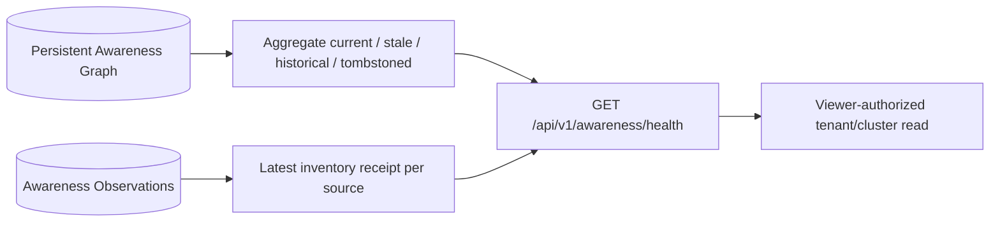

`AWARENESS_STALE_AFTER_MINUTES` controls when active graph facts become stale. `AWARENESS_INVENTORY_MAX_AGE_MINUTES` independently controls whether the latest authoritative snapshot for each configured source is reported as `current` or `stale`; a source with no receipt is `missing`.

## Awareness retention — v0.8

Retention is explicit, admin-only and dry-run by default. It never removes authoritative snapshot receipts in this phase because those receipts protect immutable snapshot identity and replay conflict detection. Historical entity/relationship observations are eligible only after the configured observation window and only when they are not the latest observation for that target.

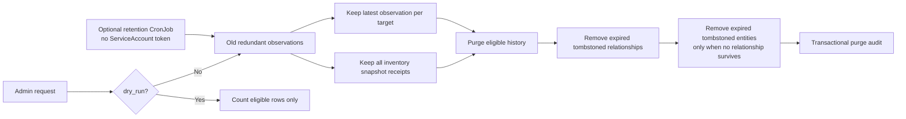

`AWARENESS_OBSERVATION_RETENTION_DAYS` defaults to 90 and `AWARENESS_TOMBSTONE_RETENTION_DAYS` defaults to 30. The retention endpoint is scoped by the same tenant/cluster authorization boundary as the graph APIs. The optional scheduler calls the same repository contract directly with explicit tenant/cluster scope, a dedicated database Secret and `automountServiceAccountToken: false`.

## Agentic Operational Context Snapshot — v0.8

The agentic planner no longer receives only entity/relationship IDs from a one-hop projection. It freezes a bounded operational snapshot that combines reconciled topology, recent graph history, ChangeEvents and Graph Health before task compilation.

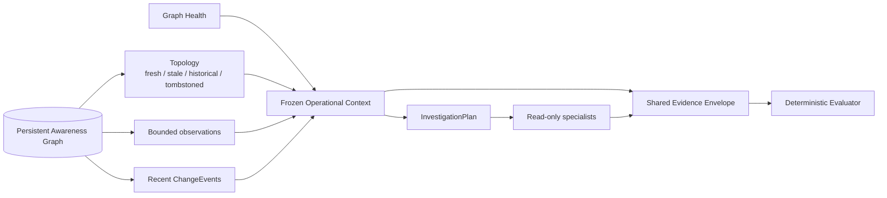

Tombstoned facts remain visible for explanation but are excluded from the task `required_entity_ids`. Persistent ChangeEvents consumed during execution are marked `context_only`. The evaluator explicitly removes context-only references from causal scoring, so persistent context can narrow investigation and preserve continuity without becoming root-cause authority.

The context is hard-bounded by node count, graph depth, number of history targets, observations per target and recent-change count. The optional planner LLM receives only a shallow sanitized projection of this snapshot; it still cannot create tasks, tools, queries, dependencies or verdicts.

## Deterministic specialist scoping — v0.8

The frozen context can narrow live reads without becoming evidence. Specialist scope is server-owned and typed. Explicit incident fields win; missing Pod or Argo CD application identity can be filled only from one fresh candidate in a complete, non-truncated graph projection.

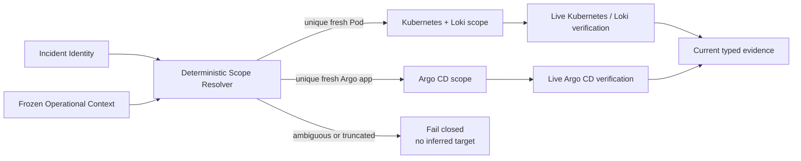

The default operational-context depth is 3 so the bounded service graph can reach Service → Deployment → ReplicaSet → Pod ownership chains. A larger context never authorizes a guess: if the node/edge budget truncates the projection, graph-derived Pod/application resolution is disabled.

## Model-assisted planning compiler — v0.8

Model assistance is an optional advisory layer, not a new execution authority. The deterministic planner first decides which specialist branches are eligible. Only that sanitized, bounded context is sent to the model. The response is compiled back through server-owned policy before a task graph exists.

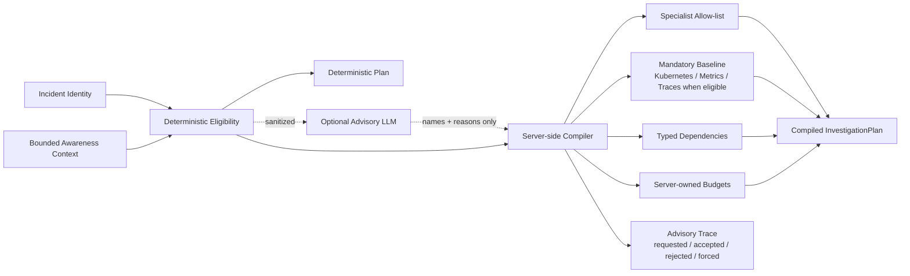

The model cannot provide a tool name, query, command, budget, dependency or remediation action. Unknown and ineligible names are rejected. Model failure, malformed JSON or advice with no eligible specialist preserves the deterministic plan. The executable plan records whether it was `deterministic` or `model-assisted`.

## Shared Kubernetes playbook stage — v0.8

The classic investigation path and the agentic Kubernetes specialist now call the same deterministic Kubernetes stage. There is no second simplified Kubernetes RCA implementation to drift from the core engine.

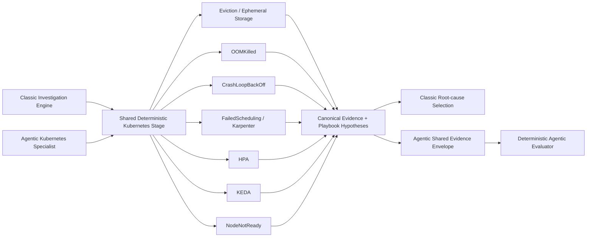

The agentic wrapper adds a dedicated read-only query budget but does not alter playbook scoring, evidence categories, ownership resolution or hypothesis IDs. A budget-exhausted Kubernetes specialist fails closed and cannot be treated as clean infrastructure context.
The root-priority policy is shared as well: when multiple Kubernetes hypotheses are confirmed, the agentic evaluator applies the same scenario-specific specificity ordering used by the classic selector. Any candidate from a non-completed specialist is blocked before selection.

## Investigation lifecycle

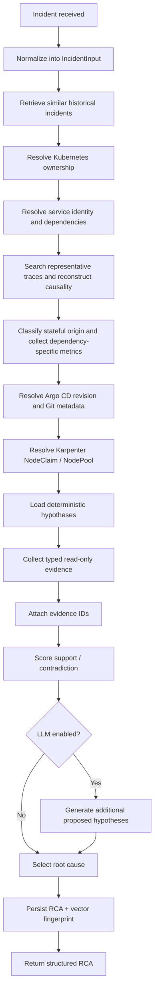

The lifecycle is intentionally evidence-first. Historical incidents and model output can expand context, but neither is allowed to override stronger current telemetry.

## Investigation sequence

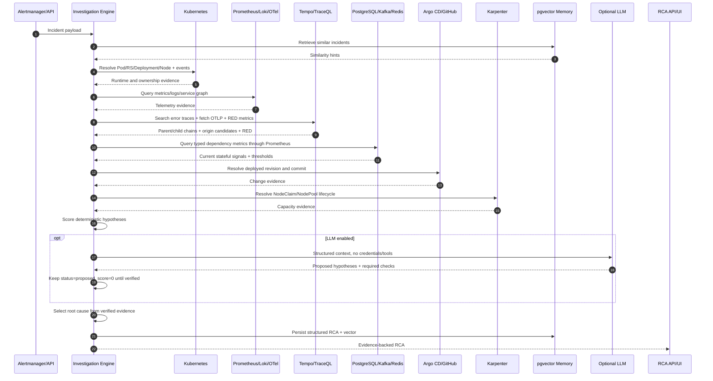

## Causal safety hierarchy

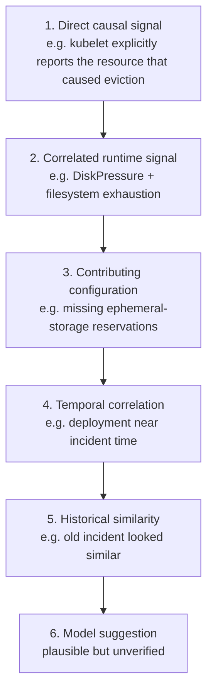

A lower layer cannot override a higher layer unless new typed evidence promotes it.

## Awareness Graph

The API returns explicit `graph_edges`; the frontend does not need to infer relationships from a flat entity list.

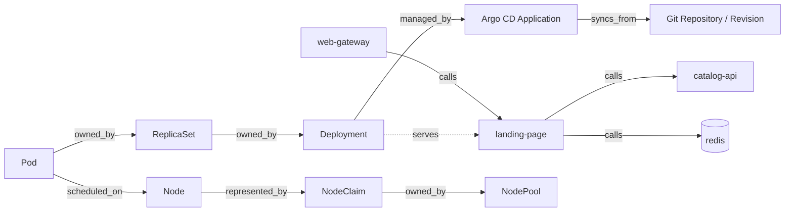

## Change correlation

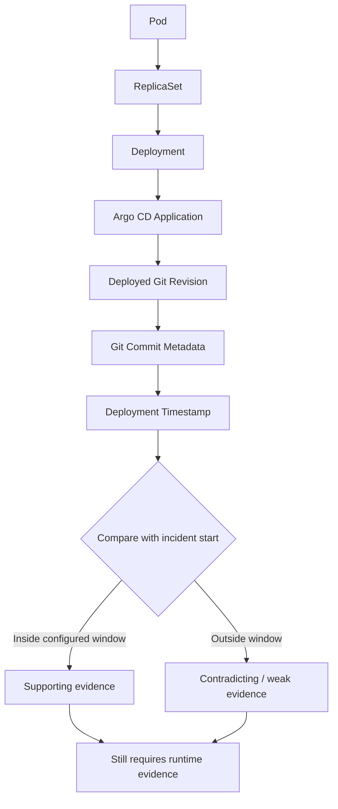

Temporal proximity is intentionally weaker than explicit runtime evidence.

## Service graph source

Tempo metrics-generator, Grafana Alloy or an OTel servicegraph processor can emit Prometheus metrics with `client` and `server` labels. The investigator consumes those metrics from the configured Prometheus-compatible backend.

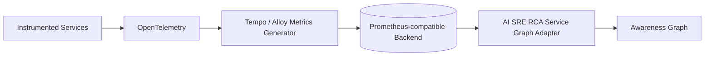

This keeps aggregate topology on typed PromQL queries. Starting in v0.4, the investigator also has **bounded, read-only** Tempo access for per-trace causality.

## Trace-aware causal propagation — v0.4

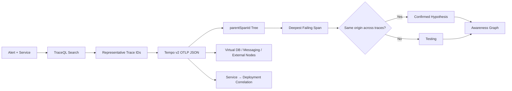

A trace-only root cause requires the same downstream origin to repeat across independent representative traces. One trace cannot confirm root cause. A previously confirmed Kubernetes RCA also keeps precedence over trace evidence.

Details: [docs/trace-causality.md](trace-causality.md).

## Stateful dependency RCA — v0.5

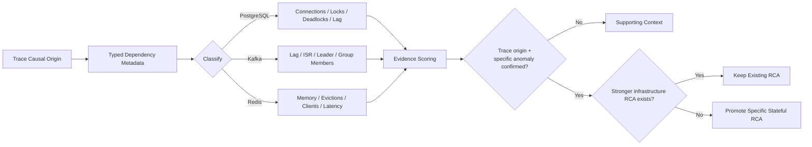

v0.5 does not connect directly to PostgreSQL, Kafka or Redis with administrative credentials. Stateful investigators use allow-listed Prometheus queries and preserve the engine's read-only boundary.

Details: [docs/stateful-dependencies.md](stateful-dependencies.md).

## Incident memory

`SQLRepository` stores the full structured RCA payload, a normalized textual fingerprint and a 128-dimensional vector.

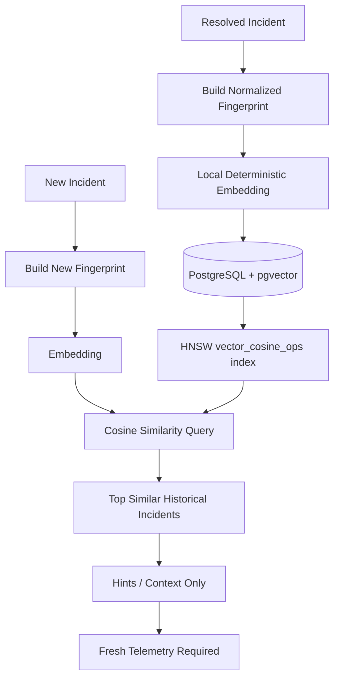

The embedding provider is isolated so a production embedding service can replace the default local implementation later.

## LLM boundary

The optional model is a **hypothesis proposer**, not an infrastructure agent.

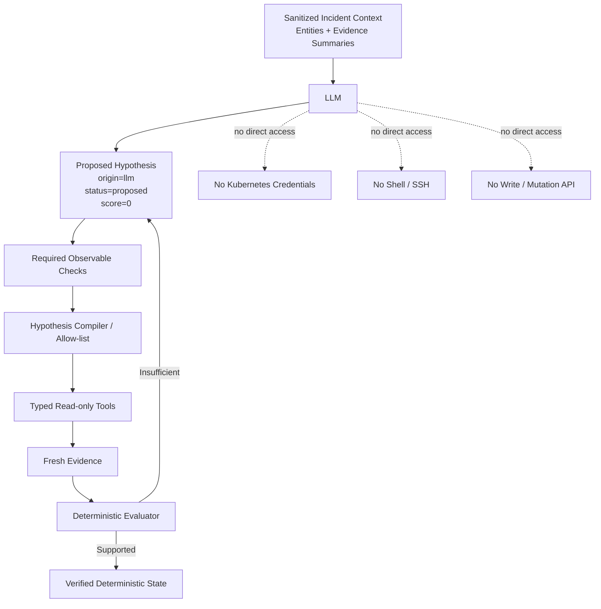

The LLM cannot query Kubernetes directly, execute PromQL/LogQL itself, run shell commands, attach evidence IDs, modify scores, set `confirmed`, or participate directly in primary root-cause selection.

## Security and remediation boundary

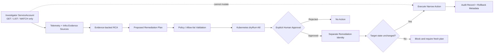

## Production hardening

- NetworkPolicy allowlists for Kubernetes API, telemetry, Argo and Git provider.
- Workload identity or short-lived credentials where supported.
- Secret redaction before any model call.
- Evidence payload hashing and immutable audit sink.
- Per-source query timeouts, range limits and cardinality budgets.
- Tenant and cluster isolation.
- Admission policy that rejects write verbs for the investigator ServiceAccount.
- Separate remediator identity, policy gates, dry-run and explicit human approval for every mutating action.


## Operational plane — v0.6

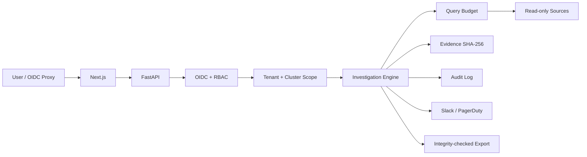

v0.6 adds authentication, tenant/cluster isolation, budgets, retention, audit and operational delivery without changing the investigator's read-only boundary. Full details: [operations.md](operations.md).


## Guarded remediation plane — v0.7

v0.7 implements the remediation boundary as a separate runtime. The investigator has no remediation routes and retains its read-only Kubernetes identity. The remediator is independently deployable and currently exposes only a typed Deployment scale operation.

The remediator uses a separate cluster credential registry, namespace-scoped Helm Roles with get/patch on deployments/scale, server-side dry-run, exact remediator-role approval, four-eyes separation, plan expiration, resourceVersion drift detection and explicit rollback.

Full details: [remediation.md](remediation.md).


## Persistent Awareness Graph and topology services — v0.8

The incident-local graph is now canonicalized and persisted so operational topology can accumulate across investigations without letting local IDs leak across scopes.

```mermaid
flowchart LR
    IR[InvestigationResult<br/>entities + graph_edges] --> CAN[Canonicalizer]
    CAN --> CE[(awareness_entities<br/>current state)]
    CAN --> CR[(awareness_relationships<br/>current state)]
    CAN --> AO[(awareness_observations<br/>append-only history)]

    CE --> REC[Fresh / Stale Reconciliation]
    CR --> REC
    AO --> HIST[Target History API]

    REC --> SP[Service-centric Projection]
    REC --> BR[Blast Radius]
    SP --> PC[Planner Context]
    BR --> API8[v0.8 Awareness APIs]
```

Canonical entity identity is derived from `tenant + cluster + kind + namespace + name`. Relationship identity is derived from the scoped canonical endpoints plus relationship type. Re-saving the same incident is idempotent.

### Authoritative reconciliation without inferred deletion

```mermaid
flowchart TD
    INC[Incident Observation] --> LS[last_seen]
    LS --> CMP{Older than stale threshold?}
    CMP -->|No| F[Fresh]
    CMP -->|Yes| S[Stale]
    S --> KEEP[Keep current record + history]

    API[Admin Inventory Reconcile] --> SRC{Allow-listed source?}
    SRC -->|No| DENY[Reject]
    SRC -->|Yes| COMPLETE{Complete snapshot + explicit coverage?}
    COMPLETE -->|No| DENY
    COMPLETE -->|Yes| DIFF[Diff covered inventory]
    DIFF -->|Present| REFRESH[Refresh / Reactivate]
    DIFF -->|Absent and no newer observation| T[Tombstone]
    DIFF -->|Newer graph fact exists| PRESERVE[Preserve newer fact]
```

Incident observations remain partial and can never delete graph state. Tombstones are produced only by a complete, admin-authorized snapshot from an allow-listed authoritative source. The scope is explicit by kind, namespace and relationship type. Tombstones remain in history/topology, are visible in the Awareness Explorer, and are excluded from current entity resolution and blast-radius traversal.

### Service projection

```mermaid
flowchart LR
    SVC[Canonical Service] --> N1[Depth 1 Neighbors]
    N1 --> N2[Depth 2 Neighbors]
    N2 --> NX[Up to configured depth]

    B1[Max depth] --> SVC
    B2[Max nodes] --> SVC
    B3[Max edges] --> SVC

    SVC --> OUT[Bounded Service Topology]
    N1 --> OUT
    N2 --> OUT
    NX --> OUT
```

The lookup is exact. If the same service name exists in multiple namespaces, a namespace is required rather than selecting an arbitrary node.

### Causal blast radius

Stored graph direction and impact direction are intentionally separate.

```mermaid
flowchart LR
    FE[frontend] -->|calls| CO[checkout]
    CO -->|calls| PG[(postgres)]
    DEP[checkout Deployment] -->|serves| CO

    PG -. impact: reverse calls .-> CO
    CO -. impact: reverse calls .-> FE
    DEP -. impact: forward serves .-> CO
```

Known relationship types are compiled through an explicit impact-direction allow-list. Unknown relationships are returned by topology APIs but never traversed for blast radius. Stale relationships are historical context only and are skipped during current-impact propagation.

## Bounded Investigation Planner — v0.8

The planner is deterministic and bounded. It uses incident identity, feature flags and a frozen Operational Context Snapshot containing bounded topology, history, ChangeEvents and Graph Health to compile typed specialist branches. Parallel specialist execution is implemented as an opt-in read-only runtime and is disabled by default.

```mermaid
flowchart TD
    INC[IncidentInput] --> PLAN[Deterministic Planner]
    PAG[Persistent Awareness Graph] --> CTX[Frozen Operational Context]
    CTX --> PLAN
    CFG[Server Budgets + Feature Flags] --> PLAN

    PLAN --> K[Kubernetes Task]
    PLAN --> M[Metrics Task]
    PLAN --> L[Logs Task]
    PLAN --> T[Traces Task]
    T --> DB[Database / Stateful Task]
    PLAN --> CH[Changes Task]

    K --> IP[InvestigationPlan]
    M --> IP
    L --> IP
    T --> IP
    DB --> IP
    CH --> IP

    IP -->|AGENTIC_EXECUTION_ENABLED=true| ORCH[Parallel Specialist Execution]
    ORCH --> SR[Typed Specialist Results]
    SR --> ENV[Shared Evidence Envelope]
    ENV --> HASH{Integrity verified?}
    HASH -->|No| INC[Inconclusive]
    HASH -->|Yes| SCORE[Re-score Playbook Hypotheses]
    SCORE --> CAUSAL[Trace / Stateful Causal Gates]
    CAUSAL --> PRE[Source Precedence]
    PRE --> EV[Deterministic Verdict]
    EV --> EX[Rejected-hypothesis Explanation Graph]
```

Planner safety properties:

- only six allow-listed specialist task kinds exist;
- every task is read-only;
- task count, topology depth/nodes, history targets, observations per target, recent changes, parallelism and per-specialist query budget are server bounded;
- specialist scope is server-owned and graph-derived identities require one fresh candidate in a non-truncated projection;
- ambiguous graph scope fails closed instead of selecting by list order;
- tombstoned facts remain visible in operational context but are excluded from current `required_entity_ids`;
- context-only persistent records are rejected from causal hypothesis scoring;
- database/stateful work depends on the trace task so dependency identity is typed before dependency telemetry is queried;
- the planner cannot confirm hypotheses, attach evidence, invoke mutation or bypass the separate remediation plane;
- the execution endpoint recompiles the plan server-side, so caller-authored task graphs are never executed;
- specialist hypotheses are advisory-only and the shared execution response has no root-cause field;
- local specialist budgets and the existing global query budget both apply;
- evidence hashes are verified before evidence is accepted into the shared envelope;
- the evaluator re-scores playbook hypotheses from integrity-verified evidence instead of trusting specialist-local status;
- missing support or contradiction references fail closed and block root-cause selection;
- trace-only selection still requires repeated origin across independent representative traces;
- stateful selection still requires trace-origin identity plus dependency-specific current telemetry;
- direct Kubernetes failure signals block downstream trace/stateful promotion;
- a planned higher-precedence Kubernetes specialist must complete before downstream trace/stateful candidates can be selected;
- `/execute` still returns no root cause; only `/investigate` can return a deterministic verdict;
- agentic execution is disabled by default.

Full details: [persistent-awareness-graph.md](persistent-awareness-graph.md) and [agentic-investigation.md](agentic-investigation.md).


## Deterministic shared-envelope evaluator — v0.8

The evaluator is a separate authority boundary after specialist execution.

```mermaid
flowchart TD
    ENV[Shared Evidence Envelope] --> I{All evidence hashes valid?}
    I -->|No| FAIL[Fail Closed: Inconclusive]
    I -->|Yes| REF[Validate Hypothesis Evidence References]
    REF --> SCORE[Recalculate Weighted Score]
    SCORE --> TG{Trace-only Candidate?}
    TG -->|Yes| TR[Require Repeated Origin Across 2+ Traces]
    TG -->|No| SG{Stateful Candidate?}
    SG -->|Yes| ST[Require causal_role=origin + Trace Evidence + Dependency Telemetry]
    SG -->|No| PRE[Apply Source Precedence]
    TR --> PRE
    ST --> PRE
    PRE --> K{Direct Kubernetes Failure Signal?}
    K -->|Yes| BLOCK[Block Downstream Promotion]
    K -->|No| PICK[Select Highest-precedence Confirmed Hypothesis]
    PICK --> ROOT[Deterministic Root Cause]
    BLOCK --> INC[Inconclusive Until Higher-precedence Playbook Exists]
    ROOT --> EX[Explanation Graph]
    INC --> EX
```

The explanation graph makes negative reasoning explicit. Evidence nodes connect to hypotheses with `supports` or `contradicts`; gates connect with `blocks`; hypotheses connect to the verdict with `selected` or `considered`.

This stage remains read-only and cannot invoke remediation. It does not trust a specialist's local `confirmed` status. It independently recalculates score and gate eligibility from the integrity-verified shared envelope.


## First-class deployment/change events — v0.8

Deployment changes are persisted as immutable `ChangeEvent` nodes derived only from collected Argo CD `change-correlation` evidence. Matching GitHub `source-change` evidence enriches the same event with commit metadata.

```mermaid
flowchart LR
    AR[Argo CD change-correlation evidence] --> CE[ChangeEvent]
    GH[GitHub source-change evidence] --> CE

    CE -->|observed_on| APP[ArgoCDApplication]
    CE -->|targets| DEP[Deployment]
    CE -->|targets_service| SVC[Service]
    CE -->|revision_from| REPO[GitRepository]

    CE -. temporal context only .-> CTX[Incident / planner context]
    CE -. never auto-causal .-> NO[Not in blast-radius impact allow-list]
```

A ChangeEvent has stable identity from `application + revision + occurred_at`. Reobserving the same deployment from another incident increments its observation count instead of creating a duplicate event.

Change events and their event relationships use `temporal_role=event` and reconcile as `historical`, not `fresh` or `stale`. This distinction is deliberate: topology can become stale, while a deployment that happened in the past remains a valid historical fact.

The bounded temporal API is:

```text
GET /api/v1/awareness/changes?cluster=<cluster>&service=<service>&namespace=<namespace>&since=<iso8601>&until=<iso8601>&limit=100
```

The endpoint remains tenant/cluster scoped and returns at most 200 events. Temporal proximity is context only and never upgrades a deployment/source change into root cause without runtime causal evidence.


## Real environment validation — v0.8.0-rc.1

The release-candidate gate runs the production read-only Kubernetes adapter against a disposable two-node Kind cluster. Controlled workloads create actual Kubernetes runtime and scheduler states, while PostgreSQL/pgvector persists authoritative inventory and graph reconciliation.

```mermaid
flowchart LR
    GA[GitHub Actions / local] --> VH[Real Environment Validation Harness]
    VH --> KIND[2-node Kind cluster]
    VH --> PG[(PostgreSQL + pgvector)]
    KIND --> OOM[OOMKilled]
    KIND --> CRASH[CrashLoopBackOff]
    KIND --> SCHED[FailedScheduling]
    KIND --> RBAC[Read-only ServiceAccount]
    RBAC --> HTTP[Production ReadOnlyHTTPTools]
    HTTP --> CORE[Classic deterministic engine]
    HTTP --> AG[Agentic Kubernetes specialist]
    HTTP --> INV[Authoritative inventory reconciliation]
    INV --> PAG[(Persistent Awareness Graph)]
    CORE --> PARITY[Expected root-cause parity]
    AG --> PARITY
    PAG --> GRAPH[owned_by / serves / scheduled_on + tombstone]
    PARITY --> REPORT[JSON + Markdown release evidence]
    GRAPH --> REPORT
```

The validator uses an ephemeral bearer token and cluster CA compatible with the production integration contract. Those credentials remain local to the job and are excluded from uploaded artifacts. Prometheus, Loki, Tempo and Argo CD are intentionally unreachable in the first RC gate so optional-source failure handling is exercised without weakening direct Kubernetes evidence. The Kind node image is pinned by digest for reproducibility.

See [../validation/README.md](../validation/README.md) for the runnable contract and exact PASS/FAIL conditions.
