# Arquitetura — v0.8 em desenvolvimento

**Português do Brasil** · [English](architecture.md)

## Visão geral do sistema

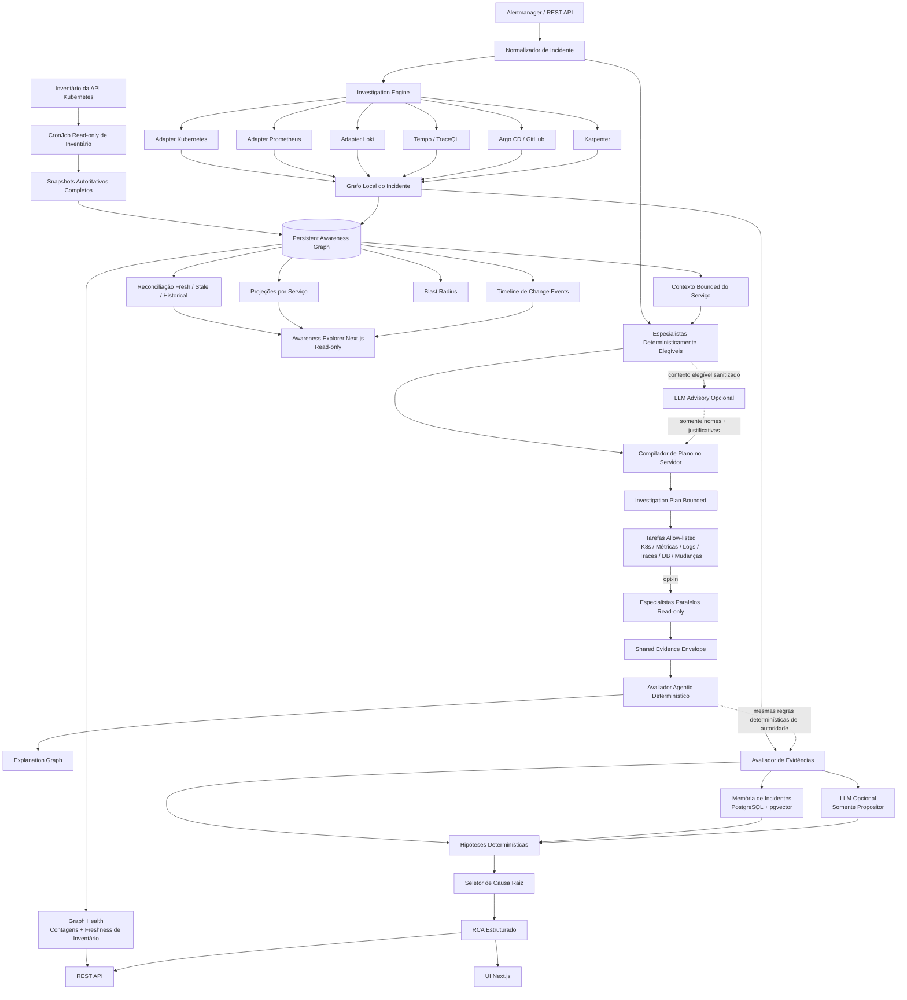


## Reconciliação automática do inventário Kubernetes — v0.8

O caminho automático de inventário roda em um CronJob Kubernetes separado, e não em um loop dentro do Deployment da API. Ele usa o ServiceAccount do investigador, com somente GET/LIST/WATCH, e grava exclusivamente pelo contrato autoritativo já existente no repositório do grafo.

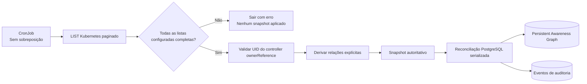

O collector nunca infere ownership por convenção de nomes. Uma aresta `owned_by` só é emitida quando existe um único `ownerReference` controlador e seu UID corresponde ao objeto owner observado no snapshot. Scheduling usa `Pod.spec.nodeName`. O roteamento de Service usa selectors exatos contra os labels do Pod template do workload, preservando a topologia mesmo com o workload escalado para zero. Execuções limitadas por namespace separam o inventário de Nodes dos recursos namespaced para que um escopo parcial não afirme deleções Pod-to-Node como autoritativas.

## Graph Health do Awareness Graph — v0.8

Graph Health é uma projeção factual e read-only do estado persistido. Ela não atribui um score sintético de confiabilidade e não usa LLM para inferir se o grafo está saudável.

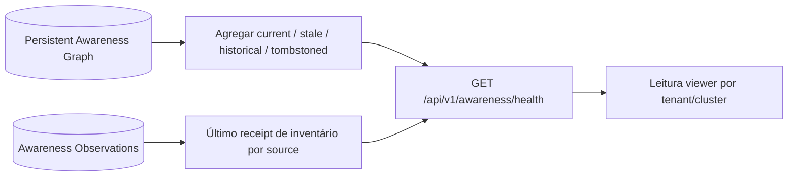

`AWARENESS_STALE_AFTER_MINUTES` controla quando fatos ativos do grafo ficam stale. `AWARENESS_INVENTORY_MAX_AGE_MINUTES` controla separadamente quando o snapshot autoritativo mais recente de cada source configurada passa de `current` para `stale`; uma source sem receipt aparece como `missing`.

## Retention do Awareness Graph — v0.8

A retention é explícita, admin-only e roda em dry-run por padrão. Nesta fase ela nunca remove receipts autoritativos de snapshot, pois esses receipts protegem a identidade imutável do snapshot e a detecção de conflito em replays. Observações históricas de entidades/relações só ficam elegíveis depois da janela configurada e quando não são a observação mais recente daquele alvo.

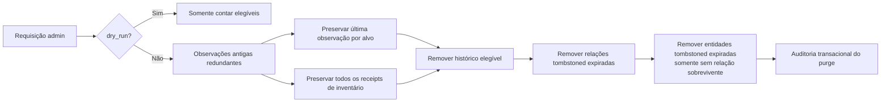

`AWARENESS_OBSERVATION_RETENTION_DAYS` tem padrão 90 e `AWARENESS_TOMBSTONE_RETENTION_DAYS` tem padrão 30. O endpoint usa a mesma fronteira de autorização por tenant/cluster das APIs do grafo.

## Compilador de planejamento assistido por modelo — v0.8

A assistência do modelo é uma camada advisory opcional, não uma nova autoridade de execução. Primeiro, o planner determinístico decide quais ramos especialistas são elegíveis. Somente esse contexto sanitizado e bounded é enviado ao modelo. A resposta volta para um compilador controlado pelo servidor antes de existir qualquer grafo de tarefas executável.

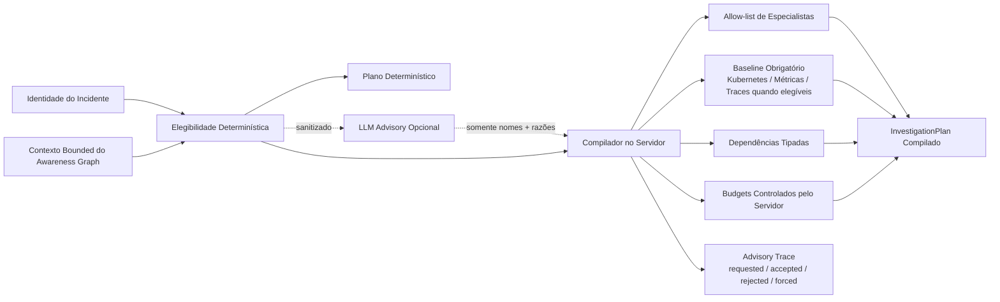

O modelo não pode fornecer nome de ferramenta, query, comando, budget, dependência ou ação de remediação. Nomes desconhecidos ou inelegíveis são rejeitados. Falha do modelo, JSON inválido ou conselho sem especialista elegível preserva o plano determinístico. O plano executável registra se sua origem foi `deterministic` ou `model-assisted`.

## Etapa Kubernetes compartilhada — v0.8

O caminho clássico de investigação e o specialist Kubernetes agentic agora chamam a mesma etapa determinística Kubernetes. Não existe uma segunda implementação simplificada de RCA Kubernetes que possa divergir do core engine.

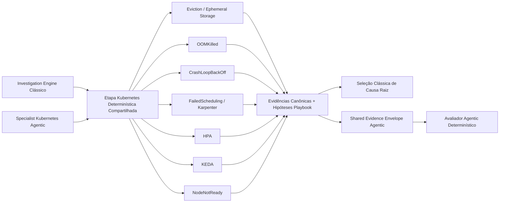

O wrapper agentic adiciona um budget read-only próprio, mas não altera scoring dos playbooks, categorias de evidência, resolução de ownership ou IDs de hipóteses. Um specialist Kubernetes com budget esgotado falha fechado e não pode ser interpretado como contexto de infraestrutura saudável.
A política de prioridade de causa raiz também é compartilhada: quando múltiplas hipóteses Kubernetes estão confirmadas, o evaluator agentic aplica a mesma ordem de especificidade por cenário usada pelo seletor clássico. Qualquer candidate vindo de um specialist que não concluiu é bloqueado antes da seleção.

## Ciclo de investigação

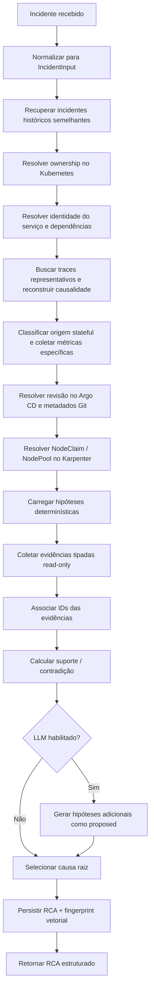

O ciclo é propositalmente **evidence-first**. Incidentes históricos e saída do modelo podem ampliar o contexto, mas não podem substituir telemetria atual mais forte.

## Sequência de investigação

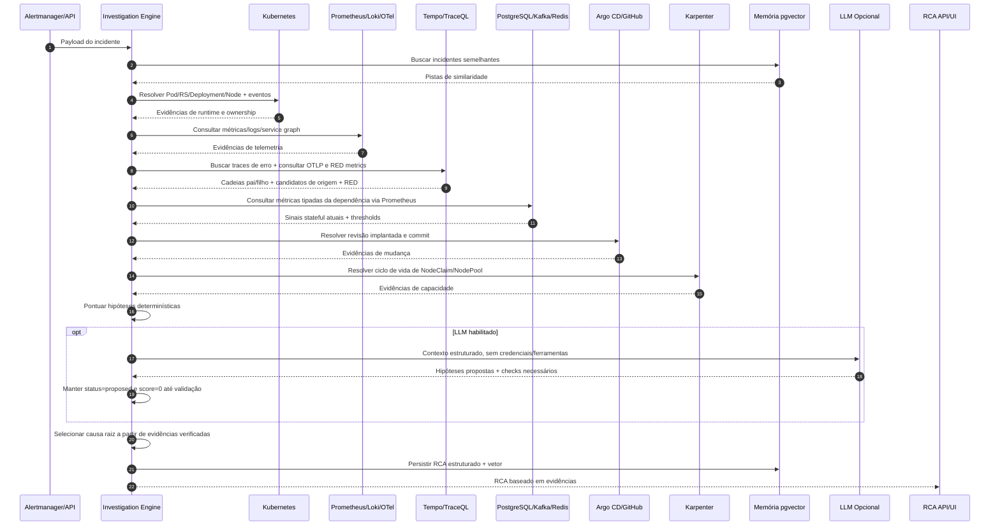

## Hierarquia de segurança causal

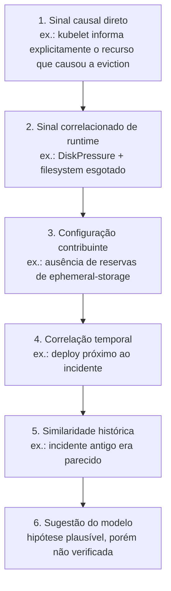

Uma camada inferior não pode sobrepor uma superior sem nova evidência tipada que a promova.

## Awareness Graph

A API retorna `graph_edges` explícitas; o frontend não precisa inferir relacionamentos a partir de uma lista plana de entidades.

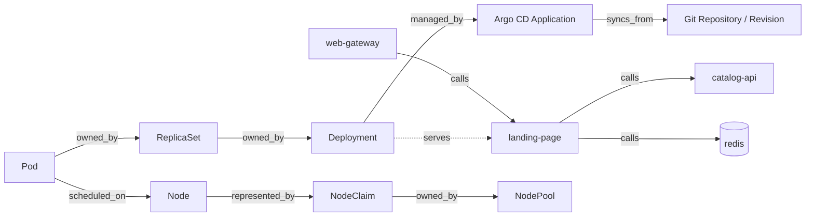

## Correlação de mudanças

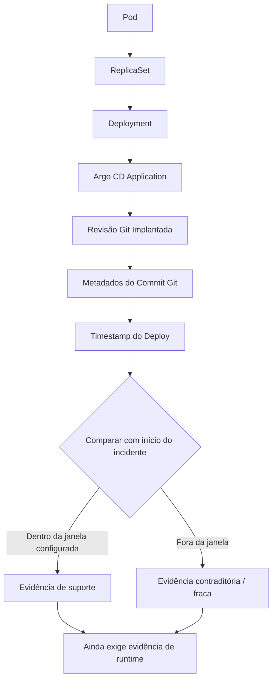

Proximidade temporal é propositalmente mais fraca do que evidência explícita de runtime.

## Origem do Service Graph

O metrics-generator do Tempo, Grafana Alloy ou um processor `servicegraph` do OTel pode emitir métricas Prometheus com labels `client` e `server`. O investigador consome essas métricas do backend Prometheus compatível configurado.

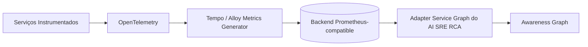

Isso mantém a topologia agregada baseada em consultas PromQL tipadas. A partir da v0.4, o investigador também possui acesso **read-only e limitado** ao Tempo para causalidade por trace.

## Propagação causal por traces — v0.4

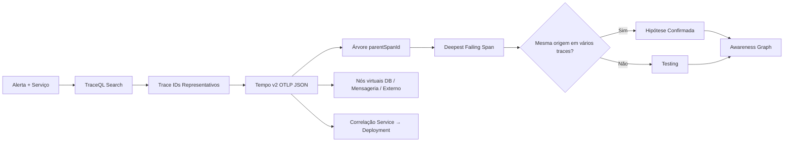

A confirmação puramente trace-aware exige repetição da mesma origem downstream em traces independentes. Um único trace não confirma causa raiz. Um RCA Kubernetes já confirmado também mantém precedência sobre evidência de trace.

Detalhes: [docs/trace-causality.pt-BR.md](trace-causality.pt-BR.md).

## RCA de dependências stateful — v0.5

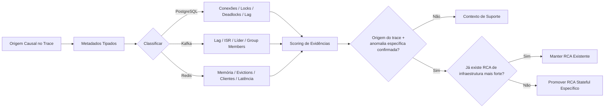

A v0.5 não acessa PostgreSQL, Kafka ou Redis diretamente com credenciais administrativas. Os investigadores stateful usam consultas Prometheus allow-listed e mantêm a mesma fronteira read-only da engine.

Detalhes: [docs/stateful-dependencies.pt-BR.md](stateful-dependencies.pt-BR.md).

## Memória de incidentes

`SQLRepository` armazena o payload completo do RCA estruturado, um fingerprint textual normalizado e um vetor de 128 dimensões.

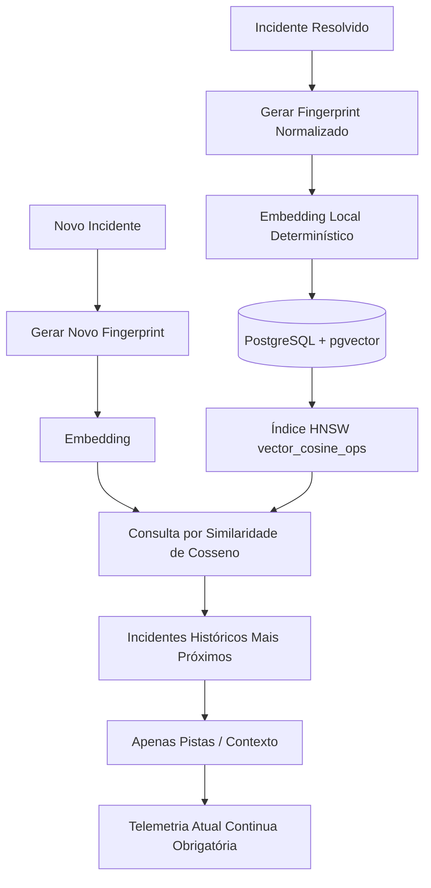

O provider de embeddings é isolado para que uma solução de produção possa substituir a implementação local padrão posteriormente.

## Boundary do LLM

O modelo opcional é um **propositor de hipóteses**, não um agente de infraestrutura.

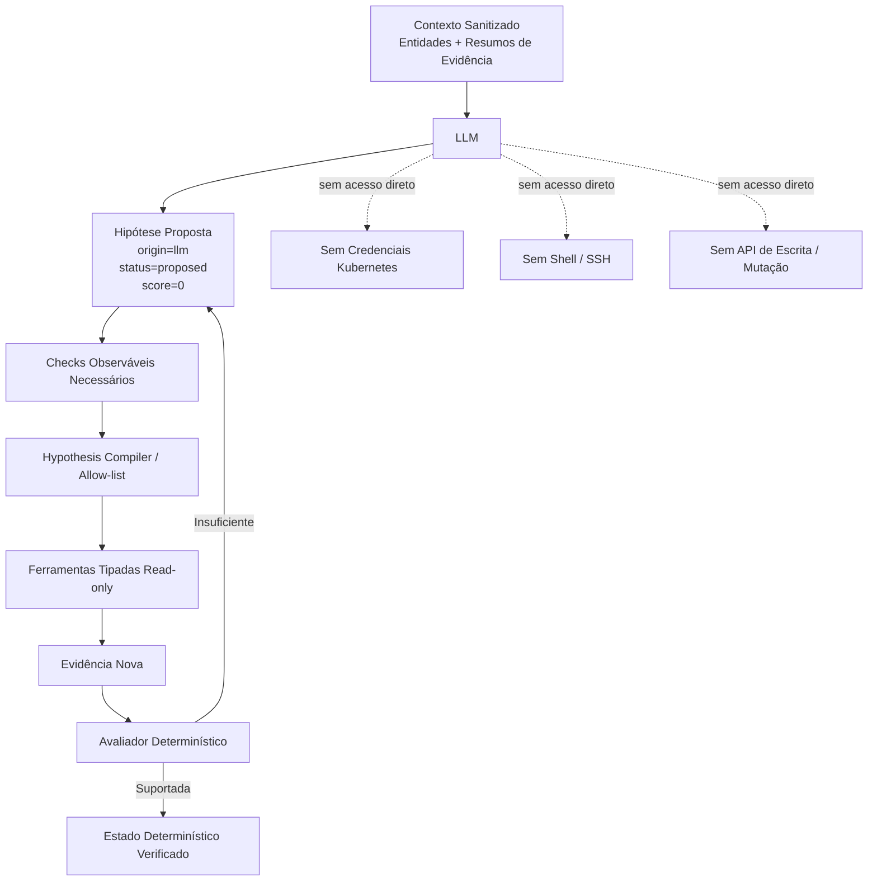

O LLM não pode consultar Kubernetes diretamente, executar PromQL/LogQL por conta própria, usar shell, anexar IDs de evidência, alterar scores, definir `confirmed` nem participar diretamente da seleção primária da causa raiz.

## Limite entre investigação e remediação

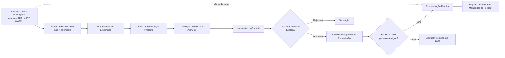

## Hardening para produção

- Allow-lists de NetworkPolicy para Kubernetes API, telemetria, Argo e provedor Git.
- Workload identity ou credenciais de curta duração quando suportado.
- Redação de secrets antes de qualquer chamada ao modelo.
- Hash dos payloads de evidência e audit sink imutável.
- Timeouts, limites de janela e budgets de cardinalidade por fonte.
- Isolamento por tenant e cluster.
- Admission policy rejeitando verbos de escrita para o ServiceAccount do investigador.
- Identidade separada do remediator, gates de política, dry-run e aprovação humana explícita para toda ação mutável.


## Plano operacional — v0.6

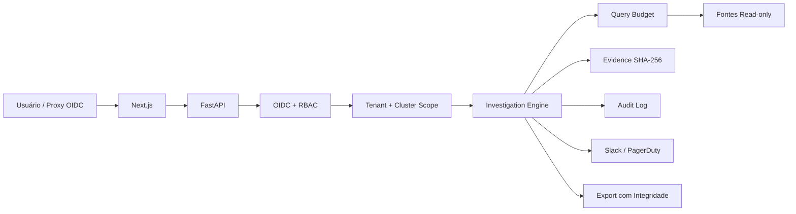

A v0.6 adiciona autenticação, isolamento de tenant/cluster, budgets, retenção, auditoria e entrega operacional sem alterar o boundary read-only do investigador. Detalhes completos: [operations.pt-BR.md](operations.pt-BR.md).


## Plano de remediação guardada — v0.7

A v0.7 implementa o boundary de remediação como outro runtime. O investigator não expõe rotas de remediação e continua usando identidade Kubernetes read-only. O remediator pode ser implantado separadamente e atualmente expõe apenas scale tipado de Deployment.

O remediator usa registry separado de credenciais, Roles Helm por namespace com get/patch somente em deployments/scale, dry-run server-side, aprovação com papel remediator exato, regra de quatro olhos, expiração de plano, detecção de drift por resourceVersion e rollback explícito.

Detalhes: [remediation.pt-BR.md](remediation.pt-BR.md).


## Persistent Awareness Graph e serviços de topologia — v0.8

O grafo local do incidente agora é canonicalizado e persistido, permitindo que a topologia operacional se acumule entre investigações sem deixar IDs locais vazarem entre escopos.

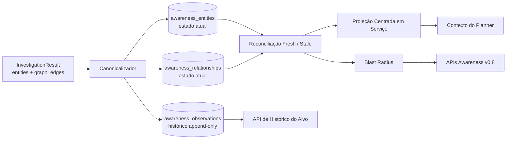

A identidade canônica da entidade deriva de `tenant + cluster + kind + namespace + name`. A identidade da relação deriva dos endpoints canônicos no mesmo escopo mais o tipo da relação. Persistir novamente o mesmo incidente é idempotente.

### Reconciliação autoritativa sem inferir deleção

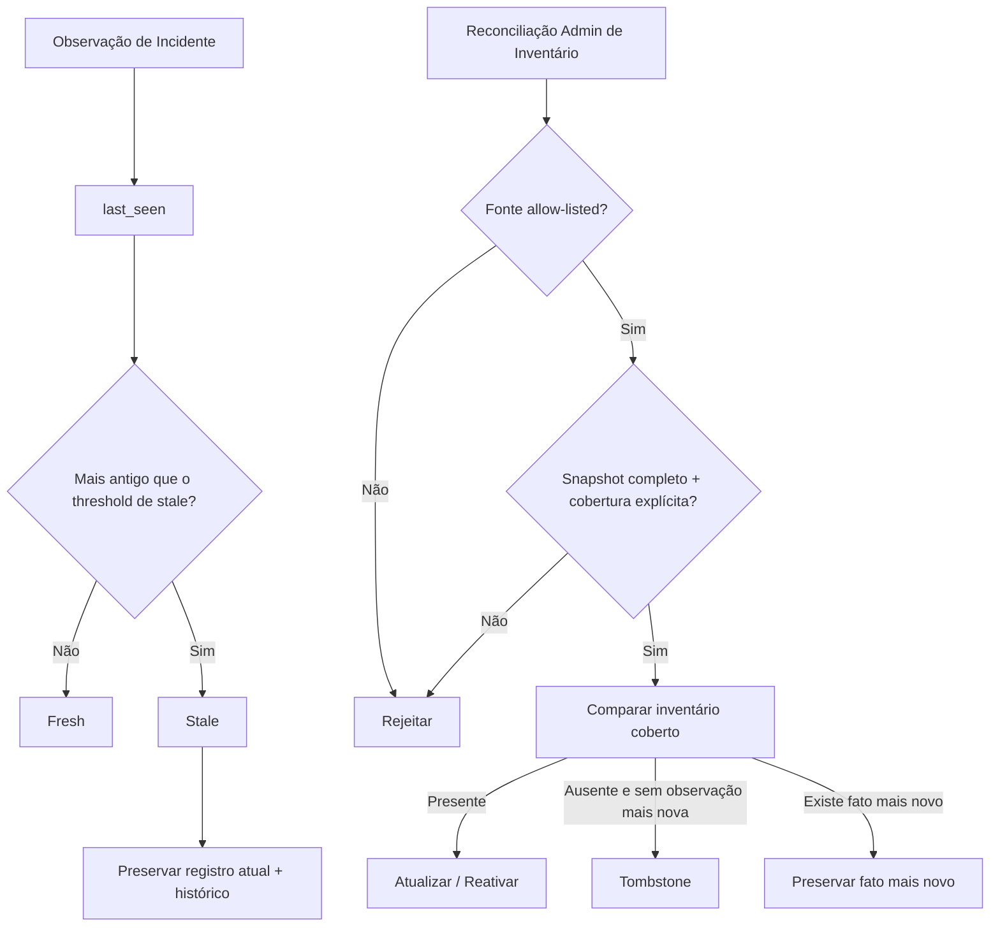

Observações de incidentes continuam parciais e nunca removem estado do grafo. Tombstones só são produzidos por snapshot completo, autorizado para admin e vindo de fonte autoritativa allow-listed. O escopo é explícito por kind, namespace e tipo de relação. Tombstones permanecem no histórico/topologia, aparecem no Awareness Explorer e ficam fora da resolução corrente de entidades e da travessia de blast radius.

### Projeção de serviço

```mermaid
flowchart LR
    SVC[Service Canônico] --> N1[Vizinhos Depth 1]
    N1 --> N2[Vizinhos Depth 2]
    N2 --> NX[Até a profundidade configurada]

    B1[Max depth] --> SVC
    B2[Max nodes] --> SVC
    B3[Max edges] --> SVC

    SVC --> OUT[Topologia Bounded do Serviço]
    N1 --> OUT
    N2 --> OUT
    NX --> OUT
```

A busca é exata. Se o mesmo nome de serviço existir em namespaces diferentes, o namespace passa a ser obrigatório em vez de escolher um nó arbitrariamente.

### Blast radius causal

A direção armazenada no grafo e a direção de impacto são propositalmente separadas.

```mermaid
flowchart LR
    FE[frontend] -->|calls| CO[checkout]
    CO -->|calls| PG[(postgres)]
    DEP[Deployment checkout] -->|serves| CO

    PG -. impacto: calls reverso .-> CO
    CO -. impacto: calls reverso .-> FE
    DEP -. impacto: serves forward .-> CO
```

Tipos de relação conhecidos passam por uma allow-list explícita de direção de impacto. Relações desconhecidas aparecem nas APIs de topologia, mas nunca são percorridas no blast radius. Relações stale são apenas contexto histórico e são ignoradas na propagação de impacto atual.

## Investigation Planner Bounded — v0.8

O planner é determinístico e bounded. Ele usa a identidade do incidente, feature flags e um neighborhood bounded do serviço para compilar ramos tipados de especialistas. A execução paralela está implementada como runtime read-only opt-in e fica desabilitada por padrão.

```mermaid
flowchart TD
    INC[IncidentInput] --> PLAN[Planner Determinístico]
    PAG[Persistent Awareness Graph] --> CTX[Contexto Bounded de 1 Salto]
    CTX --> PLAN
    CFG[Budgets do Servidor + Feature Flags] --> PLAN

    PLAN --> K[Tarefa Kubernetes]
    PLAN --> M[Tarefa Métricas]
    PLAN --> L[Tarefa Logs]
    PLAN --> T[Tarefa Traces]
    T --> DB[Tarefa Database / Stateful]
    PLAN --> CH[Tarefa Mudanças]

    K --> IP[InvestigationPlan]
    M --> IP
    L --> IP
    T --> IP
    DB --> IP
    CH --> IP

    IP -->|AGENTIC_EXECUTION_ENABLED=true| ORCH[Execução Paralela de Especialistas]
    ORCH --> SR[Resultados Tipados dos Especialistas]
    SR --> ENV[Shared Evidence Envelope]
    ENV --> HASH{Integridade verificada?}
    HASH -->|Não| INC[Inconclusivo]
    HASH -->|Sim| SCORE[Recalcular Hipóteses Playbook]
    SCORE --> CAUSAL[Gates Causais Trace / Stateful]
    CAUSAL --> PRE[Precedência por Fonte]
    PRE --> EV[Verdict Determinístico]
    EV --> EX[Explanation Graph de Hipóteses Descartadas]
```

Propriedades de segurança do planner:

- existem somente seis tipos allow-listed de tarefas especialistas;
- toda tarefa é read-only;
- quantidade de tarefas, contexto do grafo, paralelismo e budget de queries por especialista têm limites no servidor;
- database/stateful depende da tarefa de traces para que a identidade da dependência seja tipada antes de consultar telemetria específica;
- o planner não confirma hipóteses, não anexa evidências, não executa mutações e não contorna o plano de remediação separado;
- o endpoint de execução recompila o plano no servidor, então grafos de tarefas escritos pelo caller nunca são executados;
- hipóteses dos especialistas são advisory-only e a resposta compartilhada não possui campo de causa raiz;
- budgets locais por especialista e o query budget global já existente continuam ativos;
- hashes das evidências são verificados antes de entrar no shared envelope;
- o evaluator recalcula hipóteses playbook usando apenas evidências verificadas, em vez de confiar no status local dos specialists;
- referências de suporte ou contradição ausentes falham de forma fechada e bloqueiam seleção de causa raiz;
- seleção puramente trace-aware continua exigindo origem repetida em traces independentes;
- seleção stateful continua exigindo identidade de origem no trace mais telemetria atual específica da dependência;
- sinais Kubernetes diretos bloqueiam promoção downstream de trace/stateful;
- um specialist Kubernetes de maior precedência que foi planejado precisa concluir antes de qualquer candidato downstream de trace/stateful ser selecionado;
- `/execute` continua sem causa raiz; somente `/investigate` pode retornar verdict determinístico;
- a execução agentic fica desabilitada por padrão.

Detalhes: [persistent-awareness-graph.pt-BR.md](persistent-awareness-graph.pt-BR.md) e [agentic-investigation.pt-BR.md](agentic-investigation.pt-BR.md).


## Avaliador determinístico do shared envelope — v0.8

O evaluator é uma fronteira de autoridade separada depois da execução dos especialistas.

```mermaid
flowchart TD
    ENV[Shared Evidence Envelope] --> I{Todos os hashes são válidos?}
    I -->|Não| FAIL[Fail Closed: Inconclusivo]
    I -->|Sim| REF[Validar Referências de Evidência]
    REF --> SCORE[Recalcular Score Ponderado]
    SCORE --> TG{Candidato Trace-only?}
    TG -->|Sim| TR[Exigir Origem Repetida em 2+ Traces]
    TG -->|Não| SG{Candidato Stateful?}
    SG -->|Sim| ST[Exigir causal_role=origin + Evidência de Trace + Telemetria da Dependência]
    SG -->|Não| PRE[Aplicar Precedência por Fonte]
    TR --> PRE
    ST --> PRE
    PRE --> K{Existe Sinal Kubernetes Direto?}
    K -->|Sim| BLOCK[Bloquear Promoção Downstream]
    K -->|Não| PICK[Selecionar Hipótese Confirmada de Maior Precedência]
    PICK --> ROOT[Causa Raiz Determinística]
    BLOCK --> INC[Inconclusivo até existir Playbook de Maior Precedência]
    ROOT --> EX[Explanation Graph]
    INC --> EX
```

O explanation graph torna explícito o raciocínio negativo. Nós de evidência se conectam às hipóteses com `supports` ou `contradicts`; gates usam `blocks`; hipóteses se conectam ao verdict com `selected` ou `considered`.

Essa etapa permanece read-only e não pode invocar remediação. Ela não confia no `confirmed` local de um specialist. Score e elegibilidade causal são recalculados independentemente a partir do shared envelope com integridade verificada.


## Eventos de deployment/change first-class — v0.8

Mudanças de deployment são persistidas como nós imutáveis `ChangeEvent`, derivados somente das evidências `change-correlation` coletadas do Argo CD. Evidência correspondente `source-change` do GitHub enriquece o mesmo evento com metadata do commit.

```mermaid
flowchart LR
    AR[Evidência change-correlation do Argo CD] --> CE[ChangeEvent]
    GH[Evidência source-change do GitHub] --> CE

    CE -->|observed_on| APP[ArgoCDApplication]
    CE -->|targets| DEP[Deployment]
    CE -->|targets_service| SVC[Service]
    CE -->|revision_from| REPO[GitRepository]

    CE -. somente contexto temporal .-> CTX[Contexto do incidente / planner]
    CE -. nunca causal automaticamente .-> NO[Fora da allow-list de impacto do blast radius]
```

O ChangeEvent possui identidade estável baseada em `application + revision + occurred_at`. Reobservar o mesmo deploy em outro incidente aumenta o contador de observações em vez de criar um evento duplicado.

Change Events e suas relações usam `temporal_role=event` e reconciliam como `historical`, não como `fresh` ou `stale`. A distinção é intencional: topologia pode ficar stale, enquanto um deploy ocorrido no passado continua sendo um fato histórico válido.

API temporal bounded:

```text
GET /api/v1/awareness/changes?cluster=<cluster>&service=<service>&namespace=<namespace>&since=<iso8601>&until=<iso8601>&limit=100
```

O endpoint mantém isolamento por tenant/cluster e retorna no máximo 200 eventos. Proximidade temporal é somente contexto e nunca transforma deploy/source change em causa raiz sem evidência causal de runtime.
