# Arquitetura — v0.5

**Português do Brasil** · [English](architecture.md)

## Visão geral do sistema

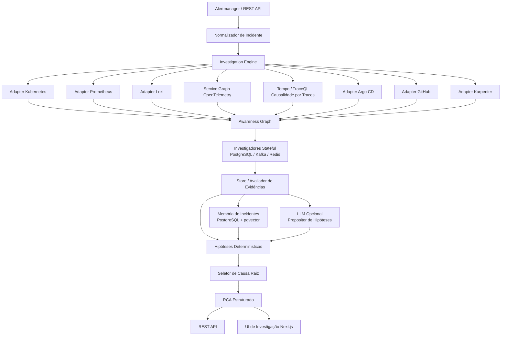

## Ciclo de investigação

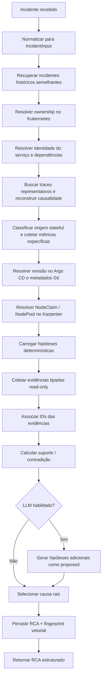

O ciclo é propositalmente **evidence-first**. Incidentes históricos e saída do modelo podem ampliar o contexto, mas não podem substituir telemetria atual mais forte.

## Sequência de investigação

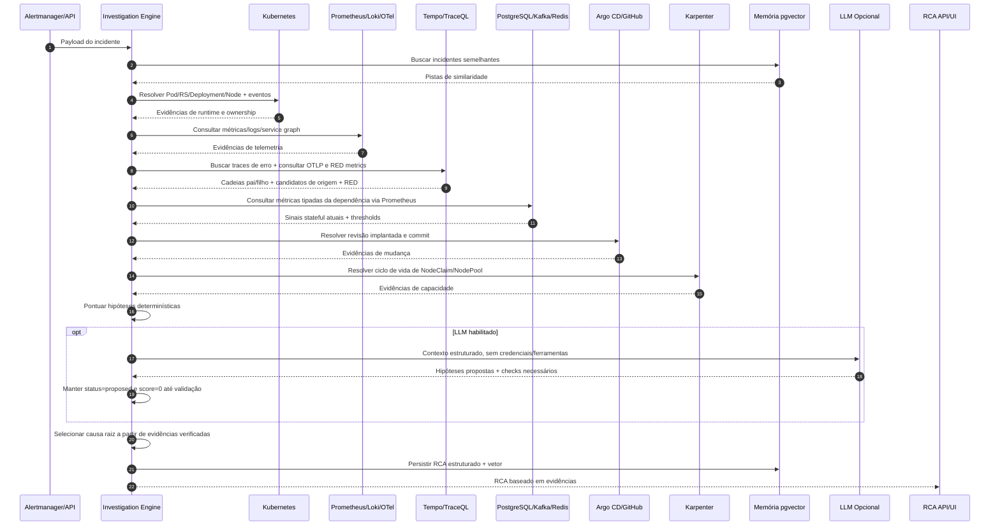

## Hierarquia de segurança causal

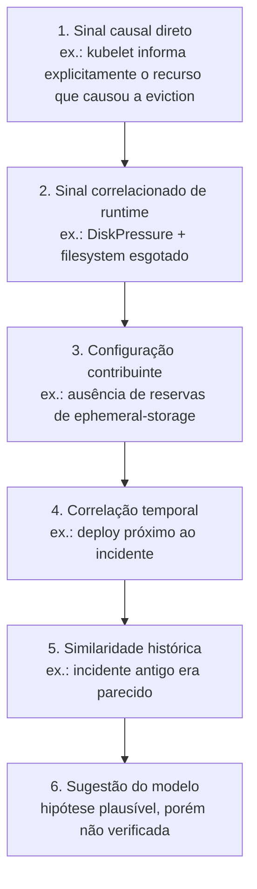

Uma camada inferior não pode sobrepor uma superior sem nova evidência tipada que a promova.

## Awareness Graph

A API retorna `graph_edges` explícitas; o frontend não precisa inferir relacionamentos a partir de uma lista plana de entidades.

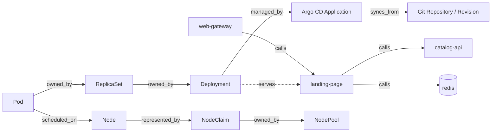

## Correlação de mudanças

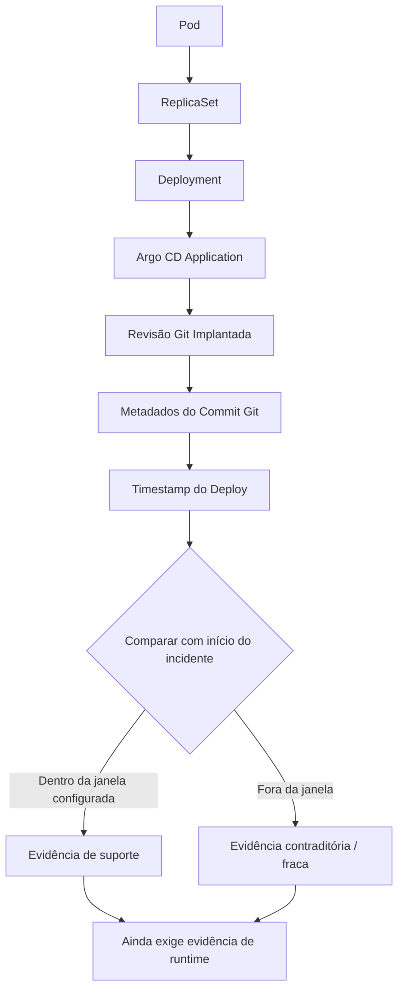

Proximidade temporal é propositalmente mais fraca do que evidência explícita de runtime.

## Origem do Service Graph

O metrics-generator do Tempo, Grafana Alloy ou um processor `servicegraph` do OTel pode emitir métricas Prometheus com labels `client` e `server`. O investigador consome essas métricas do backend Prometheus compatível configurado.

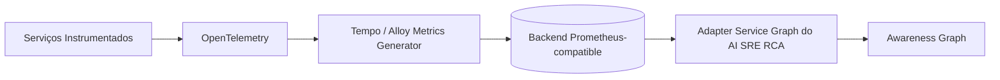

Isso mantém a topologia agregada baseada em consultas PromQL tipadas. A partir da v0.4, o investigador também possui acesso **read-only e limitado** ao Tempo para causalidade por trace.

## Propagação causal por traces — v0.4

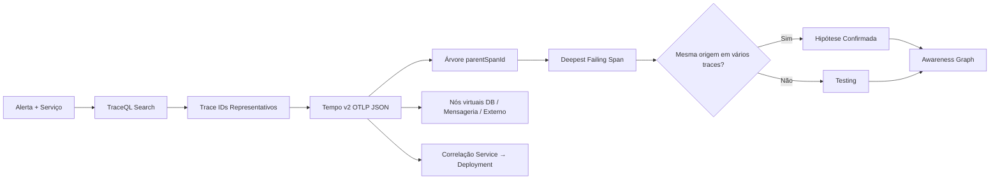

A confirmação puramente trace-aware exige repetição da mesma origem downstream em traces independentes. Um único trace não confirma causa raiz. Um RCA Kubernetes já confirmado também mantém precedência sobre evidência de trace.

Detalhes: [docs/trace-causality.pt-BR.md](trace-causality.pt-BR.md).

## RCA de dependências stateful — v0.5

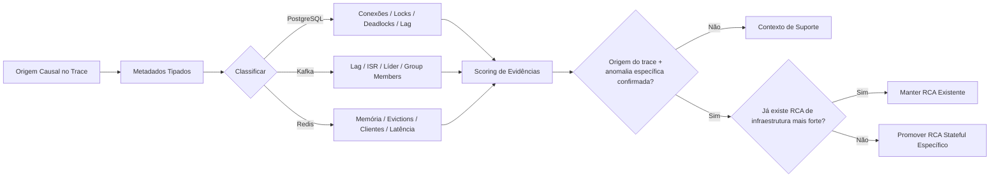

A v0.5 não acessa PostgreSQL, Kafka ou Redis diretamente com credenciais administrativas. Os investigadores stateful usam consultas Prometheus allow-listed e mantêm a mesma fronteira read-only da engine.

Detalhes: [docs/stateful-dependencies.pt-BR.md](stateful-dependencies.pt-BR.md).

## Memória de incidentes

`SQLRepository` armazena o payload completo do RCA estruturado, um fingerprint textual normalizado e um vetor de 128 dimensões.

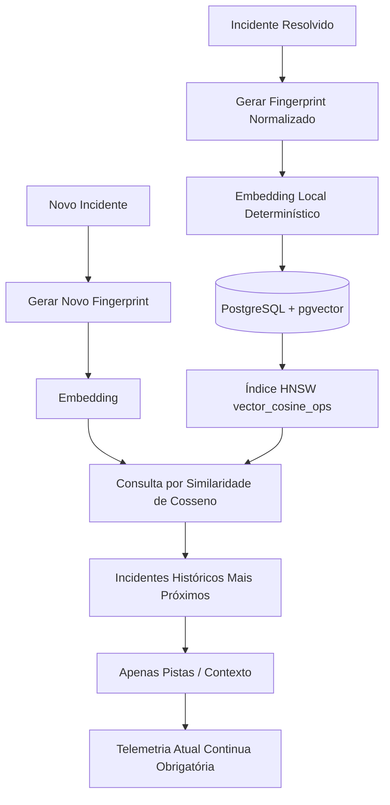

O provider de embeddings é isolado para que uma solução de produção possa substituir a implementação local padrão posteriormente.

## Boundary do LLM

O modelo opcional é um **propositor de hipóteses**, não um agente de infraestrutura.

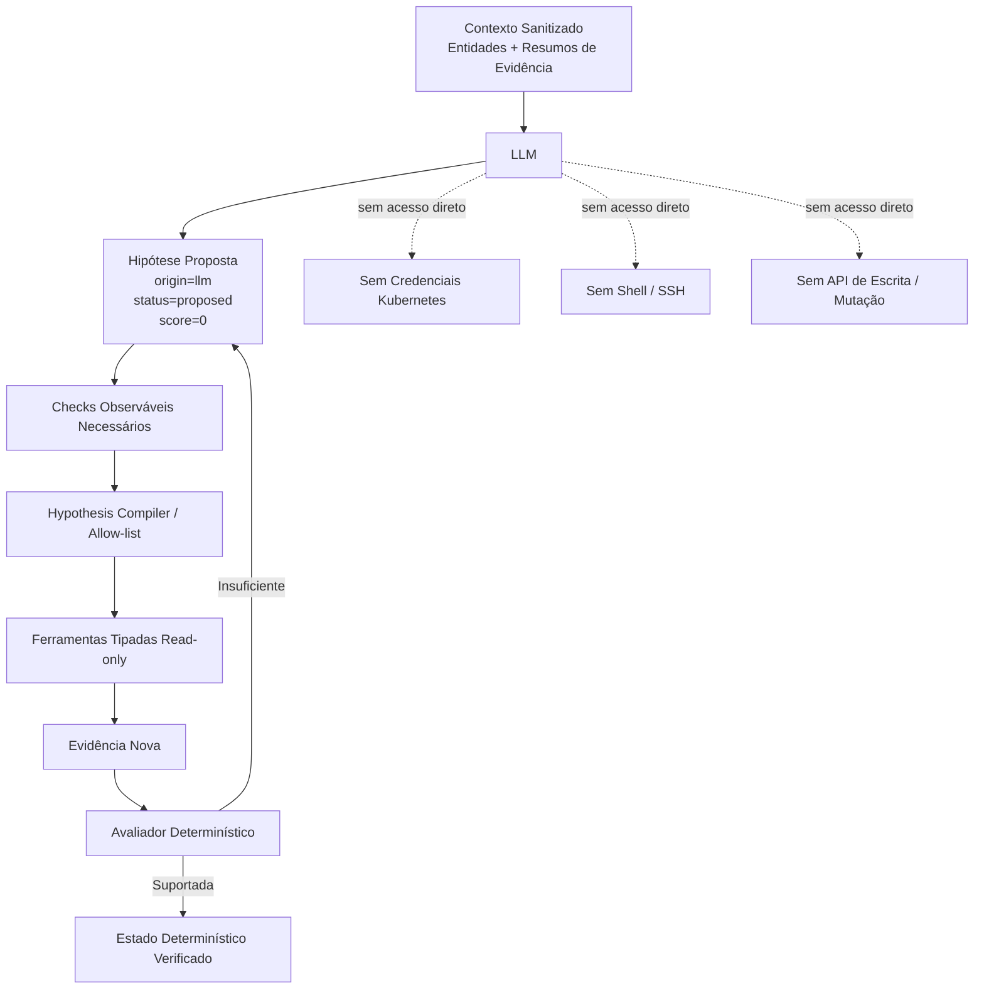

O LLM não pode consultar Kubernetes diretamente, executar PromQL/LogQL por conta própria, usar shell, anexar IDs de evidência, alterar scores, definir `confirmed` nem participar diretamente da seleção primária da causa raiz.

## Limite entre investigação e remediação

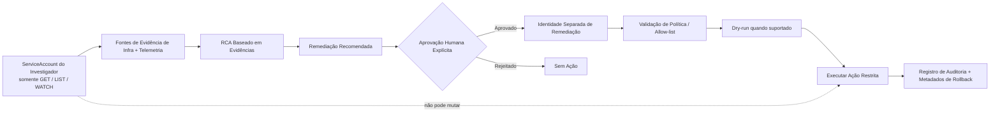

## Hardening para produção

- Allow-lists de NetworkPolicy para Kubernetes API, telemetria, Argo e provedor Git.
- Workload identity ou credenciais de curta duração quando suportado.
- Redação de secrets antes de qualquer chamada ao modelo.
- Hash dos payloads de evidência e audit sink imutável.
- Timeouts, limites de janela e budgets de cardinalidade por fonte.
- Isolamento por tenant e cluster.
- Admission policy rejeitando verbos de escrita para o ServiceAccount do investigador.
- Identidade separada e aprovação humana explícita para qualquer futuro executor de remediação.
