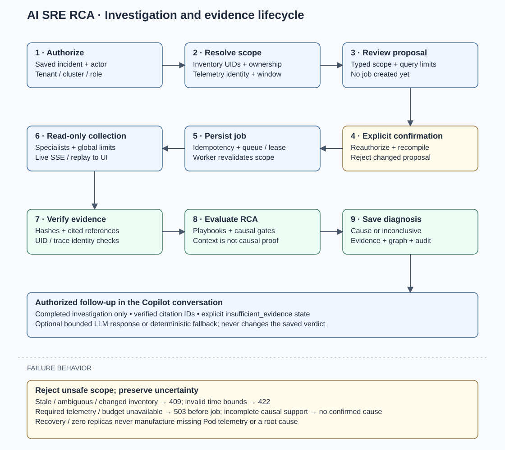
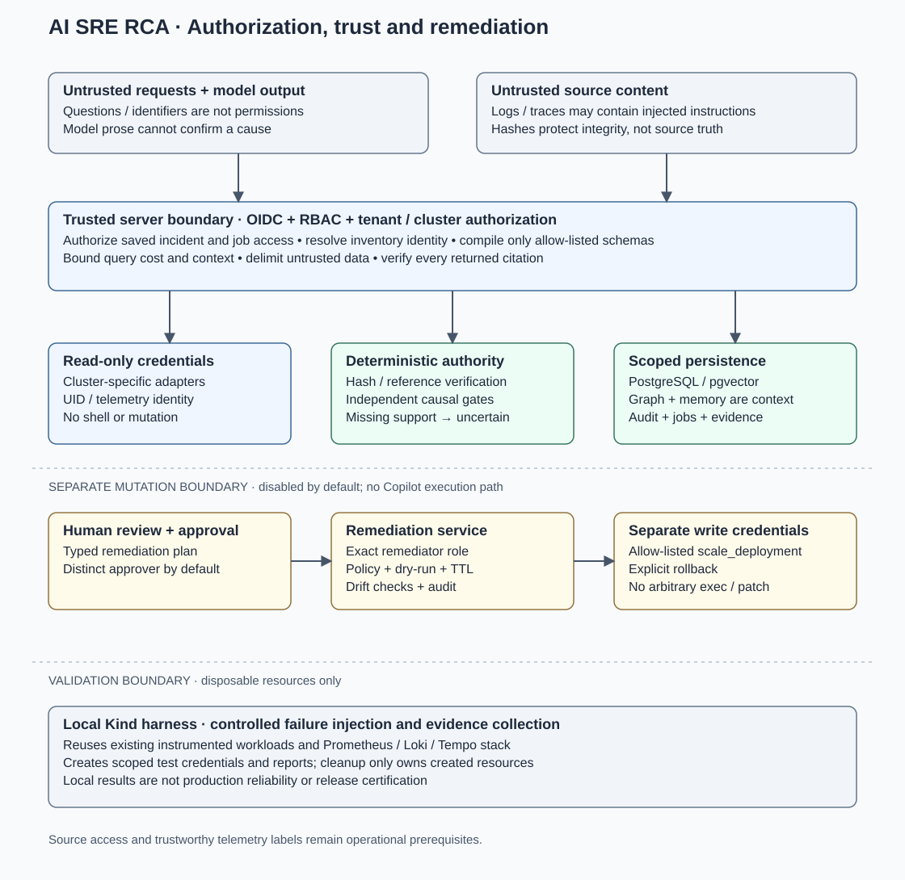

# Arquitetura — plataforma validada

[English](architecture.md) · [Visão do projeto](../README_PT-BR.md)

Escopo: implementação em `3bec577`; versão `0.8.0-rc.3` conforme [VERSION](../VERSION). Trata-se de uma candidata a lançamento em desenvolvimento. Os detalhes históricos foram preservados no [registro anterior](architecture-history.pt-BR.md); este documento prevalece quanto ao funcionamento atual.

## Componentes e execução

| Componente | Responsabilidade / código |
| --- | --- |
| Console Next.js | Histórico, formulário, workspace, Copilot, seleção de escopo, progresso dos especialistas, evidências e perguntas posteriores. Rotas do servidor encaminham autenticação. [Frontend](../frontend/app), [Copilot](../frontend/components/IncidentCopilot.tsx). |
| FastAPI | APIs tipadas; identidade verificada, papéis e autorização por tenant e cluster. [Aplicação](../backend/app/main.py), [autorização](../backend/app/auth.py). |
| Compilador de propostas | Transforma o texto descritivo e a seleção confiável de incidente/inventário em `IncidentInput`; nunca executa texto como consulta ou ferramenta. [Compilador](../backend/app/api/copilot_investigations.py), [resolução de escopo](../backend/app/core/copilot_scope.py). |
| Orquestrador persistente | Submissão, idempotência, fila limitada, leases/heartbeats, execução e progresso persistido. O worker roda no ciclo de vida da aplicação da API, sem serviço separado de broker de mensagens. [APIs e worker](../backend/app/api/planner.py). |
| Planner e especialistas | Tarefas permitidas de Kubernetes, métricas, logs, traces, banco e mudanças, definidas pelo servidor. Dependências/paralelismo limitados e envelope compartilhado de evidências. [Implementação](../backend/app/agentic). |
| Avaliador determinístico | Recalcula elegibilidade causal com evidência verificada, precedência e completude; emite decisões de seleção, rejeição ou inconclusão. [Avaliador](../backend/app/agentic/evaluator.py). |
| Persistência | Repositório SQL guarda diagnósticos, estado/histórico do grafo, mudanças, auditoria, jobs e progresso. A memória PostgreSQL/pgvector usa embeddings determinísticos de 128 dimensões por hash, sem modelo remoto de embeddings. [Repositório](../backend/app/db/repository.py). |
| Serviço de remediação | Credenciais e permissões separadas, desativado por padrão; escalonamento de Deployment após políticas e aprovação. [Serviço](../backend/app/remediation). |

O motor clássico determinístico e as APIs síncronas do planner continuam disponíveis. A orquestração persistente reutiliza planner/avaliador. O health identifica modos de worker como `experimental-postgres-leased-workers` ou `experimental-in-process-memory`; seu comportamento em escala de produção não está certificado. Em produção, fontes usam adaptadores configurados; `DEMO_MODE=true` usa adaptadores explícitos de demonstração, sem evidências de cluster real.

## Ciclo de investigação e evidências

1. Autorizar acesso à investigação de origem salva. Viewer pode fazer perguntas; propor/iniciar jobs exige permissão de investigador e execução habilitada.
2. Resolver a seleção opcional de Service, Pod, Deployment ou StatefulSet pelo inventário autorizado no servidor. Tenant vem do contexto autorizado; o cluster selecionado também precisa ser permitido.
3. Validar identidade, período, completude/atualidade do inventário, disponibilidade das fontes e orçamentos positivos. Compilar proposta tipada sem criar job.
4. Exibir escopo resolvido e limites. A confirmação precisa conter o booleano `true` e o digest da proposta revisada. O servidor recompila e reautoriza; mudanças de identidade/escopo invalidam a confirmação.
5. Submeter pela fila persistente existente com idempotência `copilot:{proposal_digest}`. Leases, heartbeats, limites de fila/concorrência e recuperação protegem a execução; isso não garante coleta externa exatamente uma vez.
6. Revalidar escopo do workload na fila antes da execução somente leitura. Tarefas de banco dependem da identidade derivada dos traces. Aplicar orçamentos globais e por especialista.
7. Verificar hashes/referências, avaliar deterministicamente e persistir diagnóstico/auditoria. O progresso apresenta estado e evidências verificadas dos especialistas; a UI carrega o diagnóstico final autorizado para perguntas posteriores.

O digest vincula incidente de origem, ator, pergunta, incidente compilado e identidade/orçamentos selecionados. Confere o conteúdo revisado; não é token de permissão. Texto livre, respostas do modelo e evidências não podem introduzir tenants, permissões, ferramentas ou grafos arbitrários de execução.

### Escopo e identidade de telemetria

- `ScopeSelection`: cluster, tipo (`Service|Pod|Deployment|StatefulSet`), nome, namespace opcional, `starts_at`, `ends_at`. Datas exigem fuso horário, duração positiva em minutos inteiros e máximo de 60 minutos; mínimo efetivo `max(5, service_graph_window_minutes, dependency_window_minutes)` (15 por padrão), dentro da retenção e com término no passado.
- O estado Kubernetes é atual, sem reconstrução histórica; a janela selecionada limita a telemetria.
- Controladores são compilados em contratos `WorkloadScope`/`WorkloadMember`. A identidade autoritativa de raiz/membros e as provas de propriedade devem ser recentes, completas, não tombstonadas e da mesma fonte/snapshot. Há limite de até 32 membros, incluindo ReplicaSets.
- Deployment → ReplicaSet → Pod e StatefulSet → Pod usam UIDs correspondentes e ownerReferences de controladores. Nomes, seletores, metadados mesclados e saída de modelo são insuficientes. Todos os ReplicaSets verificados de um rolling update são incluídos; Pods em encerramento permanecem membros explícitos.
- Zero réplicas exige verificação de réplicas desejadas iguais a zero e ausência de Pods. Fornece contexto sem consultar logs de Pods inexistentes nem fabricar evidência causal.
- A identidade de telemetria de Service/controlador é explícita (`ai-sre.io/telemetry-service`); mapeamentos conflitantes de controladores são rejeitados. Relações `serves` derivadas de seletores são contexto, não prova de propriedade.
- Coleta Loki de controladores usa identidades exatas de namespace/Pod/`pod_uid` e verifica as tuplas retornadas contra os membros. Rótulos UID ausentes ou divergentes bloqueiam a coleta. Métricas e traces usam o serviço de telemetria verificado, sem deduzir nomes.
- Leituras reais de controlador/ReplicaSet/Pod revalidam propriedade por UID; identidade do nó e eventos filtrados por UID alimentam o motor Kubernetes existente. Inventário isolado é marcado apenas como contexto.
- IDs de traces são normalizados e aliases deduplicados; IDs dos spans coletados devem corresponder ao ID canônico solicitado. A coleta limitada prioriza erros/recência; traces independentes continuam observações causais distintas.

Consulte [escopo](../backend/app/core/copilot_scope.py), [coleta real de workloads](../backend/app/agentic/workload_kubernetes.py) e [inventário](../backend/app/awareness/kubernetes_inventory.py).

## Contratos de API

As rotas abaixo pertencem ao backend, não aos proxies Next.js. Os schemas completos estão em `/docs`.

| Método / rota | Contrato |
| --- | --- |
| `POST /api/v1/incidents/investigate` | Fluxo clássico síncrono: `IncidentInput` → `InvestigationResult` persistido. |
| `GET /api/v1/incidents`, `GET /api/v1/incidents/{incident_id}` | Resumos/paginação e diagnóstico persistido autorizados. |
| `POST /api/v1/incidents/{incident_id}/copilot` | `{"question":"..."}` → `CopilotAnswer`: `answer`, `insufficient_evidence`, `evidence_ids`, `mode` (`model` ou `deterministic`). |
| `GET /api/v1/incidents/{incident_id}/copilot/scope-options?cluster=...` | Opções autorizadas de inventário e limites temporais. |
| `POST /api/v1/incidents/{incident_id}/copilot/proposals` | `InvestigationRequest`: pergunta (3–500 caracteres), escopo opcional → digest, incidente compilado e identidade/limites opcionais. Não cria job. |
| `POST /api/v1/incidents/{incident_id}/copilot/confirm` | Mesma solicitação, mais `proposal_id` (64 caracteres hexadecimais) e `confirmed: true` → `OrchestrationJob`, HTTP 202. |
| `POST /api/v1/planner/jobs` | `IncidentInput`, cabeçalho opcional `Idempotency-Key` → job persistente, HTTP 202. |
| `GET /api/v1/planner/jobs/{job_id}` | Estado e links de resultado do job autorizado. |
| `GET /api/v1/planner/jobs/{job_id}/progress?after=0` | Job e eventos retidos; alternativa por polling. |
| `GET /api/v1/planner/jobs/{job_id}/events?after=0` | SSE com sequência, replay por `Last-Event-ID` e heartbeat; emite `replay_gap` quando a retenção não cobre o cursor. |
| `POST /api/v1/planner/plan`, `/execute`, `/investigate` | Apenas plano, envelope de execução ou diagnóstico síncrono avaliado/persistido, respectivamente; grafos enviados pelo cliente não são executados. |
| `GET /api/v1/incidents/{incident_id}/audit`, `/export` | Auditoria autorizada e exportação estruturada. |

[APIs de incidentes](../backend/app/api/incidents.py), [Copilot](../backend/app/api/copilot_investigations.py), [planner](../backend/app/api/planner.py).

### Falhas e replay

Registros ausentes ou inacessíveis por tenant não são expostos por fallback de demonstração; autorização de cluster também se aplica. Conforme o controle, acesso indevido retorna 401/403/404. Execução agentic desativada retorna 404; conflito de escopo/membros desatualizados, 409; entrada temporal/tipada inválida, 422. Telemetria obrigatória ou orçamento indisponível retorna 503 **antes de criar job**. Falhas de fontes opcionais durante execução permanecem explícitas nos especialistas e podem bloquear seleção causal.

O endpoint SSE autentica/autoriza o job antes do streaming. `Last-Event-ID` inválido retorna 400. Eventos são persistidos em sequência monotônica por job; replay/retenção são limitados, sem arquivo ilimitado de eventos. Jobs terminais escoam eventos retidos e encerram o stream. Jobs com falha ficam visíveis; nenhum resultado é fabricado para transformar falha em conclusão.

## Autoridade causal e confiança no Copilot

O avaliador verifica integridade, referências de suporte/contradição, evidência atual, precedência e conclusão dos especialistas obrigatórios. Inventário contextual, memória histórica e proximidade de implantação não estabelecem causa. Falhas diretas de Kubernetes têm precedência; propagação por traces exige origem recorrente em traces representativos independentes. Promoção de PostgreSQL/Redis/Kafka exige também telemetria atual correspondente. Suporte insuficiente ou contraditório produz incerteza.

O Copilot consulta somente a investigação salva autorizada. Evidências com hash válido são limitadas a 30 itens; texto/contexto são saneados e limitados antes da chamada opcional de chat (timeout de cinco segundos, limite de 350 tokens de saída). O JSON do incidente é delimitado como dado não confiável; citações retornadas são filtradas pelo conjunto autorizado. Perguntas sobre causa raiz e próximos passos registrados seguem caminhos determinísticos. Respostas vazias/inválidas, linguagem proibida de veredito/ação, falhas do provedor e LLM desativado acionam fallback determinístico. São controles em camadas, não prova de correção factual de qualquer frase gerada. Nenhuma rota do Copilot altera vereditos ou invoca o executor de remediação.

[Implementação das respostas](../backend/app/llm/copilot.py). Hashes detectam alteração; não provam veracidade da fonte. Credenciais, autoridade do inventário, procedência de rótulos e instrumentação continuam sendo pré-requisitos de confiança.

## Limites de autorização, persistência e remediação

OIDC valida emissor, audiência e assinatura via JWKS configurado. Claims de papel, tenant e cluster alimentam verificações no servidor, consultas restritas ao repositório e seleção de fontes. A autorização pertence às APIs, não ao LLM. `AUTH_ENABLED=false` fornece identidade local/de demonstração intencionalmente; não representa isolamento em implantação sem segurança.

`DATABASE_URL` seleciona persistência SQL; sem configuração usa memória volátil. Na inicialização, SQL cria extensão vector/tabelas e aplica atualizações aditivas de compatibilidade, incluindo sequência de progresso e campos vetoriais; não é um framework completo de migrações. Diagnósticos JSON antigos continuam legíveis sem campos opcionais de workload/agentic. Privilégios de extensão/DDL e backups exigem planejamento operacional.

O grafo mantém entidades/relações atuais, observações append-only, comprovantes de inventário autoritativo, tombstones e eventos imutáveis de mudanças. Snapshots completos de fontes autoritativas permitidas podem tombstonar recursos ausentes no escopo coberto; observações parciais de incidentes não excluem estado. Contexto congelado e limitado do grafo orienta planos. Similaridade de incidentes não substitui evidências atuais.

Remediação tem aplicação, verificações de papel e `REMEDIATION_CLUSTER_CONFIG_JSON` próprios, distintos das credenciais de investigação. A API `/api/v1/remediation/plans` oferece proposta, approve/reject, execute e rollback explícito. Execução exige papel exato de remediator configurado, plano aprovado e válido pelas políticas, dry-run Kubernetes e verificações de divergência/TTL; aprovador distinto é exigido por padrão. Somente `scale_deployment` é permitido atualmente. Recomendações da investigação não concedem execução. Consulte [política e execução](remediation.pt-BR.md).

## Configuração, status e validação

Padrões em [Settings](../backend/app/config.py): `AGENTIC_PLANNER_ENABLED=true`, `AGENTIC_EXECUTION_ENABLED=false`, `AGENTIC_MODEL_PLANNER_ENABLED=false`, `LLM_ENABLED=false`, `REMEDIATION_ENABLED=false`; `DEMO_MODE=true` e `AUTH_ENABLED=false` são padrões locais/de demonstração. Orçamentos: 80 chamadas globais, 30 por fonte e 45 segundos; limites dos especialistas/orquestração se somam a eles. Configure tenant/clusters de inventário autoritativo e adaptadores por cluster explicitamente. [Operação](operations.pt-BR.md), [guia do grafo](persistent-awareness-graph.pt-BR.md), [.env.example](../.env.example).

Implementados: jobs/SSE persistentes, escopos dinâmicos, coleta por UID, citações verificadas e fallback determinístico. Experimental: priorização de tarefas assistida por modelo, sob flag própria. Planejados/não verificados em escala ampla: mais falhas reais, falha/recuperação do Kafka e avaliações maiores de múltiplos clusters/concorrência; consulte o [roadmap](roadmap.md). Não há alegação de disponibilidade de produção ou acurácia generalizada.

O harness descartável reutiliza Kind, workload instrumentado, Prometheus, Loki, Tempo e PostgreSQL existentes. Injeção controlada de falhas pertence somente a esse ambiente, não à investigação em execução. [Resultados locais registrados](real-world-rca-validation-v1.md): 6/6 casos com escopo, 325 testes de backend/harness, 8 de telemetria, 50 verificações de navegador e build Next.js de produção aprovado. Recuperação e zero réplicas são casos negativos; rollout comprova saída do processo, não causalidade da revisão Git. Relatórios brutos são artefatos locais. Esses resultados não satisfazem os controles de promoção de release; esta mudança documental não reexecuta as suítes da aplicação.

## Backends de telemetria

Métricas, logs e traces são lidos por uma interface neutra quanto à fonte ([ADR-0001](adr/0001-telemetry-interface.md)): requisições de sinais tipadas são traduzidas por backend e os resultados carregam a sua proveniência. Prometheus/Loki/Tempo são o padrão; um cluster pode escolher outro backend (hoje, Datadog) com `metrics_backend`, `logs_backend` e `traces_backend`. Sinais não suportados falham fechado em vez de gerar evidência, e cada backend mantém a sua própria fonte de orçamento de consultas.

## Diagramas e referências detalhadas

Os SVGs possuem títulos/descrições acessíveis e fundos opacos de alto contraste. Fonte editável do layout: [generate-diagrams.mjs](images/generate-diagrams.mjs); grafos Mermaid equivalentes: [sistema](images/ai-sre-rca-architecture.mmd), [ciclo](images/investigation-pipeline.mmd), [segurança](images/security-boundaries.mmd). Gere novamente com `node docs/images/generate-diagrams.mjs` na raiz. O repositório não possui dependência Mermaid CLI; os SVGs usam o pequeno gerador local, sem renderizador remoto nem fontes embutidas.

[Investigação agentic](agentic-investigation.pt-BR.md) · [Awareness Graph](persistent-awareness-graph.pt-BR.md) · [causalidade por traces](trace-causality.pt-BR.md) · [analisadores stateful](stateful-dependencies.pt-BR.md) · [harness local](../validation/README.md) · [controles de release](github-first.pt-BR.md).
