# Arquitetura — v0.8 em desenvolvimento

**Português do Brasil** · [English](architecture.md)

## Visão geral do sistema

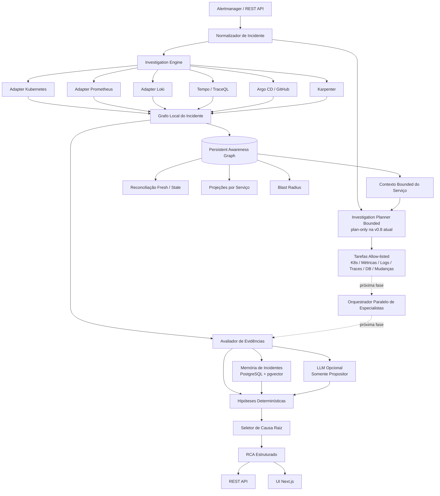

## Ciclo de investigação

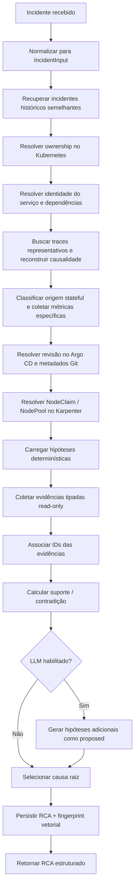

O ciclo é propositalmente **evidence-first**. Incidentes históricos e saída do modelo podem ampliar o contexto, mas não podem substituir telemetria atual mais forte.

## Sequência de investigação

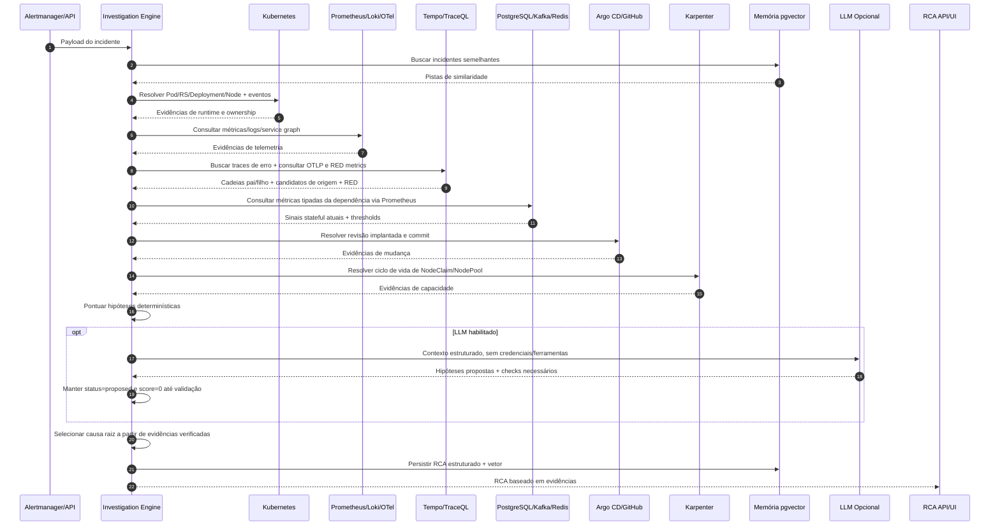

## Hierarquia de segurança causal

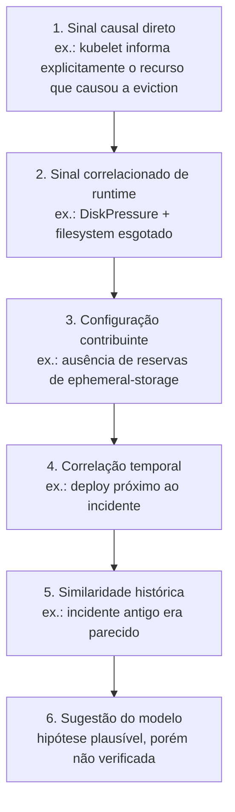

Uma camada inferior não pode sobrepor uma superior sem nova evidência tipada que a promova.

## Awareness Graph

A API retorna `graph_edges` explícitas; o frontend não precisa inferir relacionamentos a partir de uma lista plana de entidades.

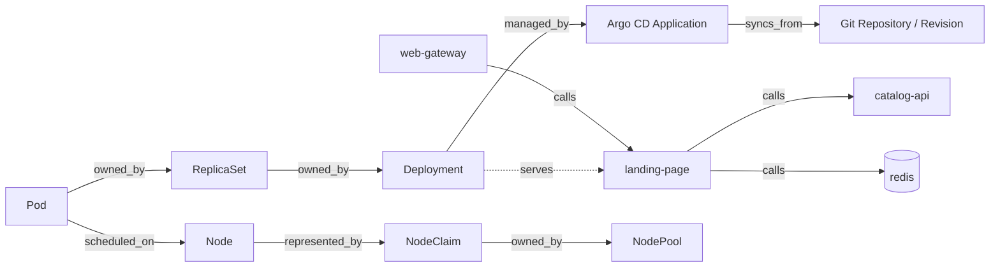

## Correlação de mudanças

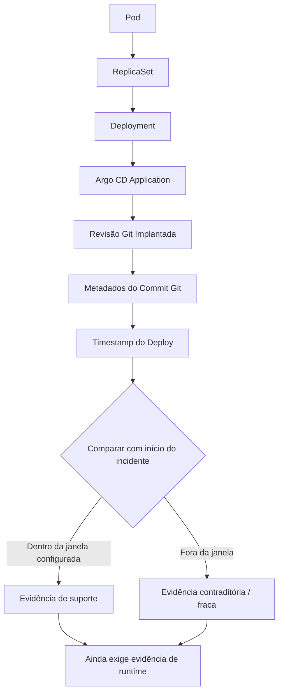

Proximidade temporal é propositalmente mais fraca do que evidência explícita de runtime.

## Origem do Service Graph

O metrics-generator do Tempo, Grafana Alloy ou um processor `servicegraph` do OTel pode emitir métricas Prometheus com labels `client` e `server`. O investigador consome essas métricas do backend Prometheus compatível configurado.

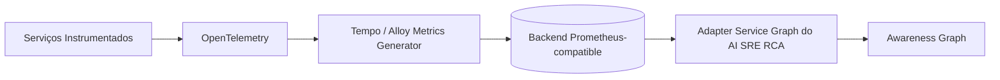

Isso mantém a topologia agregada baseada em consultas PromQL tipadas. A partir da v0.4, o investigador também possui acesso **read-only e limitado** ao Tempo para causalidade por trace.

## Propagação causal por traces — v0.4

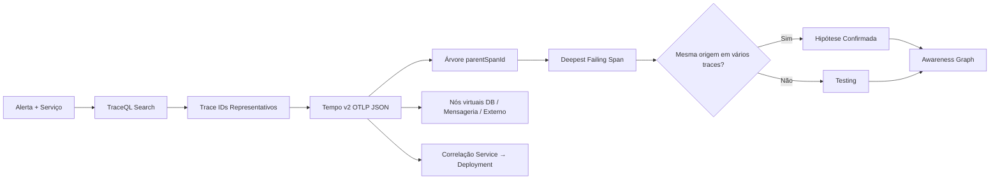

A confirmação puramente trace-aware exige repetição da mesma origem downstream em traces independentes. Um único trace não confirma causa raiz. Um RCA Kubernetes já confirmado também mantém precedência sobre evidência de trace.

Detalhes: [docs/trace-causality.pt-BR.md](trace-causality.pt-BR.md).

## RCA de dependências stateful — v0.5

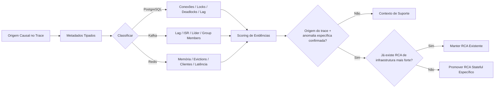

A v0.5 não acessa PostgreSQL, Kafka ou Redis diretamente com credenciais administrativas. Os investigadores stateful usam consultas Prometheus allow-listed e mantêm a mesma fronteira read-only da engine.

Detalhes: [docs/stateful-dependencies.pt-BR.md](stateful-dependencies.pt-BR.md).

## Memória de incidentes

`SQLRepository` armazena o payload completo do RCA estruturado, um fingerprint textual normalizado e um vetor de 128 dimensões.

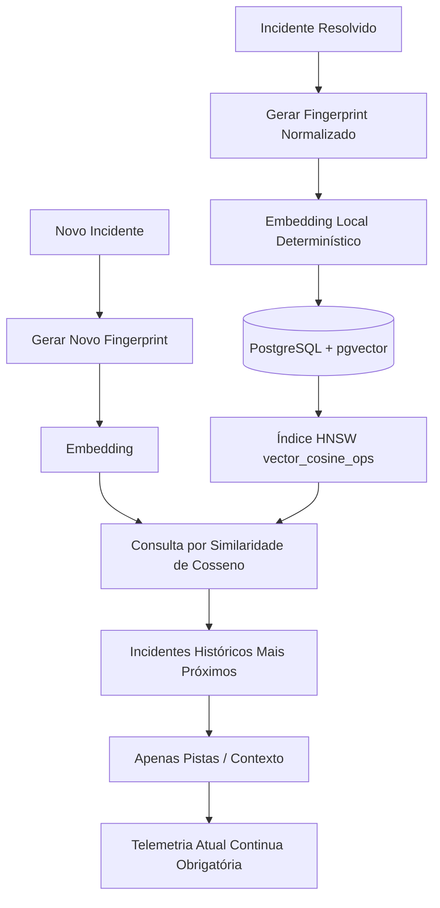

O provider de embeddings é isolado para que uma solução de produção possa substituir a implementação local padrão posteriormente.

## Boundary do LLM

O modelo opcional é um **propositor de hipóteses**, não um agente de infraestrutura.

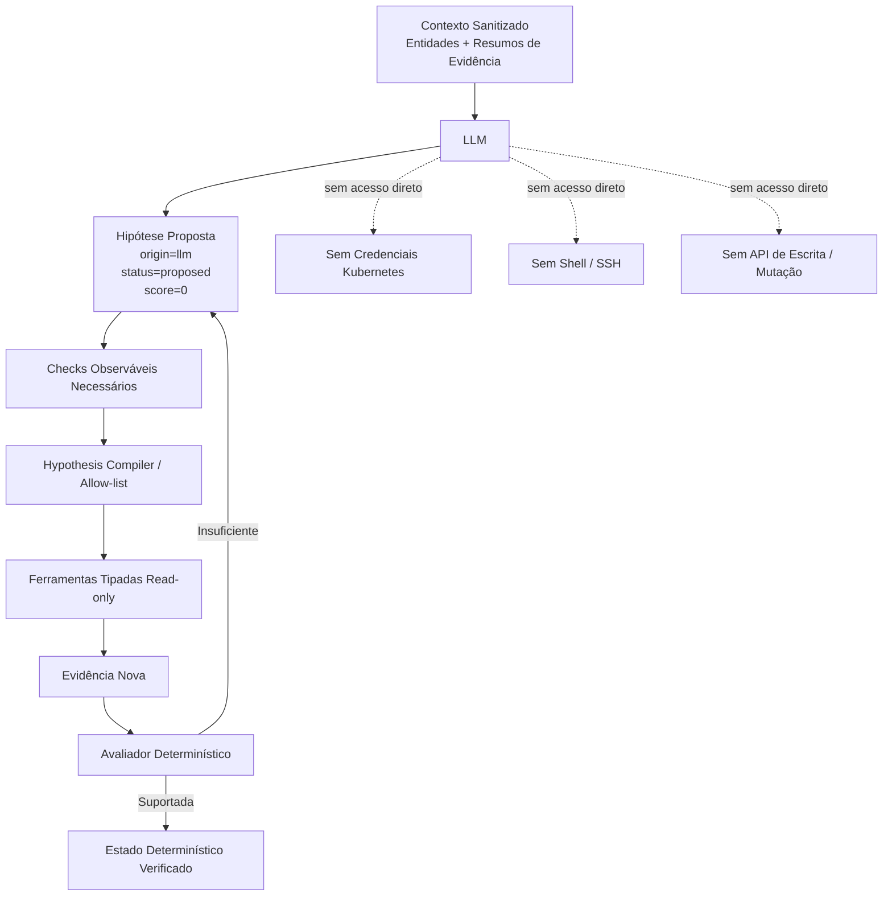

O LLM não pode consultar Kubernetes diretamente, executar PromQL/LogQL por conta própria, usar shell, anexar IDs de evidência, alterar scores, definir `confirmed` nem participar diretamente da seleção primária da causa raiz.

## Limite entre investigação e remediação

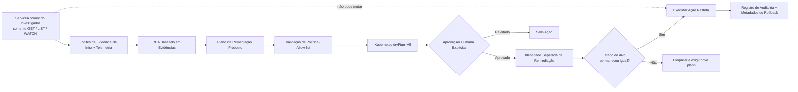

## Hardening para produção

- Allow-lists de NetworkPolicy para Kubernetes API, telemetria, Argo e provedor Git.
- Workload identity ou credenciais de curta duração quando suportado.
- Redação de secrets antes de qualquer chamada ao modelo.
- Hash dos payloads de evidência e audit sink imutável.
- Timeouts, limites de janela e budgets de cardinalidade por fonte.
- Isolamento por tenant e cluster.
- Admission policy rejeitando verbos de escrita para o ServiceAccount do investigador.
- Identidade separada do remediator, gates de política, dry-run e aprovação humana explícita para toda ação mutável.

## Plano operacional — v0.6

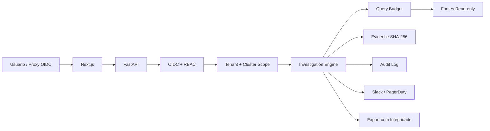

A v0.6 adiciona autenticação, isolamento de tenant/cluster, budgets, retenção, auditoria e entrega operacional sem alterar o boundary read-only do investigador. Detalhes completos: [operations.pt-BR.md](operations.pt-BR.md).

## Plano de remediação guardada — v0.7

A v0.7 implementa o boundary de remediação como outro runtime. O investigator não expõe rotas de remediação e continua usando identidade Kubernetes read-only. O remediator pode ser implantado separadamente e atualmente expõe apenas scale tipado de Deployment.

O remediator usa registry separado de credenciais, Roles Helm por namespace com get/patch somente em deployments/scale, dry-run server-side, aprovação com papel remediator exato, regra de quatro olhos, expiração de plano, detecção de drift por resourceVersion e rollback explícito.

Detalhes: [remediation.pt-BR.md](remediation.pt-BR.md).

## Persistent Awareness Graph e serviços de topologia — v0.8

O grafo local do incidente agora é canonicalizado e persistido, permitindo que a topologia operacional se acumule entre investigações sem deixar IDs locais vazarem entre escopos.

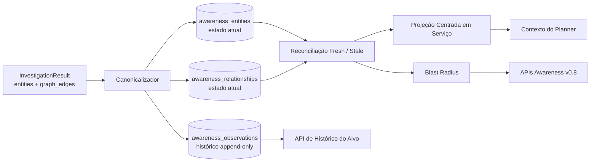

A identidade canônica da entidade deriva de `tenant + cluster + kind + namespace + name`. A identidade da relação deriva dos endpoints canônicos no mesmo escopo mais o tipo da relação. Persistir novamente o mesmo incidente é idempotente.

### Reconciliação não inventa deleção

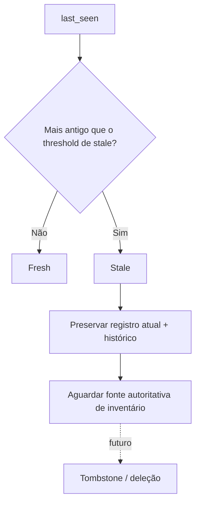

Observações de incidentes são parciais. Portanto, um recurso ausente em um RCA posterior não é tratado como deletado.

### Projeção de serviço

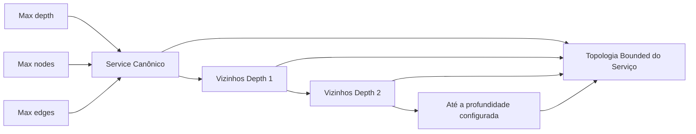

A busca é exata. Se o mesmo nome de serviço existir em namespaces diferentes, o namespace passa a ser obrigatório em vez de escolher um nó arbitrariamente.

### Blast radius causal

A direção armazenada no grafo e a direção de impacto são propositalmente separadas.

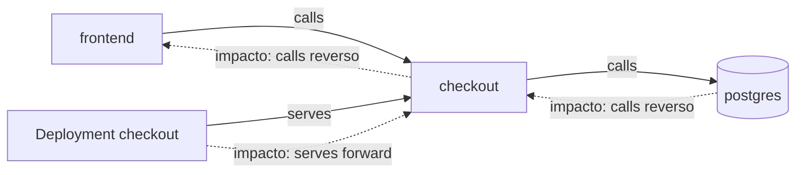

Tipos de relação conhecidos passam por uma allow-list explícita de direção de impacto. Relações desconhecidas aparecem nas APIs de topologia, mas nunca são percorridas no blast radius. Relações stale são apenas contexto histórico e são ignoradas na propagação de impacto atual.

## Investigation Planner Bounded — v0.8

O planner atual é determinístico e plan-only. Ele usa a identidade do incidente, feature flags e um neighborhood bounded do serviço para decidir quais ramos tipados de especialistas são relevantes.

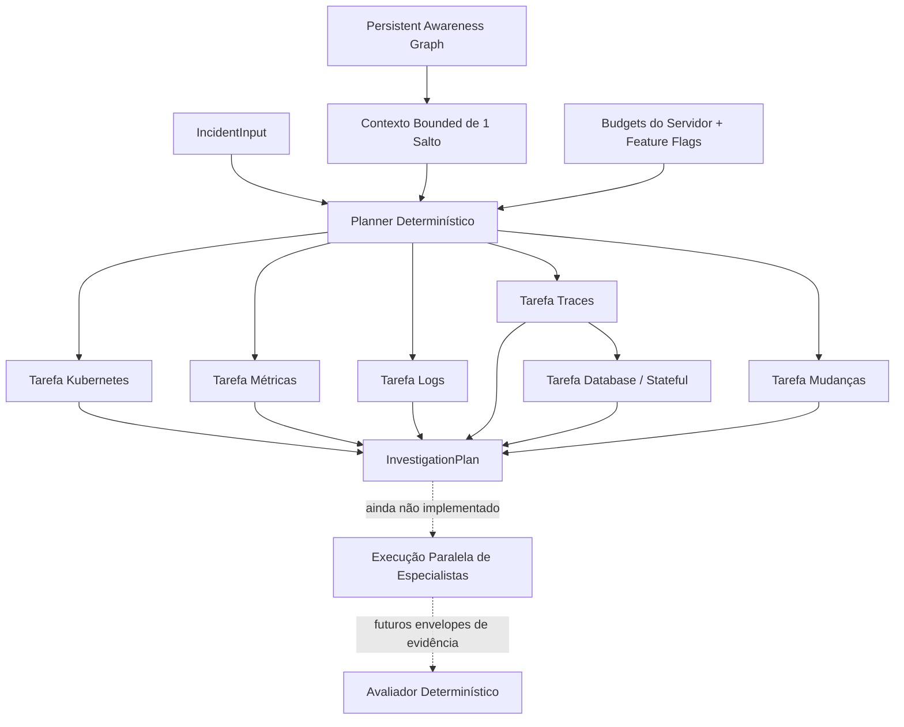

Propriedades de segurança do planner:

- existem somente seis tipos allow-listed de tarefas especialistas;
- toda tarefa é read-only;
- quantidade de tarefas, contexto do grafo, paralelismo e budget de queries por especialista têm limites no servidor;
- database/stateful depende da tarefa de traces para que a identidade da dependência seja tipada antes de consultar telemetria específica;
- o planner não confirma hipóteses, não anexa evidências, não executa mutações e não contorna o plano de remediação separado.

Detalhes: [persistent-awareness-graph.pt-BR.md](persistent-awareness-graph.pt-BR.md) e [agentic-investigation.pt-BR.md](agentic-investigation.pt-BR.md).
