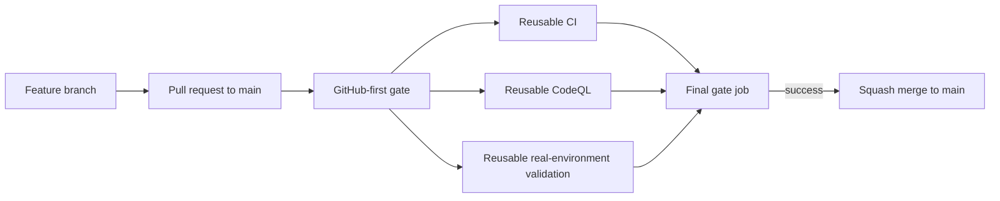
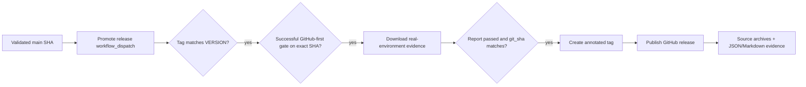

# GitHub-first delivery

GitHub is the delivery source of truth for AI SRE RCA. Local execution remains useful for debugging, but merge and release decisions are made only from GitHub Actions evidence.

## Pull-request flow

The `GitHub-first gate` workflow is the only orchestration entry point for pull requests and pushes to `main`.

It calls:

- `.github/workflows/ci.yml` through `workflow_call`;
- `.github/workflows/codeql.yml` through `workflow_call`;
- `.github/workflows/real-environment-validation.yml` through `workflow_call`.

The final `gate` job fails unless all three reusable workflows complete successfully.

For branch protection, require the final **gate** check from the **GitHub-first gate** workflow before merging to `main`. The individual reusable jobs remain visible for diagnosis but do not need to be configured as separate merge requirements.

## Release flow

Releases are no longer created by pushing a tag from a workstation.

Use **Actions → Promote release → Run workflow** on `main` and provide the release tag, for example `v0.8.0-rc.3`.

The promotion workflow fails closed when:

- it is not dispatched from `main`;
- the tag format is invalid;
- `VERSION` does not match the requested tag;
- the tag already exists;
- no successful GitHub-first gate exists for the exact `main` SHA;
- the validation artifact is missing;
- the validation report does not contain `passed: true`;
- the report `environment.git_sha` differs from the release commit.

The tag is created only after all of those checks pass. Existing release tags are never overwritten.

## Evidence ownership

The real-environment validation report is produced inside the same GitHub-first gate run that validates the commit. Release promotion downloads that artifact from the successful gate run and publishes it alongside the source archives.

This keeps one auditable chain:

`commit → GitHub-first gate → validation artifact → release tag → GitHub release`.

## Manual reruns

The specialized workflows keep `workflow_dispatch` for diagnosis:

- CI
- CodeQL
- Real environment validation

Manual runs are useful for debugging, but release promotion trusts the successful **GitHub-first gate** for the exact `main` SHA.

If the validation artifact has expired, rerun **GitHub-first gate** on `main` to generate fresh evidence before promoting a release.

## Local development

Local commands such as `pytest`, `npm run build`, `helm lint` and `make validate-real` remain supported. They shorten feedback loops, but they are not release authority.

Do not create or move release tags locally as part of the normal delivery process.

## Required permissions

The GitHub-first gate is read-only with respect to repository contents. The release promotion workflow has:

- `actions: read`, to inspect the successful gate and download its artifact;
- `contents: write`, only to create the validated tag and GitHub release.

No production infrastructure credentials are required for the release workflow.
