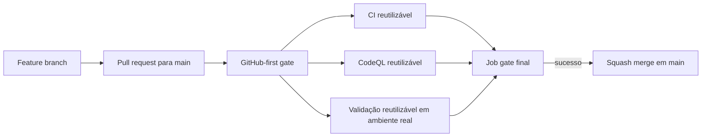
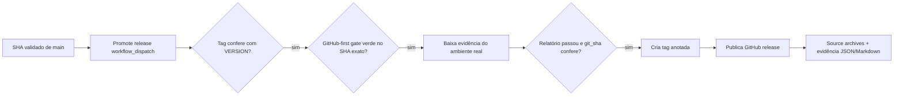

# Fluxo GitHub-first

O GitHub é a fonte de verdade para entrega do AI SRE RCA. A execução local continua útil para depuração, mas decisões de merge e release passam a depender apenas das evidências do GitHub Actions.

## Fluxo de pull request

O workflow `GitHub-first gate` é a única entrada de orquestração para pull requests e pushes em `main`.

Ele chama:

- `.github/workflows/ci.yml` via `workflow_call`;
- `.github/workflows/codeql.yml` via `workflow_call`;
- `.github/workflows/real-environment-validation.yml` via `workflow_call`.

O job final `gate` falha se qualquer um dos três workflows reutilizáveis não terminar com sucesso.

A branch `main` está protegida pelo check final **gate** do workflow **GitHub-first gate**. Permanecem ativos o requisito de branch atualizada, histórico linear e resolução de conversas; force-push e deleção da branch continuam bloqueados. Os jobs especializados seguem visíveis para diagnóstico, mas não são requisitos independentes de merge.

## Fluxo de release

Releases deixam de ser criadas pelo envio de uma tag a partir de uma estação local.

Use **Actions → Promote release → Run workflow** em `main` e informe a tag desejada, por exemplo `v0.8.0-rc.3`.

O workflow de promoção falha de forma fechada quando:

- não é executado a partir de `main`;
- o formato da tag é inválido;
- `VERSION` diverge da tag solicitada;
- a tag já existe;
- não existe um GitHub-first gate bem-sucedido para o SHA exato de `main`;
- o artifact da validação não existe;
- o relatório não contém `passed: true`;
- `environment.git_sha` no relatório diverge do commit da release.

A tag só é criada depois que todos esses checks passam. Tags de release existentes nunca são sobrescritas.

## Cadeia de evidência

O relatório da validação em ambiente real é produzido dentro do mesmo run do GitHub-first gate que valida o commit. A promoção da release baixa esse artifact do gate aprovado e o publica junto dos source archives.

A cadeia auditável passa a ser:

`commit → GitHub-first gate → artifact de validação → tag de release → GitHub release`.

## Reexecuções manuais

Os workflows especializados mantêm `workflow_dispatch` para diagnóstico:

- CI
- CodeQL
- Real environment validation

Execuções manuais ajudam no debugging, mas a promoção da release confia no **GitHub-first gate** bem-sucedido para o SHA exato de `main`.

Se o artifact da validação expirar, execute novamente o **GitHub-first gate** em `main` para gerar evidência nova antes da promoção.

## Desenvolvimento local

Comandos locais como `pytest`, `npm run build`, `helm lint` e `make validate-real` continuam suportados. Eles reduzem o tempo de feedback, mas não têm autoridade de release.

No fluxo normal, não crie nem mova tags de release localmente.

## Permissões necessárias

O GitHub-first gate é read-only em relação ao conteúdo do repositório. O workflow de promoção usa:

- `actions: read`, para localizar o gate aprovado e baixar seu artifact;
- `contents: write`, somente para criar a tag validada e a GitHub release.

Nenhuma credencial de infraestrutura de produção é necessária para o workflow de release.
