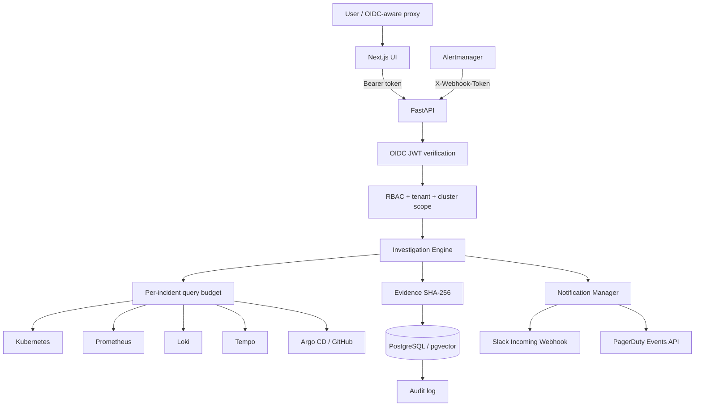
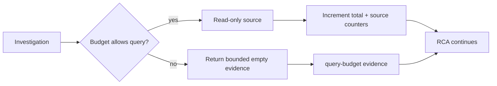

# Operational productization — v0.6.1

[Português do Brasil](operations.pt-BR.md) · **English**

v0.6 turns the read-only investigator into an operationally deployable service without adding infrastructure mutation privileges.

## Control plane



## OIDC and RBAC

Authentication is opt-in. When `AUTH_ENABLED=false`, the existing demo/local behavior remains available. In production enable OIDC and configure:

```text
AUTH_ENABLED=true
OIDC_ISSUER=https://id.example.com
OIDC_AUDIENCE=ai-sre-rca
OIDC_JWKS_URL=https://id.example.com/.well-known/jwks.json
OIDC_ROLES_CLAIM=roles
OIDC_TENANT_CLAIM=tenant
OIDC_CLUSTERS_CLAIM=clusters
```

The API verifies JWT signature, issuer, audience, expiration, issued-at and subject. Default semantic roles are hierarchical:

| Role | Access |
| --- | --- |
| `viewer` | read incident, audit, export, capabilities |
| `investigator` | viewer + start investigations |
| `admin` | investigator + retention administration |

The UI does not store a second credential. It forwards the bearer token from the request. For an OIDC-aware reverse proxy, configure `AUTH_FORWARD_HEADER` (default `x-auth-request-access-token`).

## Tenant and cluster isolation

Every incident carries a server-controlled `tenant_id`. Similar-incident memory is tenant scoped. Reads, audit access and exports validate tenant and cluster scope.

A token may contain:

```json
{
  "tenant": "payments",
  "clusters": ["prod-us", "prod-eu"],
  "roles": ["investigator"]
}
```

Cluster-specific integration endpoints are configured with `CLUSTER_CONFIG_JSON`:

```json
{
  "prod-us": {
    "kubernetes_api_url": "https://kubernetes.prod-us.example",
    "kubernetes_token_file": "/var/run/secrets/prod-us/token",
    "kubernetes_ca_file": "/var/run/secrets/prod-us/ca.crt",
    "prometheus_url": "http://mimir-prod-us.monitoring.svc:8080",
    "loki_url": "http://loki-prod-us.logging.svc:3100",
    "tempo_url": "http://tempo-prod-us.tracing.svc:3200",
    "tempo_tenant_id": "prod-us",
    "argocd_url": "https://argocd.prod-us.example"
  }
}
```

The selected cluster is stored in a context variable, so concurrent investigations do not leak routing state into one another.

`CLUSTER_CONFIG_JSON` is validated fail-closed at settings load. Invalid JSON, a non-object registry, or a cluster entry that is not an object prevents the service configuration from loading instead of silently falling back to an empty registry.

## Query budget

Each investigation owns an independent budget:

```text
QUERY_BUDGET_ENABLED=true
QUERY_BUDGET_MAX_CALLS=80
QUERY_BUDGET_MAX_CALLS_PER_SOURCE=30
QUERY_BUDGET_MAX_WALL_SECONDS=45
```



Budget exhaustion degrades evidence collection rather than granting a broader query path.

## Evidence integrity and audit

Every evidence object gets a SHA-256 hash over its canonical JSON representation. Export verifies every hash before marking the bundle valid.

Audit records include:

- investigation requested/completed;
- incident viewed/exported;
- notification sent/failed/skipped;
- manual retention purge.

Audit records are tenant scoped and have a separate retention policy.

## Incident export

```text
GET /api/v1/incidents/{incident_id}/export
```

returns `ai-sre-rca.export.v1`, including the complete structured investigation, evidence hashes and an integrity verdict.

## Retention

```text
INCIDENT_RETENTION_DAYS=30
AUDIT_RETENTION_DAYS=90
```

Retention runs at startup and can be triggered by an admin through:

```text
POST /api/v1/system/retention/purge
```

Manual purge follows the authenticated tenant boundary. A tenant admin purges only expired incidents and audit records from that tenant. Platform-wide purge is available only to a principal whose tenant claim is explicitly `*`.

Awareness Graph retention is intentionally separate and cluster-scoped:

```text
AWARENESS_OBSERVATION_RETENTION_DAYS=90
AWARENESS_TOMBSTONE_RETENTION_DAYS=30

POST /api/v1/awareness/retention/purge?cluster=prod-us&dry_run=true
POST /api/v1/awareness/retention/purge?cluster=prod-us&dry_run=false
```

The endpoint requires admin authorization. Preview is the default and performs no write. Executed purges preserve all authoritative inventory snapshot receipts plus the latest observation per graph target, remove expired tombstoned relationships before entities, and refuse to delete a tombstoned entity while a relationship still references it.

Scheduled retention is disabled by default and runs as a separate CronJob:

```yaml
awarenessRetention:
  enabled: true
  schedule: "17 3 * * *"
  existingSecret: ai-sre-retention-db
  tenantId: payments
  clusters:
    - prod-us
    - prod-eu
```

The retention Secret only needs `DATABASE_URL`. The Pod sets `automountServiceAccountToken: false`, so it has no Kubernetes API credential. `concurrencyPolicy: Forbid` prevents overlapping retention runs and the worker records each executed cluster purge under the system audit actor.

## Source capabilities

```text
GET /api/v1/system/capabilities?cluster=prod-us
```

reports Kubernetes, Prometheus, Loki, Tempo, Argo CD and GitHub as healthy/degraded/unavailable with probe latency. The UI exposes the same view at `/ops`.

## Slack and PagerDuty

Notifications are opt-in and are emitted after persistence, so delivery failure cannot erase an RCA:

```text
NOTIFICATIONS_ENABLED=true
NOTIFICATION_MIN_SEVERITY=warning
SLACK_WEBHOOK_URL=<secret>
PAGERDUTY_ROUTING_KEY=<secret>
```

Slack uses an incoming-webhook JSON POST. PagerDuty uses Events API v2 trigger payloads with `incident_id` as the dedup key.

Never store notification secrets in the Helm values committed to Git. Set `backend.existingSecret` to a Kubernetes Secret containing the sensitive environment variables.

## Alertmanager machine authentication

Alertmanager is intentionally separate from interactive OIDC:

```text
ALERTMANAGER_WEBHOOK_TOKEN=<secret>
ALERTMANAGER_TENANT_ID=platform
```

Send the token in `X-Webhook-Token`.

## Automatic Kubernetes inventory CronJob

The v0.8 inventory collector is disabled by default. Enable it only with an explicit logical cluster list and a dedicated Secret containing the collector credentials, especially `DATABASE_URL`:

```yaml
backend:
  existingSecret: ai-sre-backend-secrets

inventoryCollector:
  enabled: true
  existingSecret: ai-sre-inventory-secrets
  schedule: "*/5 * * * *"
  tenantId: payments
  clusters:
    - prod-us
  namespaces: []
```

An empty namespace list means cluster-wide inventory. If more than one logical cluster is configured, each cluster must exist in `CLUSTER_CONFIG_JSON`; otherwise the worker fails before applying any snapshot. The dedicated collector Secret should not contain OIDC, LLM, GitHub or notification credentials that the worker does not need.

The CronJob reuses the investigator's read-only ServiceAccount. `concurrencyPolicy: Forbid` prevents overlapping runs for the same Helm release. Any incomplete Kubernetes LIST page or source failure exits non-zero before reconciliation, so collection failure cannot become deletion evidence.

## NetworkPolicy

The chart ships opt-in NetworkPolicy templates:

```yaml
networkPolicy:
  enabled: true
```

Frontend-to-backend and DNS egress are generated automatically. Backend ingress allows the frontend. Backend egress is configurable because Kubernetes API, observability and Git endpoints differ between environments. When the v0.7 remediator is enabled, it receives its own NetworkPolicy using remediatorIngress and remediatorEgress. Both lists default to empty, so the mutation plane is network-denied except for DNS until explicit peers are configured.

## Security boundary

The investigator Kubernetes RBAC remains GET/LIST/WATCH. v0.7 adds mutation only in the separate remediator ServiceAccount, and Helm limits that identity to get/patch on deployments/scale in explicitly listed namespaces.

The remediator uses a separate credential registry and explicit human workflow. Sharing DATABASE_URL allows incident validation and audit persistence; it does not share Kubernetes mutation credentials with the investigator.

See [remediation.md](remediation.md) for policy gates, dry-run, approval, drift protection and rollback.
