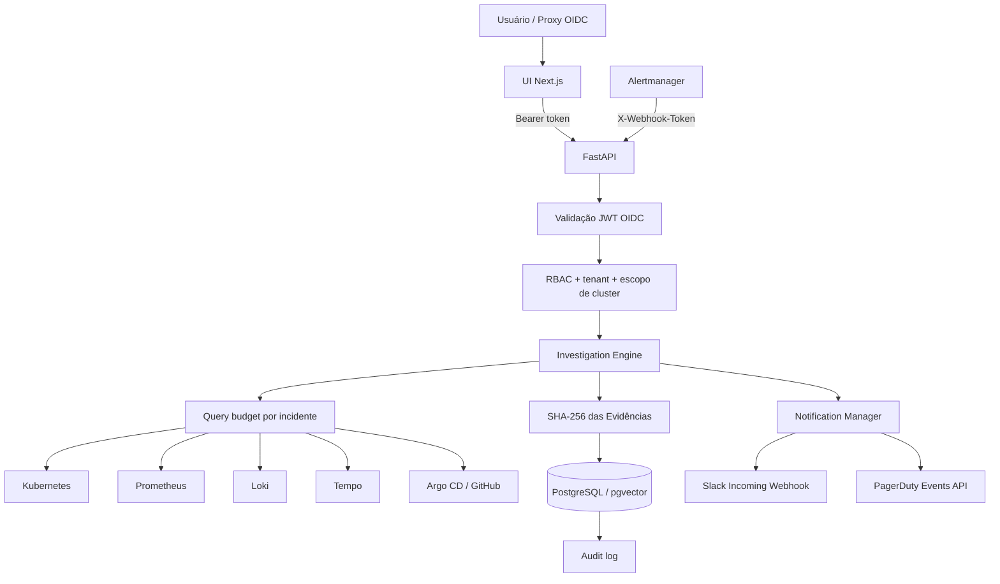
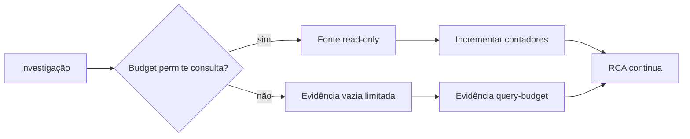

# Productização operacional — v0.6.1

**Português do Brasil** · [English](operations.md)

A v0.6 transforma o investigador read-only em um serviço operacionalmente implantável sem adicionar privilégios de mutação de infraestrutura.

## Plano de controle



## OIDC e RBAC

A autenticação é opt-in. Com `AUTH_ENABLED=false`, o comportamento local/demo existente continua funcionando. Em produção:

```text
AUTH_ENABLED=true
OIDC_ISSUER=https://id.example.com
OIDC_AUDIENCE=ai-sre-rca
OIDC_JWKS_URL=https://id.example.com/.well-known/jwks.json
OIDC_ROLES_CLAIM=roles
OIDC_TENANT_CLAIM=tenant
OIDC_CLUSTERS_CLAIM=clusters
```

A API valida assinatura JWT, issuer, audience, expiração, issued-at e subject. Os papéis padrão são hierárquicos:

| Papel | Acesso |
| --- | --- |
| `viewer` | ler incidente, auditoria, export e capabilities |
| `investigator` | viewer + iniciar investigações |
| `admin` | investigator + administrar retenção |

A UI não armazena uma segunda credencial. Ela encaminha o bearer token da requisição. Para proxies OIDC, configure `AUTH_FORWARD_HEADER` (padrão `x-auth-request-access-token`).

## Isolamento por tenant e cluster

Cada incidente recebe um `tenant_id` controlado pelo servidor. A memória de incidentes similares é isolada por tenant. Leituras, auditoria e exports validam tenant e cluster.

Exemplo de claims:

```json
{
  "tenant": "payments",
  "clusters": ["prod-us", "prod-eu"],
  "roles": ["investigator"]
}
```

Os endpoints das integrações por cluster usam `CLUSTER_CONFIG_JSON`:

```json
{
  "prod-us": {
    "kubernetes_api_url": "https://kubernetes.prod-us.example",
    "kubernetes_token_file": "/var/run/secrets/prod-us/token",
    "kubernetes_ca_file": "/var/run/secrets/prod-us/ca.crt",
    "prometheus_url": "http://mimir-prod-us.monitoring.svc:8080",
    "loki_url": "http://loki-prod-us.logging.svc:3100",
    "tempo_url": "http://tempo-prod-us.tracing.svc:3200",
    "tempo_tenant_id": "prod-us",
    "argocd_url": "https://argocd.prod-us.example"
  }
}
```

O cluster selecionado fica em `ContextVar`, impedindo vazamento de estado entre investigações concorrentes.

`CLUSTER_CONFIG_JSON` é validado em modo fail-closed ao carregar as settings. JSON inválido, registry que não seja um objeto ou entrada de cluster que não seja um objeto impedem o carregamento da configuração, em vez de virar silenciosamente um registry vazio.

## Query budget

Cada investigação possui budget independente:

```text
QUERY_BUDGET_ENABLED=true
QUERY_BUDGET_MAX_CALLS=80
QUERY_BUDGET_MAX_CALLS_PER_SOURCE=30
QUERY_BUDGET_MAX_WALL_SECONDS=45
```



Esgotar o budget degrada a coleta de evidências; nunca abre um caminho de consulta mais amplo.

## Integridade de evidência e auditoria

Toda evidência recebe hash SHA-256 sobre JSON canônico. O export verifica todos os hashes antes de marcar o bundle como íntegro.

O audit log registra:

- investigação solicitada/concluída;
- incidente visualizado/exportado;
- notificação enviada/falhou/skipped;
- purge manual de retenção.

Os registros são isolados por tenant e possuem política de retenção separada.

## Export de incidente

```text
GET /api/v1/incidents/{incident_id}/export
```

retorna `ai-sre-rca.export.v1` com o RCA estruturado completo, hashes das evidências e resultado da verificação de integridade.

## Retenção

```text
INCIDENT_RETENTION_DAYS=30
AUDIT_RETENTION_DAYS=90
```

A limpeza roda no startup e pode ser disparada por admin:

```text
POST /api/v1/system/retention/purge
```

O purge manual respeita o tenant autenticado. Um admin de tenant remove somente incidentes e registros de auditoria expirados daquele tenant. O purge global só é permitido para um principal cujo claim de tenant seja explicitamente `*`.

A retention do Awareness Graph é propositalmente separada e possui escopo por cluster:

```text
AWARENESS_OBSERVATION_RETENTION_DAYS=90
AWARENESS_TOMBSTONE_RETENTION_DAYS=30

POST /api/v1/awareness/retention/purge?cluster=prod-us&dry_run=true
POST /api/v1/awareness/retention/purge?cluster=prod-us&dry_run=false
```

O endpoint exige autorização admin. Preview é o padrão e não realiza escrita. Purges executados preservam todos os receipts autoritativos de snapshot e a observação mais recente de cada alvo do grafo, removem relações tombstoned expiradas antes das entidades e recusam apagar uma entidade tombstoned enquanto alguma relação ainda a referencia.

A retention agendada começa desabilitada e roda em CronJob separado:

```yaml
awarenessRetention:
  enabled: true
  schedule: "17 3 * * *"
  existingSecret: ai-sre-retention-db
  tenantId: payments
  clusters:
    - prod-us
    - prod-eu
```

O Secret de retention precisa somente de `DATABASE_URL`. O Pod usa `automountServiceAccountToken: false`, portanto não recebe credencial da API Kubernetes. `concurrencyPolicy: Forbid` impede execuções sobrepostas e o worker registra cada purge executado por cluster com um ator de sistema na auditoria.

## Health/capabilities por fonte

```text
GET /api/v1/system/capabilities?cluster=prod-us
```

retorna Kubernetes, Prometheus, Loki, Tempo, Argo CD e GitHub como healthy/degraded/unavailable com latência de probe. A mesma visão aparece em `/ops`.

## Slack e PagerDuty

As notificações são opt-in e acontecem após a persistência, portanto falhas de entrega não apagam o RCA:

```text
NOTIFICATIONS_ENABLED=true
NOTIFICATION_MIN_SEVERITY=warning
SLACK_WEBHOOK_URL=<secret>
PAGERDUTY_ROUTING_KEY=<secret>
```

Slack usa POST JSON em incoming webhook. PagerDuty usa trigger do Events API v2 e `incident_id` como dedup key.

Não versione secrets de notificação no values do Helm. Use `backend.existingSecret` apontando para um Kubernetes Secret externo.

## Autenticação do Alertmanager

O Alertmanager fica separado do OIDC interativo:

```text
ALERTMANAGER_WEBHOOK_TOKEN=<secret>
ALERTMANAGER_TENANT_ID=platform
```

Envie o token em `X-Webhook-Token`.

## CronJob automático de inventário Kubernetes

O inventory collector da v0.8 começa desabilitado. Habilite somente com uma lista explícita de clusters lógicos e um Secret dedicado contendo as credenciais do collector, principalmente `DATABASE_URL`:

```yaml
backend:
  existingSecret: ai-sre-backend-secrets

inventoryCollector:
  enabled: true
  existingSecret: ai-sre-inventory-secrets
  schedule: "*/5 * * * *"
  tenantId: payments
  clusters:
    - prod-us
  namespaces: []
```

Uma lista vazia de namespaces significa inventário cluster-wide. Se mais de um cluster lógico for configurado, cada um precisa existir em `CLUSTER_CONFIG_JSON`; caso contrário o worker falha antes de aplicar qualquer snapshot. O Secret dedicado do collector não deve carregar credenciais OIDC, LLM, GitHub ou notificações que ele não utiliza.

O CronJob reutiliza o ServiceAccount read-only do investigator. `concurrencyPolicy: Forbid` impede execuções sobrepostas da mesma release Helm. Qualquer página incompleta de LIST do Kubernetes ou falha da fonte encerra o job com erro antes da reconciliação, então uma falha de coleta nunca vira evidência de deleção.

## NetworkPolicy

O chart inclui templates opt-in:

```yaml
networkPolicy:
  enabled: true
```

Frontend→backend e DNS são gerados automaticamente. O ingress do backend permite o frontend. O egress do backend é configurável porque API Kubernetes, observabilidade e Git variam entre ambientes. Quando o remediator da v0.7 é habilitado, ele recebe NetworkPolicy própria usando remediatorIngress e remediatorEgress. As duas listas começam vazias, então o plano de mutação fica bloqueado por rede, exceto DNS, até que peers explícitos sejam configurados.

## Boundary de segurança

O RBAC Kubernetes do investigator continua GET/LIST/WATCH. A v0.7 adiciona mutação somente no ServiceAccount separado do remediator, e o Helm limita essa identidade a get/patch em deployments/scale nos namespaces declarados explicitamente.

O remediator usa registry de credenciais separado e workflow humano explícito. Compartilhar DATABASE_URL permite validar o incidente e persistir auditoria; isso não compartilha credenciais Kubernetes de mutação com o investigator.

Consulte [remediation.pt-BR.md](remediation.pt-BR.md) para gates de política, dry-run, aprovação, proteção contra drift e rollback.
