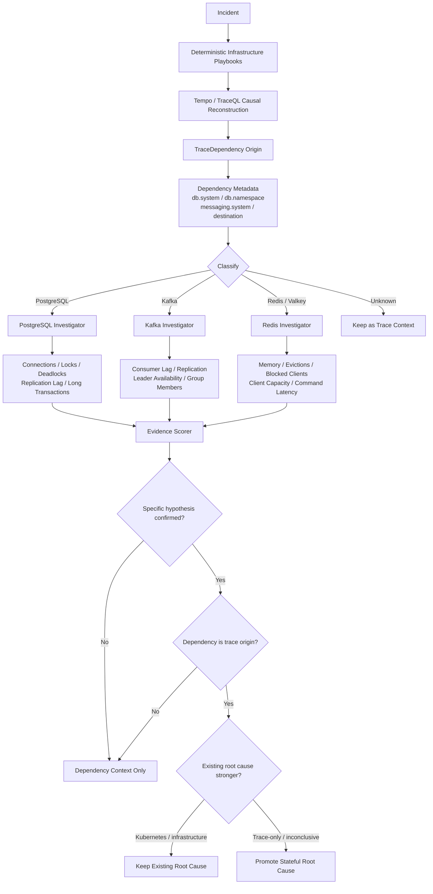
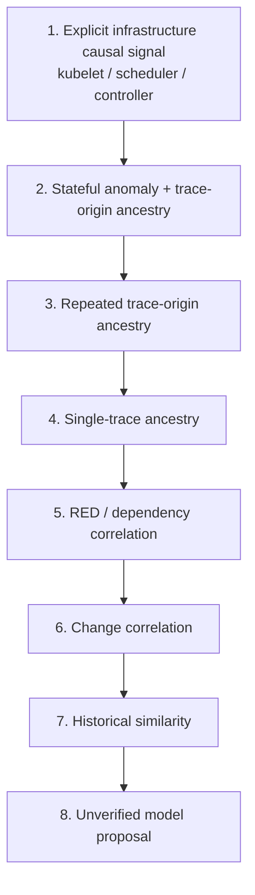
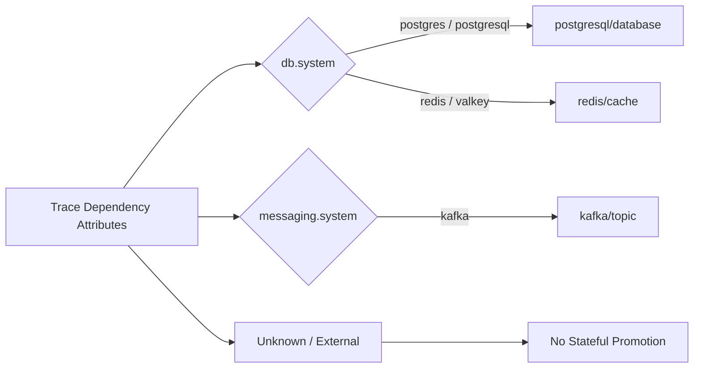
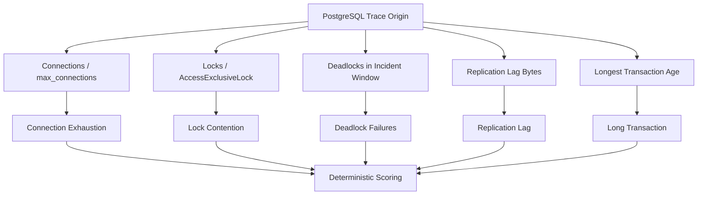
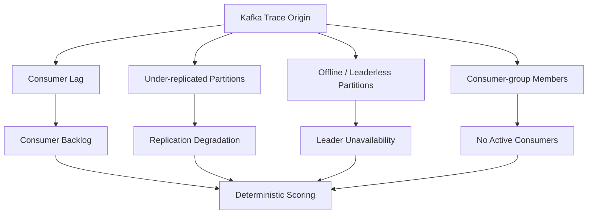
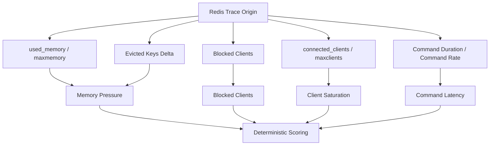
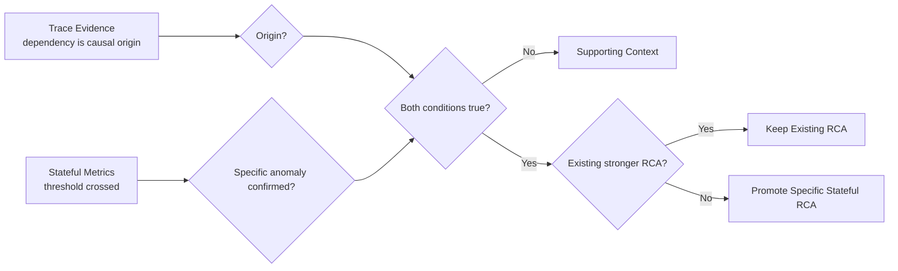
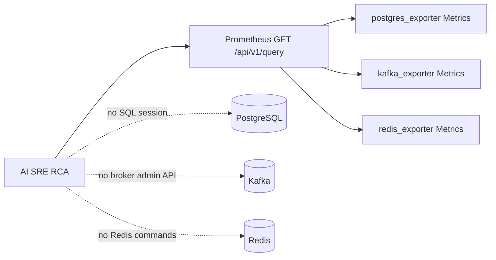

# Stateful dependency RCA — v0.5

[Português do Brasil](stateful-dependencies.pt-BR.md) · **English**

v0.5 extends the trace-aware causal graph into deterministic dependency-specific RCA. A PostgreSQL, Kafka or Redis node detected on a causal trace path can be promoted from a virtual dependency into a typed investigator that validates current runtime evidence through bounded, read-only Prometheus queries.

The design keeps the existing causal hierarchy: direct infrastructure evidence remains strongest, a trace identifies where the failure propagated from, and stateful telemetry explains **why that dependency failed**.

## End-to-end flow



## Causal hierarchy



Stateful evidence can refine a trace-only root cause, but it cannot silently replace a stronger confirmed Kubernetes root cause.

## Dependency discovery

The trace parser preserves a narrow allow-list of semantic attributes:

```text
db.system
db.namespace
db.name
server.address
server.port
peer.service
messaging.system
messaging.destination.name
messaging.destination
messaging.consumer.group.name
messaging.kafka.consumer.group
```

The classifier currently recognizes:



Unknown dependency types remain valid Awareness Graph context and are not guessed into one of the supported adapters.

## PostgreSQL investigator

The PostgreSQL path uses exporter-backed metrics and explicit thresholds.



Signals currently queried:

| Signal | Purpose |
| --- | --- |
| sessions / max_connections | detect connection-capacity exhaustion |
| active connections | runtime context |
| idle-in-transaction | pool/transaction leak context |
| total locks | broad lock pressure |
| AccessExclusiveLock | disruptive schema/DDL-style lock pressure |
| deadlock delta | direct deadlock evidence |
| WAL lag bytes | replication-health evidence |
| long transaction age | transaction lifetime / blocking context |

An unavailable optional metric stays `unknown`; it does not count as healthy evidence.

## Kafka investigator



The topic and consumer group are derived from trace messaging attributes when available. A missing consumer group does not cause the engine to invent one.

## Redis investigator



Memory pressure and eviction evidence are intentionally evaluated together because eviction without memory context may be expected under some cache policies.

## Evidence promotion

A dependency-specific hypothesis must pass two different tests before it can become the root cause:



This prevents a globally unhealthy database or broker from being blamed for an unrelated incident merely because it appears somewhere in the service graph.

## Query and target budgets

Stateful analysis is bounded by:

```text
STATEFUL_DEPENDENCY_ANALYSIS_ENABLED=true
STATEFUL_DEPENDENCY_MAX_TARGETS=4
DEPENDENCY_WINDOW_MINUTES=15
```

Only a small set of typed Prometheus queries is executed per supported target. There is no generic PromQL planner exposed to an LLM.

## Thresholds

Default thresholds are starting points, not universal production truth. They should be tuned to the deployment, exporter semantics and SLOs.

```text
POSTGRES_CONNECTION_UTILIZATION_CRITICAL=0.90
POSTGRES_LOCKS_CRITICAL=50
POSTGRES_ACCESS_EXCLUSIVE_LOCKS_CRITICAL=1
POSTGRES_DEADLOCKS_DELTA_CRITICAL=1
POSTGRES_REPLICATION_LAG_BYTES_CRITICAL=16777216
POSTGRES_LONG_TX_SECONDS_CRITICAL=60

KAFKA_CONSUMER_LAG_CRITICAL=10000
KAFKA_UNDER_REPLICATED_PARTITIONS_CRITICAL=1
KAFKA_OFFLINE_PARTITIONS_CRITICAL=1
KAFKA_CONSUMER_GROUP_MEMBERS_MIN=1

REDIS_MEMORY_UTILIZATION_CRITICAL=0.90
REDIS_EVICTIONS_DELTA_CRITICAL=1
REDIS_BLOCKED_CLIENTS_CRITICAL=1
REDIS_CLIENT_UTILIZATION_CRITICAL=0.90
REDIS_COMMAND_LATENCY_SECONDS_CRITICAL=0.05
```

## Read-only boundary



The investigator does not open SQL sessions, alter brokers, execute Redis commands or mutate dependency state. Remediation remains recommendation-only and requires a separate future approval plane.
