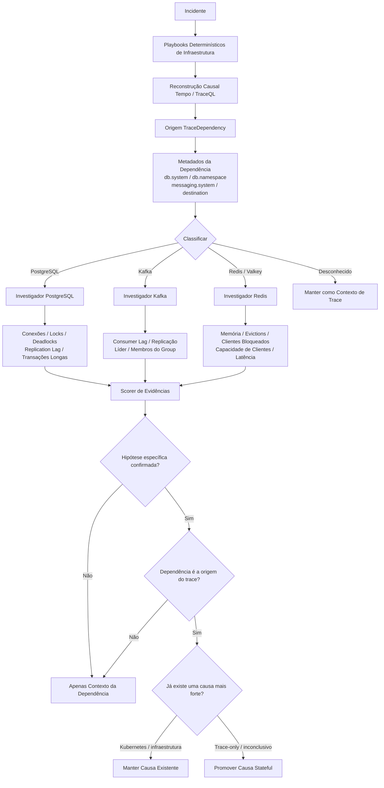
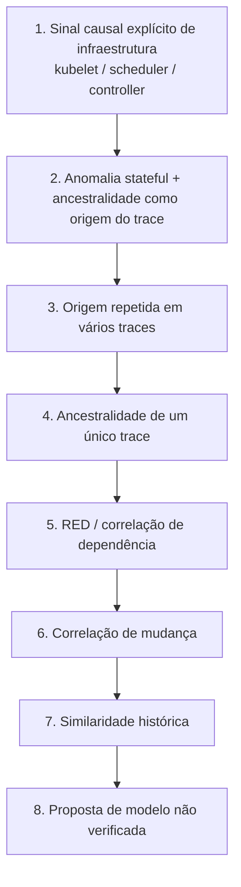
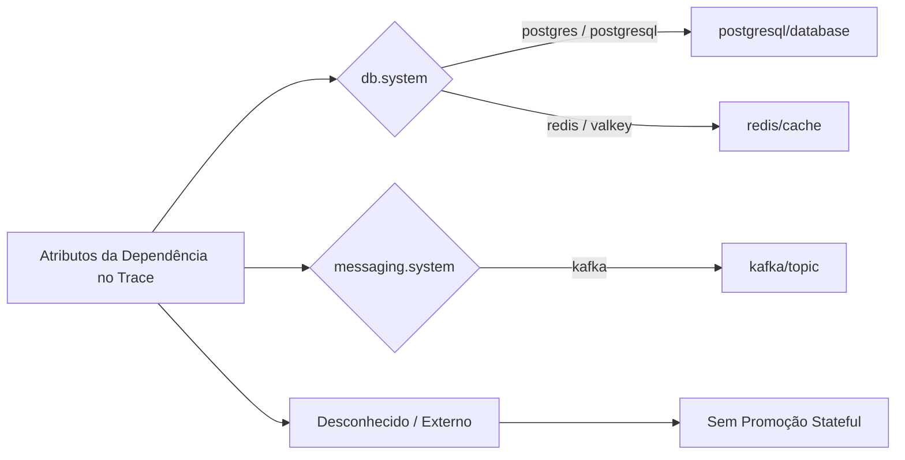
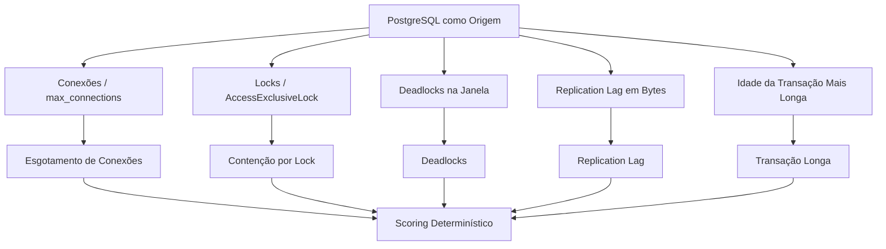
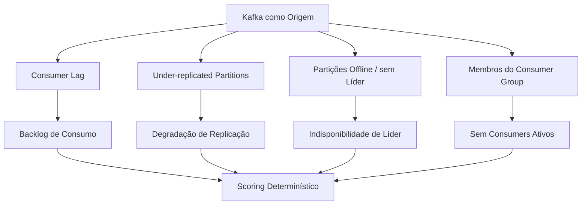
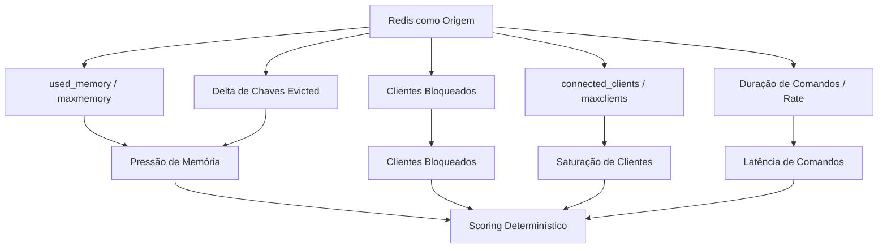
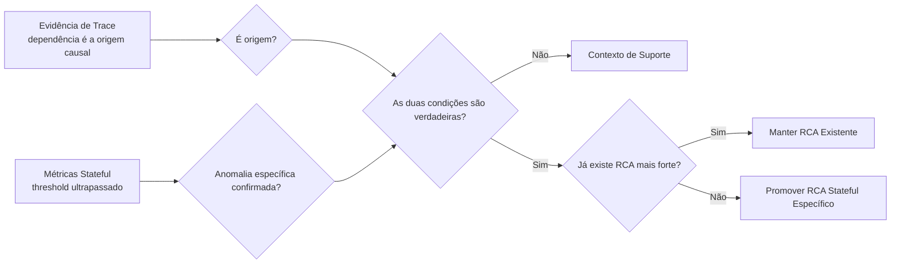
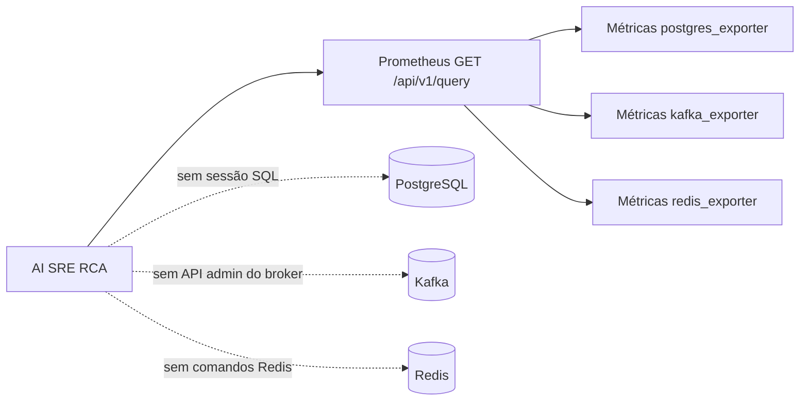

# RCA de dependências stateful — v0.5

**Português do Brasil** · [English](stateful-dependencies.md)

A v0.5 estende o grafo causal baseado em traces para RCA determinístico e específico de dependências. Um nó PostgreSQL, Kafka ou Redis detectado no caminho causal pode deixar de ser apenas uma dependência virtual e virar um investigador tipado que valida evidências atuais de runtime através de consultas Prometheus limitadas e somente leitura.

O desenho preserva a hierarquia causal existente: evidência direta de infraestrutura continua mais forte, o trace mostra **de onde a falha se propagou**, e a telemetria stateful explica **por que aquela dependência falhou**.

## Fluxo ponta a ponta



## Hierarquia causal



A evidência stateful pode refinar uma causa raiz baseada somente em trace, mas não substitui silenciosamente um RCA Kubernetes mais forte já confirmado.

## Descoberta da dependência

O parser de traces preserva apenas uma allow-list estreita de atributos semânticos:

```text
db.system
db.namespace
db.name
server.address
server.port
peer.service
messaging.system
messaging.destination.name
messaging.destination
messaging.consumer.group.name
messaging.kafka.consumer.group
```

O classificador atual reconhece:



Tipos desconhecidos continuam válidos como contexto no Awareness Graph e não são forçados para um dos adapters suportados.

## Investigador PostgreSQL



Sinais consultados atualmente:

| Sinal | Objetivo |
| --- | --- |
| sessions / max_connections | detectar esgotamento da capacidade de conexões |
| conexões ativas | contexto de runtime |
| idle-in-transaction | contexto de pool/transação vazando |
| total de locks | pressão ampla por locks |
| AccessExclusiveLock | pressão disruptiva típica de DDL/schema |
| delta de deadlocks | evidência direta de deadlock |
| lag WAL em bytes | evidência de saúde de replicação |
| idade da transação longa | contexto de duração/bloqueio |

Uma métrica opcional indisponível fica em `unknown`; ela não conta como evidência saudável.

## Investigador Kafka



Topic e consumer group são derivados dos atributos de messaging no trace quando presentes. Um consumer group ausente não é inventado pela engine.

## Investigador Redis



Pressão de memória e evictions são avaliadas em conjunto porque eviction isolada pode ser esperada dependendo da política de cache.

## Promoção de evidência

Uma hipótese específica de dependência precisa passar por dois testes diferentes antes de virar a causa raiz:



Isso impede que um banco ou broker globalmente degradado seja culpado por um incidente não relacionado apenas porque apareceu em algum ponto do grafo de serviços.

## Budgets de consulta e alvos

A análise stateful é limitada por:

```text
STATEFUL_DEPENDENCY_ANALYSIS_ENABLED=true
STATEFUL_DEPENDENCY_MAX_TARGETS=4
DEPENDENCY_WINDOW_MINUTES=15
```

Somente um conjunto pequeno de consultas Prometheus tipadas é executado por target suportado. Não existe um planejador PromQL genérico exposto ao LLM.

## Thresholds

Os thresholds padrão são pontos de partida, não verdades universais de produção. Devem ser ajustados ao ambiente, à semântica dos exporters e aos SLOs.

```text
POSTGRES_CONNECTION_UTILIZATION_CRITICAL=0.90
POSTGRES_LOCKS_CRITICAL=50
POSTGRES_ACCESS_EXCLUSIVE_LOCKS_CRITICAL=1
POSTGRES_DEADLOCKS_DELTA_CRITICAL=1
POSTGRES_REPLICATION_LAG_BYTES_CRITICAL=16777216
POSTGRES_LONG_TX_SECONDS_CRITICAL=60

KAFKA_CONSUMER_LAG_CRITICAL=10000
KAFKA_UNDER_REPLICATED_PARTITIONS_CRITICAL=1
KAFKA_OFFLINE_PARTITIONS_CRITICAL=1
KAFKA_CONSUMER_GROUP_MEMBERS_MIN=1

REDIS_MEMORY_UTILIZATION_CRITICAL=0.90
REDIS_EVICTIONS_DELTA_CRITICAL=1
REDIS_BLOCKED_CLIENTS_CRITICAL=1
REDIS_CLIENT_UTILIZATION_CRITICAL=0.90
REDIS_COMMAND_LATENCY_SECONDS_CRITICAL=0.05
```

## Boundary read-only



O investigador não abre sessões SQL, não altera brokers, não executa comandos Redis e não modifica estado das dependências. A remediação continua sendo apenas recomendação e exige um futuro plano separado com aprovação.
