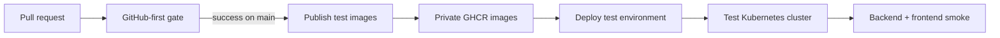

# Test environment

The repository can now build and deploy a validated test image without relying on a developer workstation.

## Delivery chain

## Published images

After a successful `GitHub-first gate` on `main`, the `Publish test images` workflow publishes:

- `ghcr.io/marcocristofolini/ai-sre-rca-backend:edge`
- `ghcr.io/marcocristofolini/ai-sre-rca-backend:sha-<12-char-sha>`
- `ghcr.io/marcocristofolini/ai-sre-rca-frontend:edge`
- `ghcr.io/marcocristofolini/ai-sre-rca-frontend:sha-<12-char-sha>`

For reproducible testing, prefer the immutable `sha-...` tag once the desired main commit has been published.

## GitHub Environment

Create a GitHub Environment named `test` and configure:

- `TEST_KUBECONFIG_B64`: base64-encoded kubeconfig with access to the test cluster;
- `GHCR_READ_TOKEN`: token with `read:packages` for the private GHCR packages;
- `TEST_HELM_VALUES_B64` (optional): base64-encoded Helm values containing test-environment integration overrides.

The baseline chart values in `helm/ai-sre-rca/values-test.yaml` intentionally start in `DEMO_MODE=true`, with authentication, notifications and remediation disabled. This proves deployment and application health without requiring production-like credentials.

To test real integrations, provide `TEST_HELM_VALUES_B64` with the environment-specific overrides. Keep credentials in Kubernetes Secrets referenced by `existingSecret`; do not commit secrets to values files.

## Deploy

Open **Actions → Deploy test environment → Run workflow**.

Inputs:

- `image_tag`: use `edge` for the newest validated main build, or preferably `sha-<12-char-sha>`;
- `namespace`: defaults to `ai-sre-rca-test`;
- `release_name`: defaults to `ai-sre-rca-test`.

The workflow:

1. verifies cluster credentials;
2. creates/updates the namespace;
3. creates the `ghcr-pull` registry secret;
4. applies baseline test values plus optional secret overrides;
5. waits for backend/frontend rollouts;
6. port-forwards both services;
7. verifies backend `/healthz` reports `0.8.0-rc.3`;
8. verifies the frontend returns the AI SRE RCA application;
9. prints Kubernetes diagnostics on failure.

## Test phases

Recommended order:

1. deployment smoke in demo mode;
2. persistent PostgreSQL/pgvector;
3. test-cluster read-only Kubernetes identity;
4. Prometheus, Loki and Tempo;
5. PostgreSQL stateful failure/recovery scenario;
6. Persistent Awareness Graph reconciliation;
7. agentic investigation;
8. guarded remediation only after read-only testing is stable.

Keep the remediator disabled during the initial test-environment phase.
