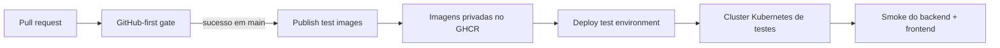

# Ambiente de testes

O repositório agora pode construir e implantar uma imagem validada de testes sem depender da máquina de desenvolvimento.

## Cadeia de entrega

## Imagens publicadas

Depois de um `GitHub-first gate` bem-sucedido em `main`, o workflow `Publish test images` publica:

- `ghcr.io/marcocristofolini/ai-sre-rca-backend:edge`
- `ghcr.io/marcocristofolini/ai-sre-rca-backend:sha-<sha-de-12-caracteres>`
- `ghcr.io/marcocristofolini/ai-sre-rca-frontend:edge`
- `ghcr.io/marcocristofolini/ai-sre-rca-frontend:sha-<sha-de-12-caracteres>`

Para testes reproduzíveis, prefira a tag imutável `sha-...` depois que o commit desejado de `main` for publicado.

## GitHub Environment

Crie um GitHub Environment chamado `test` e configure:

- `TEST_KUBECONFIG_B64`: kubeconfig do cluster de testes codificado em base64;
- `GHCR_READ_TOKEN`: token com `read:packages` para os pacotes privados no GHCR;
- `TEST_HELM_VALUES_B64` (opcional): arquivo de values Helm do ambiente de testes codificado em base64.

Os valores base em `helm/ai-sre-rca/values-test.yaml` começam intencionalmente com `DEMO_MODE=true`, autenticação, notificações e remediação desabilitadas. Assim validamos primeiro o deploy e a saúde da aplicação sem exigir credenciais semelhantes às de produção.

Para testar integrações reais, forneça `TEST_HELM_VALUES_B64` com os overrides específicos do ambiente. Credenciais devem permanecer em Kubernetes Secrets referenciados por `existingSecret`; não coloque segredos nos arquivos versionados.

## Deploy

Abra **Actions → Deploy test environment → Run workflow**.

Inputs:

- `image_tag`: use `edge` para a build validada mais recente de `main`, ou preferencialmente `sha-<sha-de-12-caracteres>`;
- `namespace`: padrão `ai-sre-rca-test`;
- `release_name`: padrão `ai-sre-rca-test`.

O workflow:

1. valida as credenciais do cluster;
2. cria/atualiza o namespace;
3. cria o secret `ghcr-pull`;
4. aplica os values base de testes mais overrides secretos opcionais;
5. aguarda os rollouts de backend e frontend;
6. faz port-forward dos dois serviços;
7. confirma que `/healthz` do backend reporta `0.8.0-rc.3`;
8. confirma que o frontend entrega a aplicação AI SRE RCA;
9. imprime diagnósticos Kubernetes se algo falhar.

## Fases de teste

Ordem recomendada:

1. smoke de deployment em demo mode;
2. PostgreSQL/pgvector persistente;
3. identidade read-only no cluster Kubernetes de testes;
4. Prometheus, Loki e Tempo;
5. cenário stateful PostgreSQL de falha/recuperação;
6. reconciliação do Persistent Awareness Graph;
7. investigação agentic;
8. remediação guardada somente depois da fase read-only estar estável.

Mantenha o remediator desabilitado durante a fase inicial de testes.
