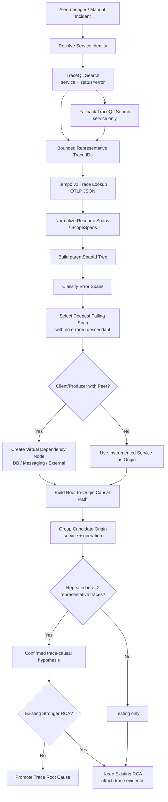
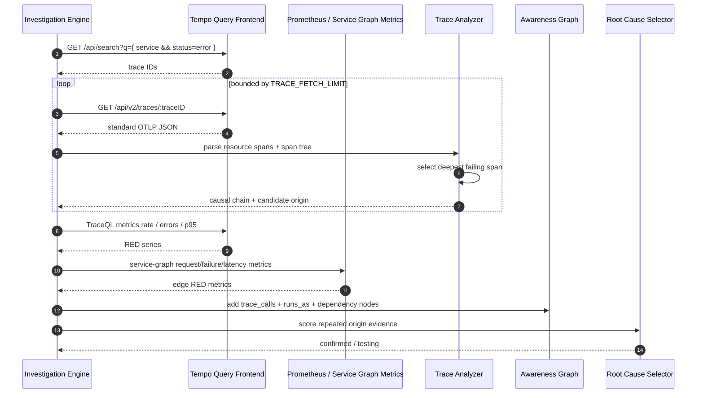
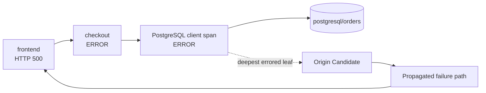
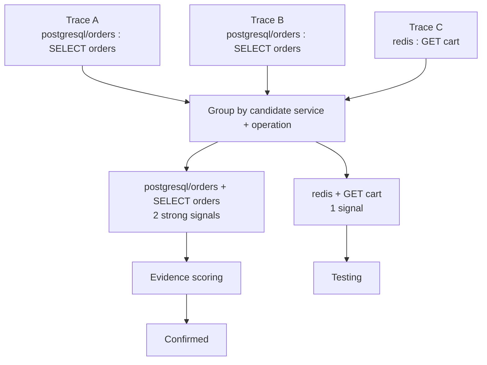
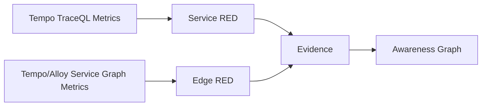
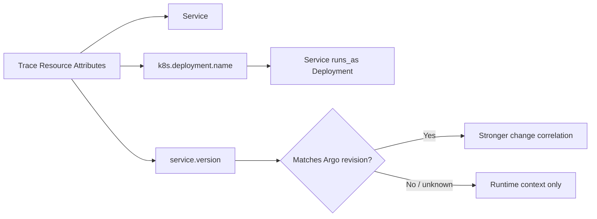
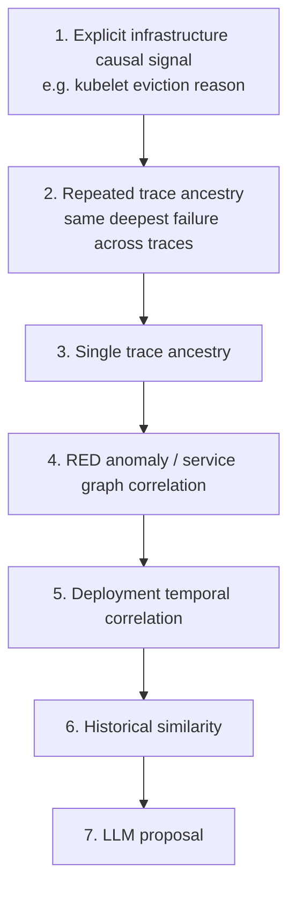

# Trace-aware causal propagation — v0.4

[Português do Brasil](trace-causality.pt-BR.md) · **English**

v0.4 adds a bounded, read-only Tempo investigation path that turns distributed traces into typed evidence. The objective is not to let a model "reason over traces" freely; the engine deterministically reconstructs span ancestry, identifies the deepest failing operation, compares independent representative traces, and only then promotes trace evidence into a root-cause candidate.

## End-to-end flow



## Investigation sequence



## Causal origin selection

The deterministic selector prefers an errored span that has no errored descendant. Among multiple candidates it selects the deepest span in the trace tree, then the earliest start time. This approximates the first downstream failure rather than the most visible upstream symptom.



When a failing client or producer span contains peer/database/messaging attributes, the peer becomes a virtual dependency node. The instrumented client span remains on the path as the upstream propagating service.

## Cross-trace confirmation rule

One trace is useful evidence but not enough for a trace-only root cause.



The existing evidence scorer still applies. Two independent strong trace-chain evidence items reach the confirmation threshold; one strong trace remains testing.

## RED signals

v0.4 gathers two complementary RED views:

1. **TraceQL metrics** for the investigated service:
   - request/span rate
   - error span rate
   - p95 span duration
2. **Service-graph edge metrics**:
   - requests
   - failures
   - error ratio
   - p95 server-side latency



RED data strengthens context and blast-radius understanding. It does not by itself replace parent/child causal ancestry.

## Trace-to-Deployment correlation

The OTLP resource attributes are retained per service. When present, v0.4 correlates:

- `k8s.deployment.name`
- `k8s.namespace.name`
- `k8s.pod.name`
- `k8s.node.name`
- `service.version`
- `deployment.environment.name`



## Safety hierarchy



A confirmed Kubernetes playbook is never silently replaced by trace evidence. Trace evidence may enrich the Awareness Graph, hypotheses, timeline and remediation context.

## Bounded read-only queries

The trace adapter only issues GET requests:

- `GET /api/search`
- `GET /api/v2/traces/<traceID>`
- `GET /api/metrics/query_range`

Limits are controlled by:

```text
TRACE_ANALYSIS_ENABLED=true
TRACE_WINDOW_MINUTES=15
TRACE_SEARCH_LIMIT=8
TRACE_FETCH_LIMIT=4
TRACE_SLOW_SPAN_MIN_MS=500
TRACE_SLOW_SPAN_ROOT_FRACTION=0.5
```

There is no Tempo write endpoint, shell access or generic arbitrary-command interface in the investigator.
