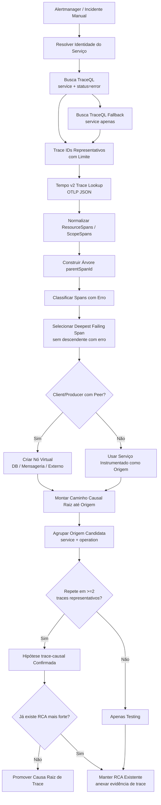
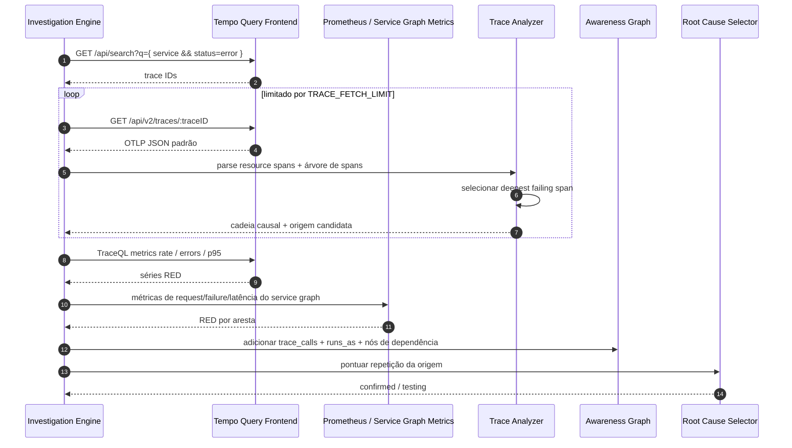
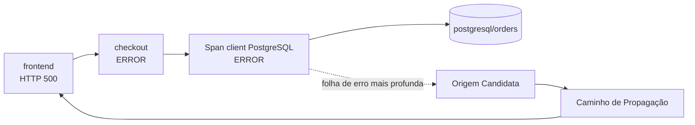
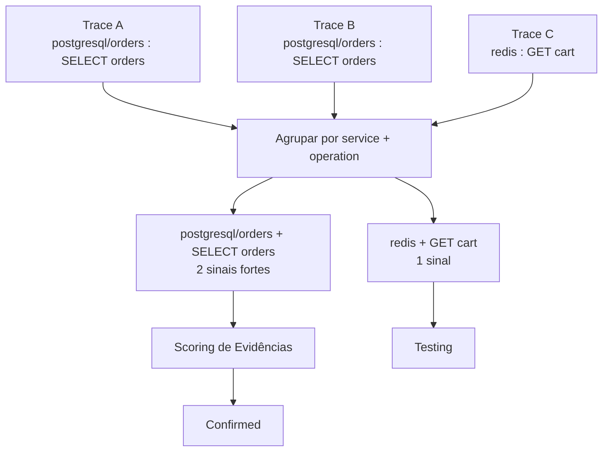
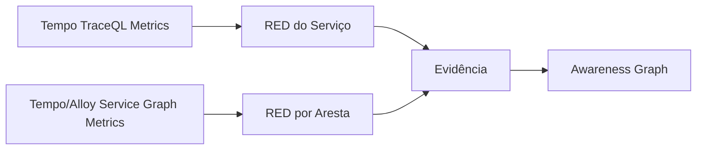
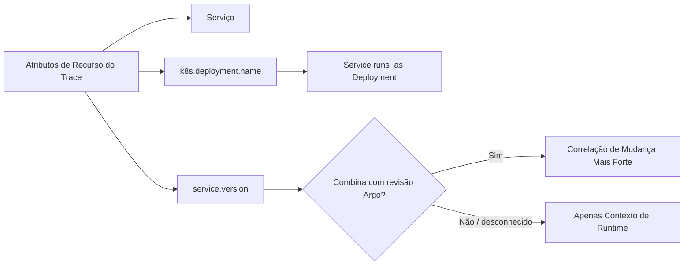
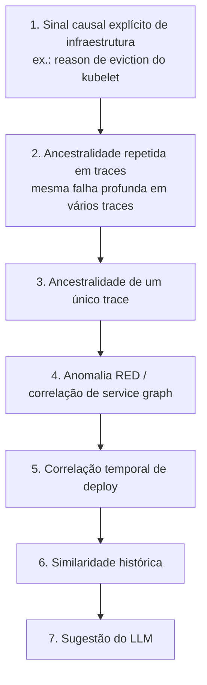

# Propagação causal trace-aware — v0.4

**Português do Brasil** · [English](trace-causality.md)

A v0.4 adiciona um caminho de investigação Tempo limitado e somente leitura que transforma traces distribuídos em evidência tipada. O objetivo não é deixar um modelo “raciocinar livremente sobre traces”; a engine reconstrói deterministicamente a ancestralidade dos spans, identifica a operação downstream mais profunda que falhou, compara traces representativos independentes e só então promove a evidência de trace para candidata a causa raiz.

## Fluxo ponta a ponta



## Sequência da investigação



## Seleção da origem causal

O seletor determinístico prefere um span com erro que não tenha descendente também com erro. Se houver vários candidatos, escolhe o span mais profundo na árvore e, depois, o que começou antes. Isso aproxima a primeira falha downstream em vez do sintoma upstream mais visível.



Quando um span client ou producer com erro contém atributos de peer, banco ou mensageria, o peer vira um nó virtual de dependência. O span instrumentado continua no caminho como o serviço upstream que propagou a falha.

## Regra de confirmação entre traces

Um único trace é evidência útil, mas não basta para confirmar uma causa raiz baseada apenas em tracing.



O scorer de evidências existente continua valendo. Duas evidências fortes independentes de cadeia causal atingem o limiar de confirmação; um único trace forte permanece em testing.

## Sinais RED

A v0.4 coleta duas visões RED complementares:

1. **TraceQL metrics** para o serviço investigado:
   - rate de spans/requests
   - rate de spans com erro
   - p95 de duração
2. **Métricas por aresta do service graph**:
   - requests
   - failures
   - error ratio
   - p95 de latência server-side



RED fortalece contexto e entendimento de blast radius. Sozinho, não substitui a ancestralidade causal pai/filho.

## Correlação Trace → Deployment

Os atributos de recurso OTLP são preservados por serviço. Quando presentes, a v0.4 correlaciona:

- `k8s.deployment.name`
- `k8s.namespace.name`
- `k8s.pod.name`
- `k8s.node.name`
- `service.version`
- `deployment.environment.name`



## Hierarquia de segurança causal



Um playbook Kubernetes já confirmado nunca é substituído silenciosamente por evidência de trace. Traces podem enriquecer Awareness Graph, hipóteses, timeline e contexto de remediação.

## Consultas limitadas e read-only

O adapter de trace emite apenas GETs:

- `GET /api/search`
- `GET /api/v2/traces/<traceID>`
- `GET /api/metrics/query_range`

Os limites são controlados por:

```text
TRACE_ANALYSIS_ENABLED=true
TRACE_WINDOW_MINUTES=15
TRACE_SEARCH_LIMIT=8
TRACE_FETCH_LIMIT=4
TRACE_SLOW_SPAN_MIN_MS=500
TRACE_SLOW_SPAN_ROOT_FRACTION=0.5
```

Não existe endpoint de escrita no Tempo, acesso a shell ou interface genérica de execução de comandos dentro do investigador.
