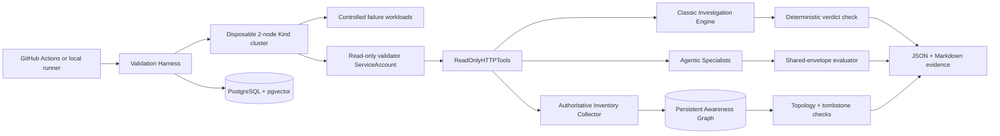

# Real Environment Validation Harness

The v0.8.0-rc.1 validation harness proves the Kubernetes RCA path against a disposable, real Kubernetes control plane instead of mocks or canned fixtures.

## Release gate

The harness creates a two-node Kind cluster, applies a read-only validator ServiceAccount, starts PostgreSQL/pgvector, injects controlled failures, and runs both the classic deterministic engine and the v0.8 agentic execution path against the live Kubernetes API.

The first RC gate covers:

- real `OOMKilled` state, expected root cause `container-oom` when Prometheus is intentionally unavailable;
- real `CrashLoopBackOff` with exit code 42, expected root cause `application-exit`;
- real `FailedScheduling` caused by impossible resource requests, expected root cause `insufficient-resources`;
- authoritative Kubernetes inventory collection into the Persistent Awareness Graph;
- real `owned_by`, `serves` and `scheduled_on` relationships;
- authoritative tombstoning after a resource is deleted from the real cluster;
- SHA-256 evidence-integrity verification;
- root-cause parity between classic and agentic Kubernetes evaluation.

Prometheus, Loki, Tempo and Argo CD are deliberately unreachable in this first gate. The test therefore also verifies that optional-source outages do not invent healthy evidence or override direct Kubernetes signals.

## Flow



## Run locally

Prerequisites are Docker, Kind, kubectl and the backend Python dependencies.

```bash
cd backend
python -m venv .venv
source .venv/bin/activate
pip install -e '.[dev]'
cd ..
make validate-harness
make validate-real
```

The harness pins the Kind node image by digest. The CI workflow separately pins the Kind binary and verifies its SHA-256 checksum.

## Evidence

Successful or failed runs write only these shareable artifacts:

- `validation-artifacts/validation-report.json`
- `validation-artifacts/validation-report.md`

Temporary Kubernetes bearer-token and CA files live below `validation-artifacts/runtime/` only while the job is running and are never uploaded by CI.

The process exits non-zero when any required signal, deterministic verdict, agentic verdict, graph relationship, evidence-integrity check or tombstone invariant fails.

## Cleanup

By default the harness removes the disposable Kind cluster and PostgreSQL container in a `finally` block. Pass `--keep` only for local debugging.
