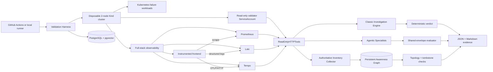

# Real Environment Validation Harness

The validation harness now has two layers:

- **v0.8.0-rc.1 baseline:** real Kubernetes failure states plus authoritative Persistent Awareness Graph reconciliation.
- **v0.8.0-rc.2 full-stack release candidate:** real Prometheus, Loki and Tempo/OpenTelemetry telemetry produced by an instrumented workload and consumed through the production read-only adapters.
- **v0.8.0-rc.3 development:** stateful dependency recovery validation, beginning with PostgreSQL exporter-contract telemetry over live Prometheus queries.

## Release gate

The harness creates a disposable two-node Kind cluster, applies the read-only validator ServiceAccount, starts PostgreSQL/pgvector, deploys the validation workloads, and runs the production investigation code against live APIs.

For the rc2 path it additionally deploys:

- Prometheus, scraping the instrumented validation workload every two seconds;
- Loki, receiving structured application logs through its HTTP push API;
- Tempo, receiving OTLP/HTTP traces produced by the official OpenTelemetry SDK;
- an instrumented `frontend` workload that exposes Prometheus metrics and emits correlated logs and traces.

The observability images and the Kind node image are pinned by digest. The workload image pins its Python base image and OpenTelemetry package versions.

## What the gate proves

The Kubernetes baseline still requires:

- real `OOMKilled`, resolving to `container-oom`;
- real restart backoff with exit code 42, preserving classic/agentic parity and never promoting `application-exit` without log evidence;
- real `FailedScheduling` caused by impossible resource requests, resolving to `insufficient-resources`;
- authoritative Kubernetes inventory ingestion;
- `owned_by`, `serves` and `scheduled_on` graph relationships;
- authoritative tombstones after deleting real resources;
- SHA-256 evidence-integrity verification.

The rc2 full-stack path additionally generates three failing checkout requests. Each request produces:

- an HTTP 500 counter visible through Prometheus;
- a structured error log in Loki carrying both Pod/service labels and the trace ID;
- an OTLP trace with the causal path `frontend -> postgresql/orders@orders-db:5432`;
- service-graph RED metrics exposed through Prometheus.

The gate requires Prometheus, Loki and Tempo to report healthy through the production capability checks. At least two independent traces must converge on the same downstream origin before `trace-causal-propagation` can be selected. The agentic execution must complete its metrics, logs and traces specialists, and both classic and agentic evaluation must agree on the deterministic root cause.

A failure in an optional source must never fabricate evidence. The original rc1 crash-loop invariant remains: without the evidence required for a more specific application-exit diagnosis, the engine may stay inconclusive or select the generic crash-loop mechanism, but it may not overclaim specificity.

## v0.8.0-rc.3 PostgreSQL recovery slice

The first rc3 slice exercises the production PostgreSQL Prometheus adapter against live Prometheus data using the exact metric names and labels expected from postgres_exporter-compatible telemetry.

The validation workload exposes two states:

- **pressure:** 19 of 20 PostgreSQL connections are represented as in use, producing 95% connection utilization and requiring `postgres-connection-exhaustion:*` to supersede the trace-only root cause;
- **recovered:** the same dependency returns to 4 of 20 connections while new failing traces are still generated, requiring the engine to stop promoting the old PostgreSQL-specific cause and return to `trace-causal-propagation`.

Both classic and agentic paths must agree. The agentic database specialist must complete in both phases, and evidence integrity remains mandatory.

This slice validates adapter contract and recovery semantics. A subsequent rc3 slice will replace the exporter-compatible workload metrics with an actual PostgreSQL + postgres_exporter runtime before the release candidate is closed.

## Flow



## Run locally

Prerequisites are Docker, Kind, kubectl and the backend Python dependencies.

```bash
cd backend
python -m venv .venv
source .venv/bin/activate
pip install -e '.[dev]'
cd ..
make validate-harness
make validate-real
```

The harness builds the small validation workload locally, loads it into Kind, starts the telemetry stack and cleans everything up afterward.

## Evidence

Every run writes only these shareable artifacts:

- `validation-artifacts/validation-report.json`
- `validation-artifacts/validation-report.md`

The v3 report keeps all rc2 sections and adds PostgreSQL stateful pressure/recovery evidence. The pressure phase must promote a PostgreSQL-specific RCA while the recovery phase must fall back to trace causality once the current PostgreSQL telemetry is healthy again.

Temporary Kubernetes bearer-token and CA files live under `validation-artifacts/runtime/` only while the job is running and are never uploaded by CI.

The process exits non-zero when any required runtime signal, telemetry source, deterministic verdict, agentic verdict, graph relationship, evidence-integrity check or tombstone invariant fails.

## Cleanup

By default the harness terminates port-forwards, removes the disposable Kind cluster and removes the PostgreSQL container in a `finally` path. Pass `--keep` only for local debugging.
