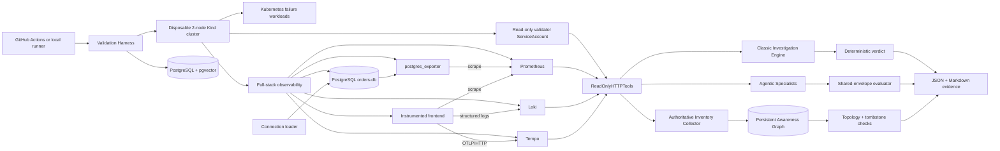

# Real Environment Validation Harness

The validation harness now has three layers:

- **v0.8.0-rc.1 baseline:** real Kubernetes failure states plus authoritative Persistent Awareness Graph reconciliation.
- **v0.8.0-rc.2 full-stack release candidate:** real Prometheus, Loki and Tempo/OpenTelemetry telemetry produced by an instrumented workload and consumed through the production read-only adapters.
- **v0.8.0-rc.3 development:** a real PostgreSQL 17 instance, real postgres_exporter telemetry, deterministic stateful root-cause promotion, and an explicit recovery phase that must stop promoting stale causal evidence.

## Release gate

The harness creates a disposable two-node Kind cluster, applies the read-only validator ServiceAccount, starts PostgreSQL/pgvector, deploys the validation workloads, and runs the production investigation code against live APIs.

For the full-stack paths it additionally deploys:

- Prometheus, scraping the instrumented validation workload every two seconds;
- Loki, receiving structured application logs through its HTTP push API;
- Tempo, receiving OTLP/HTTP traces produced by the official OpenTelemetry SDK;
- an instrumented `frontend` workload that exposes Prometheus metrics and emits correlated logs and traces;
- PostgreSQL 17 as the traced `orders-db:5432` dependency;
- postgres_exporter, with Prometheus relabeling the exporter target to the traced database instance identity;
- a bounded connection-loader workload that creates a real connection-capacity anomaly and can be scaled to zero for recovery validation.

The observability images and the Kind node image are pinned by digest. The workload image pins its Python base image and OpenTelemetry package versions.

## What the gate proves

The Kubernetes baseline still requires:

- real `OOMKilled`, resolving to `container-oom`;
- real restart backoff with exit code 42, preserving classic/agentic parity and never promoting `application-exit` without log evidence;
- real `FailedScheduling` caused by impossible resource requests, resolving to `insufficient-resources`;
- authoritative Kubernetes inventory ingestion;
- `owned_by`, `serves` and `scheduled_on` graph relationships;
- authoritative tombstones after deleting real resources;
- SHA-256 evidence-integrity verification.

The rc2 full-stack path additionally generates three failing checkout requests. Each request produces:

- an HTTP 500 counter visible through Prometheus;
- a structured error log in Loki carrying both Pod/service labels and the trace ID;
- an OTLP trace with the causal path `frontend -> postgresql/orders@orders-db:5432`;
- service-graph RED metrics exposed through Prometheus.

The gate requires Prometheus, Loki and Tempo to report healthy through the production capability checks. At least two independent traces must converge on the same downstream origin before `trace-causal-propagation` can be selected. The agentic execution must complete its metrics, logs and traces specialists, and both classic and agentic evaluation must agree on the deterministic root cause.

The rc3 PostgreSQL path first requires live exporter utilization to cross a validation threshold. With the same failing traces, classic and agentic RCA must then converge on a `postgres-connection-exhaustion:...` root and the agentic database specialist must complete. The loader is subsequently scaled to zero, exporter utilization must fall below the recovery threshold, and the workload emits three healthy requests with fresh success traces and logs. A recovery investigation uses only the fresh post-recovery trace window and must not promote `trace-causal-propagation` or any PostgreSQL/Kafka/Redis anomaly root.

A failure in an optional source must never fabricate evidence. The original rc1 crash-loop invariant remains: without the evidence required for a more specific application-exit diagnosis, the engine may stay inconclusive or select the generic crash-loop mechanism, but it may not overclaim specificity.

## Flow



## Run locally

Prerequisites are Docker, Kind, kubectl and the backend Python dependencies.

```bash
cd backend
python -m venv .venv
source .venv/bin/activate
pip install -e '.[dev]'
cd ..
make validate-harness
make validate-real
```

The harness builds the small validation workload locally, loads it into Kind, starts the telemetry stack and cleans everything up afterward.

## Evidence

Every run writes only these shareable artifacts:

- `validation-artifacts/validation-report.json`
- `validation-artifacts/validation-report.md`

The v3 report includes Kubernetes scenarios, full-stack source health and telemetry counts, distributed-trace RCA parity, real PostgreSQL exporter saturation, stateful classic/agentic parity, recovery evidence, evidence integrity, and Persistent Awareness Graph reconciliation/tombstones.

Temporary Kubernetes bearer-token and CA files live under `validation-artifacts/runtime/` only while the job is running and are never uploaded by CI.

The process exits non-zero when any required runtime signal, telemetry source, deterministic verdict, agentic verdict, graph relationship, evidence-integrity check or tombstone invariant fails.

## Cleanup

By default the harness terminates port-forwards, removes the disposable Kind cluster and removes the PostgreSQL container in a `finally` path. Pass `--keep` only for local debugging.
