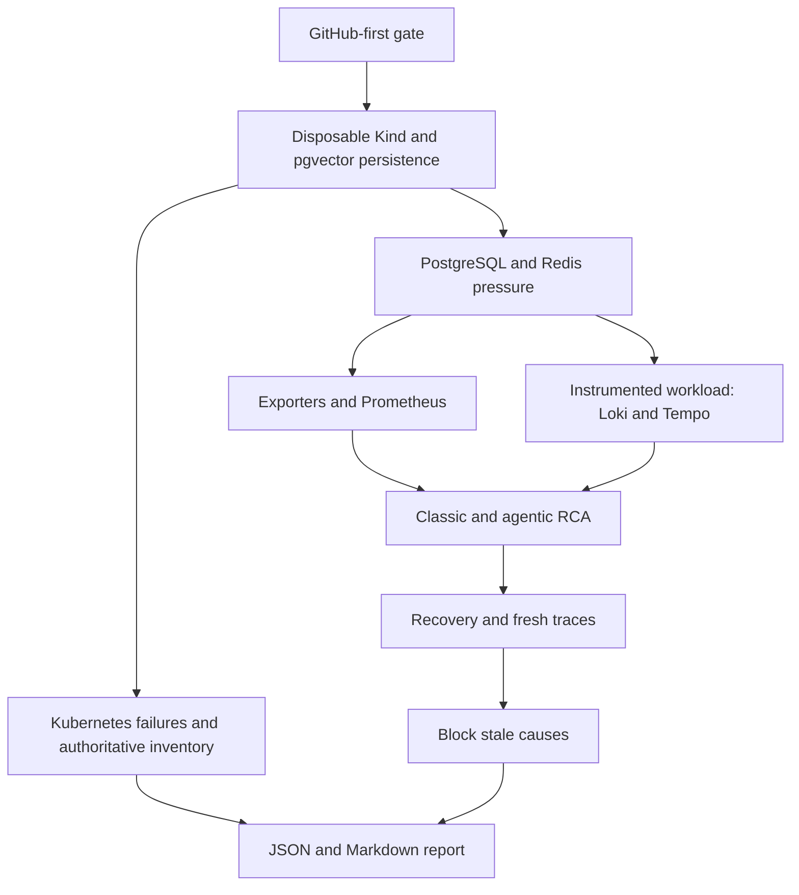

# Real Environment Validation Harness

The validation harness now has three layers:

- **v0.8.0-rc.1 baseline:** real Kubernetes failure states plus authoritative Persistent Awareness Graph reconciliation.
- **v0.8.0-rc.2 full-stack release candidate:** real Prometheus, Loki and Tempo/OpenTelemetry telemetry produced by an instrumented workload and consumed through the production read-only adapters.
- **v0.8.0-rc.3 development:** a real PostgreSQL 17 instance, real postgres_exporter telemetry, deterministic stateful root-cause promotion, and an explicit recovery phase that must stop promoting stale causal evidence.

## Release gate

The harness creates a disposable two-node Kind cluster, applies the read-only validator ServiceAccount, starts PostgreSQL/pgvector, deploys the validation workloads, and runs the production investigation code against live APIs.

For the full-stack paths it additionally deploys:

- Prometheus, scraping the instrumented validation workload every two seconds;
- Loki, receiving structured application logs through its HTTP push API;
- Tempo, receiving OTLP/HTTP traces produced by the official OpenTelemetry SDK;
- an instrumented `frontend` workload that exposes Prometheus metrics and emits correlated logs and traces;
- PostgreSQL 17 as the traced `orders-db:5432` dependency;
- postgres_exporter, with Prometheus relabeling the exporter target to the traced database instance identity;
- a bounded connection-loader workload that creates a real connection-capacity anomaly and can be scaled to zero for recovery validation.

The observability images and the Kind node image are pinned by digest. The workload image pins its Python base image and OpenTelemetry package versions.

## What the gate proves

The Kubernetes baseline still requires:

- real `OOMKilled`, resolving to `container-oom`;
- real restart backoff with exit code 42, preserving classic/agentic parity and never promoting `application-exit` without log evidence;
- real `FailedScheduling` caused by impossible resource requests, resolving to `insufficient-resources`;
- authoritative Kubernetes inventory ingestion;
- `owned_by`, `serves` and `scheduled_on` graph relationships;
- authoritative tombstones after deleting real resources;
- SHA-256 evidence-integrity verification.

The rc2 full-stack path additionally generates three failing checkout requests. Each request produces:

- an HTTP 500 counter visible through Prometheus;
- a structured error log in Loki carrying both Pod/service labels and the trace ID;
- an OTLP trace with the causal path `frontend -> postgresql/orders@orders-db:5432`;
- service-graph RED metrics exposed through Prometheus.

The gate requires Prometheus, Loki and Tempo to report healthy through the production capability checks. At least two independent traces must converge on the same downstream origin before `trace-causal-propagation` can be selected. The agentic execution must complete its metrics, logs and traces specialists, and both classic and agentic evaluation must agree on the deterministic root cause.

The rc3 PostgreSQL path first requires live exporter utilization to cross a validation threshold. With the same failing traces, classic and agentic RCA must then converge on a `postgres-connection-exhaustion:...` root and the agentic database specialist must complete. The loader is subsequently scaled to zero, exporter utilization must fall below the recovery threshold, and the workload emits three healthy requests with fresh success traces and logs. A recovery investigation uses only the fresh post-recovery trace window and must not promote `trace-causal-propagation` or any PostgreSQL/Kafka/Redis anomaly root.

A failure in an optional source must never fabricate evidence. The original rc1 crash-loop invariant remains: without the evidence required for a more specific application-exit diagnosis, the engine may stay inconclusive or select the generic crash-loop mechanism, but it may not overclaim specificity.

## rc.3 Redis scenario

The harness deploys Redis 7.4 and redis_exporter using digest-pinned images. Redis uses `maxmemory=16mb`, `noeviction` and disabled persistence. The validation workload writes at most 256 fixed-prefix 64 KiB keys until memory pressure is reached. A 2 MiB write must be rejected by Redis with OOM; failure traces record that actual rejection.

This path uses the OTel service `cache-frontend`, isolated from the PostgreSQL scenario. The exporter instance label is `cache:6379`, matching the trace identity `redis/0@cache:6379`. Prometheus, Loki and Tempo must observe three failing requests. Classic and agentic evaluation must confirm exactly `redis-memory-pressure:dependency:redis/0@cache:6379`, complete the database specialist and preserve evidence integrity.

Recovery deletes only the bounded validation key set, requires exporter-reported used memory below 30% of maxmemory, and executes three fresh successful SET/GET operations. Investigation is restricted to post-recovery traces and cannot promote the previous cause. Missing metrics, zero capacity or non-finite values fail the check.

Redis mutations exist only in the disposable validation workload. Investigator adapters remain read-only. Kafka/kafka_exporter validation remains pending before rc.3 promotion.

## Flow



## Run locally

Prerequisites are Docker, Kind and kubectl. Run Python and its dependencies only in the existing backend test image.

```bash
make test-docker-build
sh validation/run-docker.sh --copilot --cluster-name ai-sre-real-validation-local
```

The harness builds the small validation workload locally, loads it into Kind, starts the telemetry stack and cleans everything up afterward.

Set `KIND_BIN`, `KUBECTL_BIN` or `VALIDATION_TEST_IMAGE` if tools or the cached test image have different paths/names. The Docker runner uses a private kubeconfig and workload port 18090; `VALIDATION_WORKLOAD_PORT` overrides that port. Existing cluster/container names are refused. Cleanup removes only resources created by the run.

### Copilot real-telemetry cases

`--copilot` reuses the same Prometheus/Loki/Tempo manifests and instrumented image. It validates Deployment and StatefulSet scope, actual downstream HTTP timeouts, a rollout exiting 42, recovery, bounded allocation causing OOMKilled, zero replicas, changed membership, conflicting service identities and an actual Loki outage. Kubernetes mutations exist only in the disposable harness; investigation adapters remain read-only.

Pod UID labels come from the Kubernetes Downward API and are checked against live UID/ownerReference chains. HTTP traces preserve parent context across both workloads. Investigations require proposal review and explicit confirmation, reuse persistent jobs and SSE, and verify authorized citations and evidence hashes. Missing telemetry or a failed causal verdict makes the report fail; it never becomes an expected pass.

Additional artifacts include `copilot-live.json`, raw referenced telemetry, inventory provenance, source fingerprints and controlled-failure details. `scripts/validate-real-copilot-ui.py` is the separate browser entry point for the live API; it requires the report and running production API/frontend. Existing browser runners remain independent; `validation.browser_fixtures:app` is an explicit **demo-only** API fixture entry point for their synthetic inventories, never the live validation adapter.

## Evidence

Every run writes only these shareable artifacts:

- `validation-artifacts/validation-report.json`
- `validation-artifacts/validation-report.md`

The v3 report includes Kubernetes scenarios, full-stack source health and telemetry counts, distributed-trace RCA parity, real PostgreSQL/Redis exporter saturation, stateful classic/agentic parity, dependency-specific recovery evidence, evidence integrity, and Persistent Awareness Graph reconciliation/tombstones.

Temporary Kubernetes bearer-token and CA files live under `validation-artifacts/runtime/` only while the job is running and are never uploaded by CI.

The process exits non-zero when any required runtime signal, telemetry source, deterministic verdict, agentic verdict, graph relationship, evidence-integrity check or tombstone invariant fails.

## Cleanup

By default the harness terminates port-forwards, removes the disposable Kind cluster and removes the PostgreSQL container in a `finally` path. Pass `--keep` only for local debugging.

