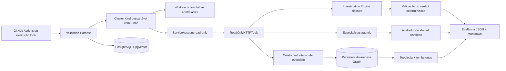

# Harness de Validação em Ambiente Real

O harness da v0.8.0-rc.1 comprova o caminho de RCA Kubernetes contra um control plane Kubernetes real e descartável, sem depender de mocks ou fixtures preparadas.

## Gate da release candidate

O harness cria um cluster Kind com dois nós, aplica uma ServiceAccount de validação somente leitura, inicia PostgreSQL/pgvector, injeta falhas controladas e executa tanto o engine determinístico clássico quanto o caminho agentic da v0.8 usando a API real do Kubernetes.

O primeiro gate da RC cobre:

- estado real `OOMKilled`, com causa esperada `container-oom` quando o Prometheus está propositalmente indisponível;
- `CrashLoopBackOff` real com exit code 42, com causa esperada `application-exit`;
- `FailedScheduling` real causado por requests impossíveis de recursos, com causa esperada `insufficient-resources`;
- coleta autoritativa do inventário Kubernetes para o Persistent Awareness Graph;
- relações reais `owned_by`, `serves` e `scheduled_on`;
- tombstone autoritativo depois que um recurso é removido do cluster real;
- verificação de integridade SHA-256 das evidências;
- paridade de causa raiz entre o caminho clássico e a avaliação agentic Kubernetes.

Prometheus, Loki, Tempo e Argo CD ficam propositalmente indisponíveis neste primeiro gate. Assim o teste também prova que a indisponibilidade de fontes opcionais não cria evidência saudável fictícia nem substitui sinais diretos do Kubernetes.

## Fluxo



## Executar localmente

É necessário ter Docker, Kind, kubectl e as dependências Python do backend.

```bash
cd backend
python -m venv .venv
source .venv/bin/activate
pip install -e '.[dev]'
cd ..
make validate-harness
make validate-real
```

A imagem de nó do Kind fica presa por digest. No CI, o binário do Kind também fica em versão fixa e tem o SHA-256 validado antes da execução.

## Evidências

Cada execução gera apenas estes artefatos compartilháveis:

- `validation-artifacts/validation-report.json`
- `validation-artifacts/validation-report.md`

O bearer token temporário do Kubernetes e o arquivo de CA ficam em `validation-artifacts/runtime/` somente durante a execução e nunca são enviados como artefatos pelo CI.

O processo termina com código diferente de zero se qualquer sinal obrigatório, verdict determinístico, verdict agentic, relação do grafo, verificação de integridade ou tombstone não corresponder ao esperado.

## Limpeza

Por padrão o harness remove o cluster Kind descartável e o container PostgreSQL dentro de um bloco `finally`. Use `--keep` apenas para depuração local.
