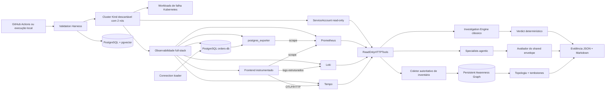

# Harness de Validação em Ambiente Real

O harness de validação agora possui três camadas:

- **baseline da v0.8.0-rc.1:** falhas reais de Kubernetes mais reconciliação autoritativa do Persistent Awareness Graph.
- **release candidate full-stack v0.8.0-rc.2:** Prometheus, Loki e Tempo/OpenTelemetry reais, alimentados por um workload instrumentado e consultados pelos adapters read-only de produção.
- **v0.8.0-rc.3 em desenvolvimento:** PostgreSQL 17 real, telemetria real do postgres_exporter, promoção determinística de causa stateful e uma fase explícita de recuperação que precisa deixar de promover evidência causal antiga.

## Gate da release

O harness cria um cluster Kind descartável com dois nós, aplica a ServiceAccount de validação read-only, inicia PostgreSQL/pgvector, sobe os workloads de validação e executa o código real de investigação contra APIs live.

Para os caminhos full-stack ele também sobe:

- Prometheus, fazendo scrape do workload instrumentado a cada dois segundos;
- Loki, recebendo logs estruturados pela API HTTP de push;
- Tempo, recebendo traces OTLP/HTTP gerados pelo SDK oficial do OpenTelemetry;
- um workload `frontend` instrumentado que expõe métricas Prometheus e emite logs e traces correlacionados;
- PostgreSQL 17 como a dependência rastreada `orders-db:5432`;
- postgres_exporter, com relabeling no Prometheus para alinhar o target do exporter à identidade da instância observada no trace;
- um connection loader bounded que cria uma anomalia real de capacidade de conexões e pode ser escalado para zero durante a validação de recuperação.

As imagens do stack de observabilidade e do nó Kind ficam presas por digest. A imagem do workload fixa a imagem base Python e as versões dos pacotes OpenTelemetry.

## O que o gate comprova

O baseline Kubernetes continua exigindo:

- `OOMKilled` real, resolvido como `container-oom`;
- restart backoff real com exit code 42, preservando paridade clássico/agentic e nunca promovendo `application-exit` sem evidência de logs;
- `FailedScheduling` real por requests impossíveis, resolvido como `insufficient-resources`;
- ingestão autoritativa do inventário Kubernetes;
- relações `owned_by`, `serves` e `scheduled_on` no grafo;
- tombstones autoritativos depois da remoção de recursos reais;
- verificação SHA-256 da integridade das evidências.

O caminho full-stack da rc2 gera adicionalmente três requests de checkout com falha. Cada request produz:

- contador HTTP 500 visível no Prometheus;
- log estruturado no Loki com labels de Pod/serviço e o trace ID;
- trace OTLP com o caminho causal `frontend -> postgresql/orders@orders-db:5432`;
- métricas RED do service graph expostas pelo Prometheus.

O gate exige que Prometheus, Loki e Tempo apareçam como healthy nos checks de capability do adapter de produção. Pelo menos dois traces independentes precisam convergir para a mesma origem downstream antes de `trace-causal-propagation` poder ser selecionada. A execução agentic precisa concluir os specialists de métricas, logs e traces, e as avaliações clássica e agentic precisam concordar com a causa raiz determinística.

O caminho PostgreSQL da rc3 primeiro exige que a utilização observada pelo exporter ultrapasse o threshold de validação. Com os mesmos traces de falha, os caminhos clássico e agentic precisam convergir para uma causa `postgres-connection-exhaustion:...`, e o specialist de database precisa concluir. Depois o loader é escalado para zero, a utilização precisa cair abaixo do threshold de recuperação e o workload emite três requests saudáveis com traces e logs novos. Uma investigação de recovery usa apenas a janela nova pós-recuperação e não pode promover `trace-causal-propagation` nem qualquer causa de anomalia PostgreSQL/Kafka/Redis.

Uma falha de fonte opcional nunca pode fabricar evidência. O invariant original da rc1 para crash loop continua valendo: sem a evidência exigida para diagnosticar uma saída específica da aplicação, o engine pode ficar inconclusivo ou selecionar o mecanismo genérico de crash loop, mas não pode afirmar uma especificidade sem suporte.

## Fluxo



## Executar localmente

É necessário ter Docker, Kind, kubectl e as dependências Python do backend.

```bash
cd backend
python -m venv .venv
source .venv/bin/activate
pip install -e '.[dev]'
cd ..
make validate-harness
make validate-real
```

O harness constrói o pequeno workload de validação localmente, carrega a imagem no Kind, inicia o stack de telemetria e remove tudo ao terminar.

## Evidências

Cada execução gera apenas estes artefatos compartilháveis:

- `validation-artifacts/validation-report.json`
- `validation-artifacts/validation-report.md`

O relatório v3 inclui cenários Kubernetes, health e contagens da telemetria full-stack, paridade do RCA por traces distribuídos, saturação real observada pelo postgres_exporter, paridade stateful clássico/agentic, evidência de recuperação, integridade das evidências e reconciliação/tombstones do Persistent Awareness Graph.

O bearer token temporário do Kubernetes e o arquivo de CA ficam em `validation-artifacts/runtime/` somente durante a execução e nunca são enviados como artefatos pelo CI.

O processo termina com código diferente de zero se qualquer sinal de runtime, fonte de telemetria, verdict determinístico, verdict agentic, relação do grafo, verificação de integridade ou invariant de tombstone falhar.

## Limpeza

Por padrão o harness encerra os port-forwards, remove o cluster Kind descartável e remove o container PostgreSQL pelo caminho de `finally`. Use `--keep` apenas para depuração local.
